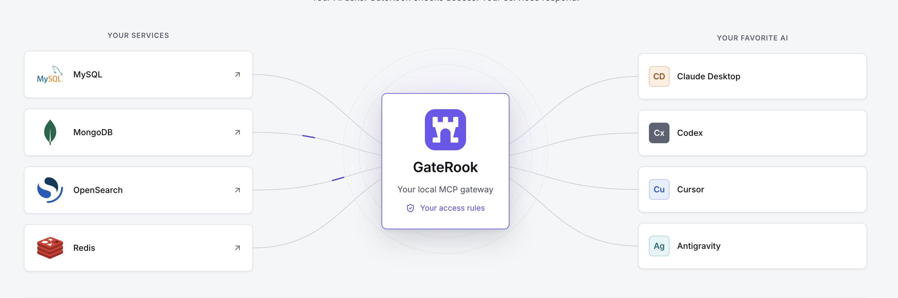

# GateRook

GateRook is a desktop MCP gateway that gives AI clients scoped access to databases, logs, APIs, and cloud services. Credentials stay in the gateway; changes require review by default. An explicit per-tool Bypass mode runs calls without approval while retaining policy limits.

[](https://github.com/msrv-ai/gaterook/releases/latest)
[](https://apps.microsoft.com/detail/9ncv7wxz9wsv)

For macOS, download the `.dmg` installer from the latest release. Windows installs and updates through Microsoft Store.

Installed apps check update metadata at `msrv.dev`; macOS update downloads remain on GitHub. Each app data directory gets a random 16-character installation ID on first launch. Update checks send this ID to count installations active within the last 30 days. Turn off **Settings → General → Check for updates automatically** to stop scheduled checks; a manual check still contacts the service. See [update checks](docs/development.md#update-checks-and-installation-identity) for details.

On DEV and STAGE, you can temporarily bypass approval for a method on one connection and endpoint for 15 or 30 minutes, or 1, 3, 12, or 24 hours. Open **Temporary bypass** in an approval review or the endpoint's tool list. The original mode returns automatically at expiry, and you can end the bypass early. Existing pending requests still need a separate decision.

[Website](https://msrv.dev) · [Issues](https://github.com/msrv-ai/gaterook/issues) · [Architecture](docs/ARCHITECTURE.md) · [Research](docs/research/README.md) · [Design kit](design/README.md)

## How it works

Connect your services to GateRook, then choose which connections and tools each AI app can use. GateRook sits between your services and AI apps, keeps credentials local, and applies your access rules to tool calls.

To discover connections in a repository, [import connections with AI](docs/ai-connection-import.md). Your AI app prepares configurations and credentials in a private import file; you review the connections and choose an endpoint for each in GateRook. You can save incomplete discoveries disabled and finish their setup later.

For HTTP APIs, [import an OpenAPI file or prepare one with your AI app](docs/http-api-import.md). Review the server, authentication, and selected operations before saving them as MCP tools.

To put an MCP server behind GateRook, [find it in the MCP registry, add it by its URL or paste its configuration](docs/mcp-servers.md) as in Claude Desktop, Cursor or Codex. When it asks for a sign-in, you sign in in your browser, but the sign-in goes to GateRook, not the AI app. GateRook keeps it encrypted, renews it, and never hands it to an agent.

Log queries have no maximum time range by default in any environment. To set one, open **Policies → Logs → Longest time range** and enter the number of hours; `0` means no time limit. Existing explicit limits remain in effect. Line counts, response sizes, and request deadlines still apply.



## Application overview

The Overview page brings pending approvals, connection health, and AI app access into one place. Use the On/Off switches there, in Endpoints, or in Connections to pause access without removing settings. A connection switch applies across all endpoints; an endpoint switch affects only that endpoint. Paused tools remain visible to AI apps and return a message asking the user to enable access. Use the sidebar to manage connections, secrets, policies, and endpoints, or inspect tool calls in Activity.


This repository contains the complete application, its tests, the canonical design kit, and everything needed for a local development build. The application is in development; a source build is not a signed release installer.

## Build and run locally

Install **JDK 25**, **Maven 3.9 or newer**, and **Node.js 24.22.1** (pinned in `.nvmrc`, with npm 11.19.1). Set `JAVA_HOME` to your JDK and ensure `java`, `mvn`, `node`, and `npm` are on `PATH`. A graphical desktop session is required for Electron. GraalVM and Docker are not needed for this development build.

The native unlock helper also needs **Xcode Command Line Tools with Swift** on macOS, or **Visual Studio C++ build tools and the Windows 11 SDK** on Windows. On Windows, run builds from a Developer Command Prompt matching your Node.js architecture. Linux needs no additional unlock compiler.

```bash
git clone https://github.com/msrv-ai/gaterook.git
cd gaterook
# If you use nvm: nvm install && nvm use
npm ci
npm ci --prefix design
npm run build
npm start
```

`npm run build` builds the design kit, all Java modules, the Angular UI, and the Electron main/preload bundle. It compiles tests but skips running them. `npm start` opens the desktop application, which manages its JVM core. Development data is stored in `desktop/.dev/home/`; stop the application with **Ctrl+C** in the terminal.

With OS credential protection enabled, select **Unlock GateRook** to continue startup. macOS offers Touch ID when enrolled, with your Mac password as a fallback. Windows uses Windows Hello when available, including face, fingerprint, or PIN; otherwise it asks for your Windows account password. On a computer with Windows Hello, a new GateRook home binds its encryption key to Windows Hello, so only Windows Hello opens it: if Hello is turned off, GateRook can't unlock until it is set up again, and if Windows removed the key, GateRook offers to restore your master-key backup. Authentication happens only in system dialogs. Denying access closes GateRook. Restarting the core within the same app session does not ask again.

An existing macOS vault uses its previous Keychain access once to migrate the same encryption key. Later launches use native unlock. A locked Keychain or a changed helper signature may require its access/password dialog; GateRook uses that grant without adding a second Touch ID prompt.

To open a separate demo instance without OS key-store prompts:

```bash
npm start -- --demo --home ./desktop/.dev/demo --protection off
```

Demo data is seeded only into a new home. Add `--fresh` only when you intend to delete that selected development home. Rebuild after source changes with `npm run build`.

**Settings → Backup** offers passphrase-encrypted full backup and restore, including the database and master key. See [full backup and restore](docs/development.md#full-backup-and-restore) for recovery steps, included data and limits.

To send an endpoint to another person, open it and choose **Share endpoint**. Select its connections and whether to include stored secrets, then save an encrypted `.grshare` file. The recipient opens **Endpoints → Import shared endpoint**, enters the passphrase and chooses which items to import. See [endpoint sharing](docs/development.md#endpoint-sharing) for what transfers and how review works.

For browser UI development with a signed local API proxy:

```bash
npm run dev:ui
```

Use the URL printed by the dev server. See [the development guide](docs/development.md) for component builds, tests, native binaries, and troubleshooting.

To build and launch from IntelliJ IDEA, follow [the IDEA setup](docs/development.md#intellij-idea) and use **GateRook: Build**, **GateRook: Run**, or **GateRook: Demo**.

## Checks

```bash
npm test                          # Build and staging helper tests
npm test -w bridge                # Token broker and stdio bridge
npm test -w desktop               # Electron type checking and unit tests
npm test -w ui                    # Angular component and behavior tests
npm --prefix design run verify   # Design generation and validation
mvn -B -ntp verify                # Java tests; some integration tests need local services
```

For the full connector integration suite, follow [the Docker test-services guide](test-services/README.md). Native image and installer verification are separate from the JVM development build.

## Documentation

| Document | Contents |
| --- | --- |
| [Architecture](docs/ARCHITECTURE.md) | Processes, modules, call flow, persistence, security, and extension contracts |
| [Product decisions](docs/DECISIONS.md) | Accepted product and engineering decisions, with implementation caveats |
| [Research](docs/research/README.md) | Protocol, client, connector, security, native-image, and plugin-host investigations |
| [Development](docs/development.md) | Toolchains, build/run commands, tests, native builds, and troubleshooting |
| [External MCP servers](docs/mcp-servers.md) | Finding servers in the MCP registry, adding them by URL or pasted configuration, OAuth sign-in, your own OAuth app, and troubleshooting |
| [Oracle Database](docs/oracle.md) | Service connections, TLS, schema access, queries and Oracle-specific limits |
| [SQL Server](docs/sql-server.md) | SQL authentication, database selection, permissions, and T-SQL limits |
| [Redis](docs/redis.md) | Reading and writing values, expiration, key and database scopes, and write limits |
| [GCP logs](docs/gcp-logs.md) | Logs Explorer filters, GKE logs, credentials, scopes, and endpoint access |
| [SSH log files](docs/ssh-log-files.md) | Remote file selection, searching, latest records, time ranges, and continuation |
| [Repository layout](docs/repository-layout.md) | Source directories and their responsibilities |
| [Migration scope](docs/migration.md) | Source inclusion, compatibility, and publication boundaries |
| [Design kit](design/README.md) | Tokens, styles, assets, reference pages, and verification |
| [Design rules](design/DESIGN.md) | Visual language and interaction rules |
| [Components](design/COMPONENTS.md) | Component and element APIs |
| [UI blueprint](design/BLUEPRINT.md) | Screens, states, and the shared demo world |
| [Contributor and AI rules](AGENTS.md) | English-only content and handling of internal AI files |

The stack is Electron 45, Angular 22, Java 25, and Spring Boot 4.1. The core can also be built as a GraalVM native executable. Java plugins run in a separate JVM host. See the manifests and lockfiles for exact dependency versions.

All documentation is in English. Internal AI scratch files, temporary research, and progress logs belong in the ignored root `ai/` directory and must never be committed. The curated research linked above is intentional product documentation.

## Author

GateRook was created by [Vadym Dobroskok](https://www.linkedin.com/in/dobroskok/), Tech Lead at [ProvenBase Inc.](https://provenbase.com/)

## License

GateRook is licensed under the [Apache License, Version 2.0](LICENSE). Bundled third-party components retain their respective licenses and notices.
