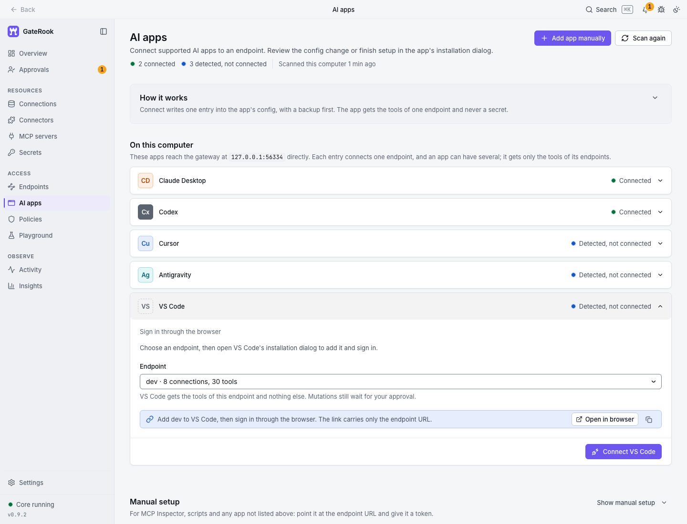
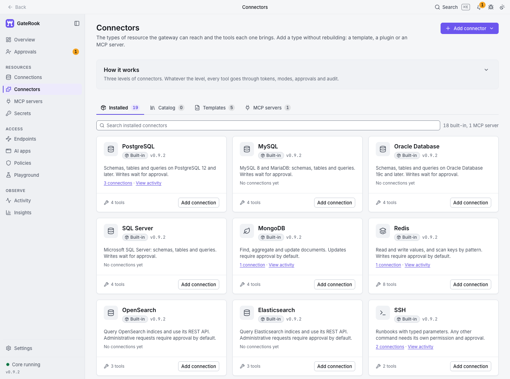
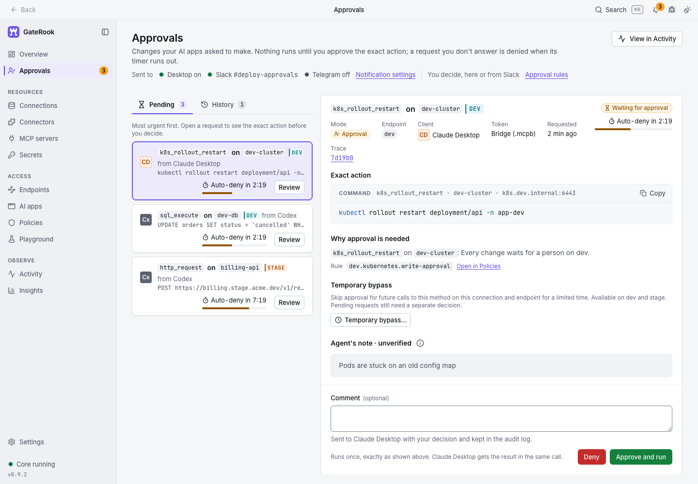
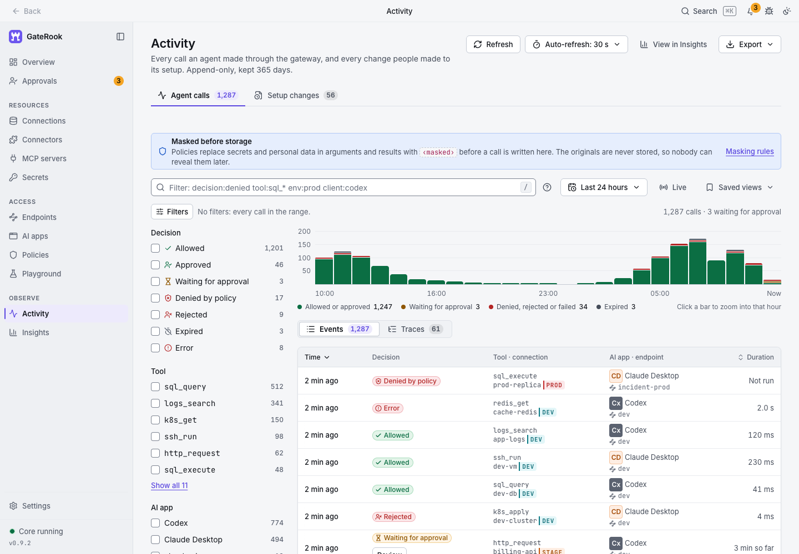

# GateRook

**The MCP Firewall for AI access to production.**

Let AI investigate incidents, query databases, search logs, and work with your services while you control what it can access and execute. GateRook is a desktop app that puts **scoped permissions, encrypted credentials, action approvals, and audit history** between your AI apps and connected infrastructure through MCP (Model Context Protocol).

**Works with Claude Desktop · Codex · Cursor · Antigravity · VS Code**

[](https://github.com/gaterook/gaterook/releases/download/v0.9.2/GateRook-0.9.2-mac-arm64.dmg)
[](https://apps.microsoft.com/detail/9ncv7wxz9wsv)

macOS: direct download of the **0.9.2 Apple Silicon `.dmg`**. Windows: install and update through Microsoft Store. [Release notes](https://github.com/gaterook/gaterook/releases/latest).

[Website](https://gaterook.com) · [Get started](#get-started) · [Connectors](#connect-your-stack) · [Security](#security-you-can-configure-and-inspect) · [Build from source](#build-and-run-locally) · [Support](mailto:support@gaterook.com)

## See GateRook in action

Watch the workflow: connect a service, give an AI app access, and review an action before it runs.

https://github.com/user-attachments/assets/019835d6-2b7b-4c91-be5c-28eba543087a


*Screenshots use the application's demo environment with fictional connections and activity.*

## What you can do

| Your workflow | How GateRook helps |
| --- | --- |
| **Investigate with AI** | Let your AI app correlate database records, logs, cloud metrics, and service state through one controlled access point. |
| **Review changes before they run** | Inspect the exact SQL statement, API request, command, or resource change. Approve or deny it in GateRook; changes require approval by default. |
| **Manage access across AI apps** | Configure connections once, group them into endpoints, and choose which connections and tools each app can use. Pause access without deleting setup. |
| **Keep service credentials out of client configuration** | Store credentials in the encrypted local vault or resolve them from an external secret store. GateRook supplies them to the selected connector. |
| **Bring existing MCP servers under the same controls** | Add local or remote MCP servers, manage upstream sign-ins, and apply tool permissions, approvals, and audit history. |
| **Understand what happened** | Follow requests, approval decisions, and execution results in Activity, backed by append-only, tamper-evident audit logs. |

## Get started

1. **Install and open GateRook.** Use the macOS download or Microsoft Store button above.
2. **Add a connection.** Choose a database, log source, cloud service, HTTP API, or MCP server. Configure its credentials, environment, and allowed resources.
3. **Choose an endpoint and tool permissions.** An endpoint is the set of connections and tools an AI app may use. Keep investigation access read only and leave changes in **Approval** mode when you want human review.
4. **Connect your AI app.** Open **AI apps**, select **Connect**, choose the endpoint, and follow the app's setup flow.
5. **Start a task.** Ask your AI app to inspect a connected service. Review requested changes in **Approvals** and follow the result in **Activity**.

For example: “Search the staging API logs for recent errors, compare them with database records, and propose a fix.” Allowed reads run within your configured limits; a change requiring approval waits for your decision.

Most connectors are part of the installer and need no download. A few of GateRook's own connectors arrive the first time you choose them (Apache Cassandra, Neo4j, ClickHouse, DuckDB, H2 and Microsoft Access are [connector modules](docs/connector-delivery.md#connector-modules)); they and Java plugins run on the optional Java runtime. That runtime, the modules and the Cloudflare Tunnel binary are verified and cached on first use; that first use requires internet access. See [optional components and offline use](docs/development.md#optional-components-and-offline-use).

## Connect your AI apps in one place

Use the AI apps page to connect detected applications and see their access status. Each app reaches only the connections and tools exposed by its selected endpoint.

| AI app | Setup in GateRook |
| --- | --- |
| **Claude Desktop** | Install a GateRook desktop extension for an endpoint, or use the managed stdio bridge configuration. |
| **Codex** | Use the managed configuration and local token helper. Service credentials stay in GateRook. |
| **Cursor** | Choose token-based access, browser OAuth sign-in, or the stdio bridge. |
| **Antigravity** | Choose token-based access, browser OAuth sign-in, or the stdio bridge. |
| **VS Code / GitHub Copilot** | Install the endpoint through VS Code's MCP setup and complete browser OAuth sign-in. [Setup details](docs/development.md#vs-code-and-microsoft-copilot). |
| **Other MCP clients** | Select **Add app manually**, choose an endpoint, and use its Streamable HTTP URL and Bearer token in the client's MCP settings. |



Manage DEV, STAGE, and PROD access separately. Turn off a **connection** to pause new access across all its endpoints, or turn off an **endpoint** to pause only that access path. Settings remain saved; operations already running are not cancelled. Revoke client access when it is no longer needed.

## Connect your stack

Built-in connectors give AI structured tools for the services you already operate. Select the resources each connection exposes; the service account's own permissions still apply.

| Category | Connectors | Typical tasks |
| --- | --- | --- |
| **SQL databases** | PostgreSQL and [CockroachDB](docs/cockroachdb.md), MySQL, MariaDB, [Oracle Database](docs/oracle.md), [SQL Server](docs/sql-server.md), [SQLite](docs/sqlite.md), [Google Cloud Spanner](docs/spanner.md), [DuckDB](docs/duckdb.md), [H2](docs/h2.md) and [Microsoft Access](docs/access.md) | Explore schemas, query data, and review supported writes. |
| **Documents, key-value, and wide-column data** | MongoDB, [Redis](docs/redis.md), [Amazon DynamoDB](docs/dynamodb.md), [Cloud Firestore](docs/firestore.md), [Firebase Realtime Database](docs/firebase-rtdb.md), [Azure Cosmos DB](docs/cosmosdb.md), [Apache Cassandra](docs/cassandra.md) | Find documents and items, inspect keys and values, run queries, and review updates. |
| **Graph databases** | [Neo4j](docs/neo4j.md) | Explore labels, relationships, and properties, run Cypher reads that Neo4j confirms as read only, and review writes. |
| **Data warehouses** | [Google BigQuery](docs/bigquery.md), [Snowflake](docs/snowflake.md), [Amazon Redshift](docs/redshift.md), [Databricks SQL](docs/databricks.md), [Trino and Presto](docs/trino.md), [Amazon Athena](docs/athena.md), ClickHouse | Explore datasets and tables, run reads checked by the engine's own plan or dry run, and review changes. |
| **Metrics and time series** | [Prometheus](docs/prometheus.md), [InfluxDB](docs/influxdb.md) | Query metrics and series, inspect targets, rules, and alerts, and review InfluxDB writes. |
| **Vector databases** | [Pinecone, Qdrant, Milvus and Zilliz Cloud, Weaviate, Chroma](docs/vector-databases.md) | Fetch records by id or metadata filter, search nearest neighbours by vector, record, or text, and review upserts and deletes. |
| **Search** | OpenSearch, Elasticsearch, [Algolia, Meilisearch, Typesense, Azure AI Search](docs/search-engines.md) | Discover indices, run filtered and faceted searches, fetch documents, and review document writes and administrative requests. |
| **Logs** | [GCP Cloud Logging](docs/gcp-logs.md), AWS CloudWatch Logs, [Azure Monitor Logs](docs/azure.md#logs), Loki, [SSH log files](docs/ssh-log-files.md) | Search logs, investigate errors, and read selected remote files. |
| **Cloud and infrastructure** | AWS, GCP, [Azure](docs/azure.md), [Cloudflare](docs/cloudflare.md), Kubernetes, SSH | Inspect resources and metrics, call [any Google Cloud API method](docs/gcp-api.md) or [any AWS API operation](docs/aws-api.md) within the connection's limits, manage Cloudflare DNS, Workers, and Pages, read pod logs, run configured commands or runbooks, and review supported changes. |
| **Object storage** | [Amazon S3 and S3-compatible storage](docs/s3.md) such as Cloudflare R2, DigitalOcean Spaces, Backblaze B2, and MinIO | List buckets and objects, read text objects within limits, and review uploads, copies, and deletes. |
| **HTTP APIs** | HTTP requests and [OpenAPI imports](docs/http-api-import.md) | Expose selected API operations as scoped MCP tools. |
| **External MCP servers** | Remote Streamable HTTP / SSE and local stdio | Bring existing MCP tools behind GateRook's permissions and approvals. |

**Compatible services** such as Supabase, Neon, Amazon Aurora and RDS, Cloud SQL, PlanetScale, TiDB, Valkey, Amazon ElastiCache, ScyllaDB and Thanos have cards of their own in **Add connection** that open the supported connector with the service's starting settings; plugins that the signed catalog offers can be installed there too. See [compatible services](docs/compatible-services.md).



**Less manual setup:** [import connections with AI](docs/ai-connection-import.md) from a repository, then review each discovery and its endpoint before saving. For APIs, [import an OpenAPI specification](docs/http-api-import.md) and choose which operations to expose. Incomplete discoveries can stay disabled until you finish setup.

### Bring your existing MCP servers

Open **Connectors → MCP servers** to browse developer integrations or search the **Official MCP Registry**. Add a server by URL, local command, or pasted Claude Desktop/Cursor JSON, VS Code JSON, or Codex TOML. Review its settings before connecting or starting it.

For AWS Knowledge, Cloudflare, DigitalOcean, Vercel, Firebase, Supabase, Netlify, and Azure DevOps, GateRook's [verified profiles](docs/mcp-servers.md#verified-profiles-for-cloud-platforms) set up the vendor's official server. A profile turns on the vendor's read-only switch where there is one and starts tools that run code, return credentials, or hand work to another agent in **Approval**; it can start a tool stricter, never looser.

For servers that support OAuth, sign in through your browser; GateRook stores and renews the encrypted sign-in. GitHub's server signs in with a one-time code that you enter on GitHub, using GateRook's own GitHub app, so there is no OAuth app to create. Select the endpoints that may use the server, then control its tools individually. A registry listing or a server's read-only declaration is not a safety certification. See the [MCP server guide](docs/mcp-servers.md) for setup and trust boundaries.

An endpoint with many servers can publish more tools than some AI apps accept. When an endpoint has more than 40 tools or 100 KB of tool definitions, its tool list shows GateRook's own tools and the 10 tools agents call most; `find_tools` finds the others by what they do, and `call_tool` or `call_read_tool` runs them under their own modes, approvals, and audit. Change this in the endpoint's **Settings → Tool list**.

## Review the exact action before it runs

An AI app can propose a change; GateRook holds actions that require approval for your review. The review shows the prepared action and target, with connector-specific impact information where available. You can **approve and run** or **deny** it.



Approval is bound to the stored action. Before execution, GateRook rechecks its expiry, policy, relevant versions, and integrity, then executes that authorized payload itself. The AI client cannot swap in a different command after approval or grant approval through MCP.

Choose the behavior of each connection/tool pair:

| Mode | What happens |
| --- | --- |
| **Off** | The tool is not exposed or callable. |
| **Read only** | Allowed reads run within policy limits; an action classified as a mutation requires approval. A read-only endpoint separately prohibits mutations and Bypass. |
| **Approval** | Both reads and changes wait for a review decision. |
| **Bypass** | Explicitly enabled calls run without human approval; policy denials, integrity checks, masking, and execution limits still apply. |

Permanent Bypass is available on standard endpoints, including PROD. For DEV and STAGE, **Temporary bypass** can allow one tool on one connection and endpoint for a fixed duration, then restore its original mode automatically. It is unavailable on production and does not approve requests already pending. See the [security model](docs/security.md).

## Security you can configure and inspect

| Control | What it gives you |
| --- | --- |
| **Scoped access** | Endpoint-specific connections and tool modes, connector resource restrictions, request deadlines, rate limits, and output limits. |
| **Encrypted credentials** | AES-256-GCM envelope encryption for stored secrets, with platform key protection when enabled and available. |
| **Exact-action approvals** | Decisions bound to prepared payloads, with policy and integrity checked again before execution. |
| **Production boundaries** | Production connections require production endpoints. No built-in tunnel publication or Slack/Telegram approvals for PROD. |
| **Masking** | Recognized secrets and configured sensitive fields are masked in supported results and views. |
| **Auditable execution** | Append-only records, hash chains, and authenticated heads help detect changes to audit history. |

GateRook governs requests routed through its endpoints and connectors. Allowed results still reach your AI app and may reach its provider. The local OS account, upstream permissions, and verified TLS/SSH transport remain part of the security boundary; masking is not complete data-loss prevention. Read the [security model](docs/security.md) for encryption scope, retention, Bypass, and external-server trust.

### Keep credentials encrypted and under your control

Manage credentials in **Secrets**. The local vault keeps its master key outside the database. With OS credential protection enabled and available, the master-key file is protected using **macOS Keychain**, **Windows Hello / DPAPI**, or **Linux Secret Service / KWallet**. The app shows the active protection status; macOS unlock supports Touch ID or your Mac password.

Use **Secrets → External stores** to resolve credentials from **HashiCorp Vault / OpenBao**, **GCP Secret Manager**, **AWS Secrets Manager**, or **Azure Key Vault**. External values are resolved at call time and cached briefly in memory. See [external stores and secret references](docs/research/12-secrets.md#5-external-stores-and-reference-syntax), [Key Vault as an external secret store](docs/azure.md#key-vault-as-an-external-secret-store), and [desktop key protection](docs/ARCHITECTURE.md#71-electron).

### Follow every request through Activity

Inspect calls, approval decisions, execution outcomes, and configuration changes in one place. Use filters and traces to follow an investigation, and configure history retention and export for your workflow.



## More control as your setup grows

- **Share reviewed setups:** export a passphrase-encrypted endpoint file, with secrets excluded by default. Recipients review what to import; client grants and tokens do not transfer. [Endpoint sharing](docs/development.md#endpoint-sharing).
- **Back up and restore:** create a passphrase-encrypted full backup from **Settings → Backup**. [Recovery guide](docs/development.md#full-backup-and-restore).
- **Test and reuse tools:** try calls in **Playground**; turn named SQL queries, SSH runbooks, and OpenAPI operations into reusable tools with typed parameters.
- **Extend the connector catalog:** install Java plugins, or a [connector module of your own](docs/connector-delivery.md#a-module-from-a-file), in a separate JVM host, with reviewed capabilities and tool permissions. [Plugin architecture](docs/ARCHITECTURE.md#75-plugins-catalog-and-external-mcp-servers).
- **Use remote access when appropriate:** publish non-production endpoints through the built-in tunnel with OAuth. Production endpoints remain local. [Security boundaries](docs/security.md#apply-stricter-controls-to-production).
- **Work in your preferred theme:** light, dark, and high-contrast variants, with keyboard navigation throughout the desktop UI.

## Build and run locally

This repository contains the complete application source, tests, runtime assets, and build inputs. The stack is Electron 45, Angular 22, Java 25, and Spring Boot 4.1; the core also supports a GraalVM native build.

Install **JDK 25**, **Maven 3.9+**, and **Node.js 24.22.1** with npm **11.19.1** (see `.nvmrc`). Set `JAVA_HOME` and put the tools on `PATH`. Electron requires a graphical desktop session. The native unlock helper also needs Xcode Command Line Tools with Swift on macOS, or Visual Studio C++ build tools and the Windows 11 SDK on Windows. GraalVM and Docker are not needed for this development build.

```bash
git clone https://github.com/gaterook/gaterook.git
cd gaterook
# If you use nvm: nvm install && nvm use
npm ci
npm run build
npm start
```

The build compiles Java, Angular, and Electron; it compiles tests but skips running them. Development data lives in `desktop/.dev/home/`. Stop the app with **Ctrl+C**.

<details>
<summary>Demo mode, UI development, and checks</summary>

Open a separate demo instance without OS key-store prompts:

```bash
npm start -- --demo --home ./desktop/.dev/demo --protection off
```

Demo data is seeded only into a new home. Rebuild after source changes with `npm run build`.

For browser UI development with a signed local API proxy:

```bash
npm run dev:ui
```

Run the relevant checks:

```bash
npm test                          # Build and staging helpers
npm test -w bridge                # Token broker and stdio bridge
npm test -w desktop               # Electron type checking and unit tests
npm test -w ui                    # Angular component and behavior tests
mvn -B -ntp verify                # Java tests; some integration tests need local services
```

See the [development guide](docs/development.md), [IntelliJ IDEA setup](docs/development.md#intellij-idea), and [Docker test-services guide](test-services/README.md) for toolchains, component builds, integration services, and troubleshooting. A local build does not verify a signed installer or published release.

</details>

## Documentation and support

| Resource | What you will find |
| --- | --- |
| [Security model](docs/security.md) | Permissions, approvals, credential protection, audit integrity, and trust boundaries. |
| [Architecture](docs/ARCHITECTURE.md) | Processes, modules, execution flow, persistence, UI, and extension contracts. |
| [Development](docs/development.md) | Local builds, tests, backups, endpoint sharing, and troubleshooting. |
| [External MCP servers](docs/mcp-servers.md) | Registry discovery, verified cloud profiles, local and remote servers, OAuth, and cloud credentials. |
| [Connector guides](#connect-your-stack) | Credentials, permissions, limits, and reviewed changes for the connectors linked in the connector table. |
| [AI connection import](docs/ai-connection-import.md) / [OpenAPI import](docs/http-api-import.md) | Reviewable setup flows for repositories and HTTP APIs. |
| [Product decisions](docs/DECISIONS.md) / [Research](docs/research/README.md) | Accepted engineering decisions and curated technical investigations. |
| [Repository layout](docs/repository-layout.md) / [Contributor rules](AGENTS.md) | Where code belongs and how to contribute. |

Report bugs or request features in [GitHub Issues](https://github.com/gaterook/gaterook/issues), or contact [support@gaterook.com](mailto:support@gaterook.com). Contributions are welcome; read [AGENTS.md](AGENTS.md) before making changes. Repository content is English only, and internal AI scratch work belongs in the ignored root `ai/` directory.

## Author

GateRook was created by [Vadym Dobroskok](https://www.linkedin.com/in/dobroskok/), Tech Lead at [ProvenBase Inc.](https://provenbase.com/)

## License

GateRook is licensed under the [Apache License, Version 2.0](LICENSE). Bundled third-party components retain their respective licenses and notices.
