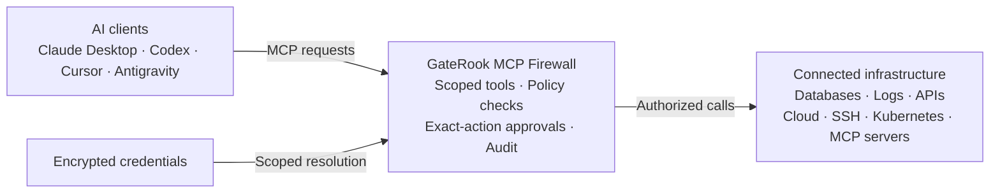
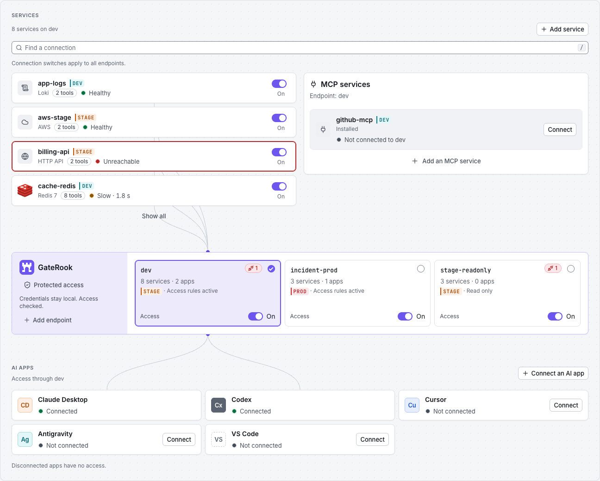

# GateRook — MCP Firewall for AI Access to Production

**Put every AI action through a security checkpoint.**

GateRook is a desktop **MCP Firewall** for AI access to production infrastructure. Protect connected databases, logs, APIs, cloud services, and external MCP servers with encrypted credentials, scoped tool permissions, exact-action approvals, and append-only, tamper-evident audit logs. You control which services AI apps can reach and how their actions run through GateRook.

[](https://github.com/gaterook/gaterook/releases/latest)
[](https://apps.microsoft.com/detail/9ncv7wxz9wsv)

For macOS, download the `.dmg` installer from the latest release. Windows installs and updates through Microsoft Store.

Cloudflare Tunnel support and Java support for plugins download on first use. They are verified and cached locally for later use without another download. First use needs internet access; built-in connectors do not need these downloads. See [optional components and offline use](docs/development.md#optional-components-and-offline-use).

[Website](https://gaterook.com) · [Support](mailto:support@gaterook.com) · [Security model](docs/security.md) · [Issues](https://github.com/gaterook/gaterook/issues) · [Architecture](docs/ARCHITECTURE.md) · [Research](docs/research/README.md)

Watch how GateRook connects AI to your infrastructure while keeping you in control.

https://github.com/user-attachments/assets/019835d6-2b7b-4c91-be5c-28eba543087a

## Put a firewall between AI and production

| Security control | What GateRook enforces |
| --- | --- |
| **Keep credentials encrypted** | AES-256-GCM envelope encryption protects locally stored secrets. GateRook resolves credentials for connectors and manages upstream OAuth sign-ins without putting them in AI client configuration. |
| **Control every connected tool** | Choose each endpoint's connections and tool modes: Off, Read only, Approval, or explicit Bypass. Apply resource restrictions, deadlines, rate limits, and output limits. |
| **Review the exact action before execution** | Changes require approval by default. Review the prepared action; GateRook binds approval to its stored payload and rechecks policy, versions, and integrity before running it. |
| **Trace actions with tamper-evident audit logs** | Append-only records, hash chains, and authenticated heads make changes detectable. Activity links calls, decisions, and execution; configured retention and export rules govern history. |
| **Apply stricter production boundaries** | Production connections require production endpoints. Production endpoints cannot be published through the built-in tunnel, and production approvals cannot be granted through Slack or Telegram. |

GateRook controls actions routed through its MCP endpoints and connectors. Its protection complements restricted infrastructure accounts, verified transport, and a secure local OS account. See the [security model](docs/security.md) for encryption scope, audit retention, Bypass, and trust boundaries.

## How the MCP Firewall controls execution

Connect your services to GateRook, select the resources and tools each AI app may use, and assign their modes. GateRook authenticates the client, checks endpoint scope and policy, resolves credentials for the selected connector, and audits execution. Allowed reads run within configured limits; changes enter review by default.

An explicit per-tool **Bypass** mode runs calls without human approval while retaining policy denials, integrity checks, masking, and execution limits. This permanent mode is available on standard endpoints, including production; read-only endpoints prohibit it.

On DEV and STAGE, you can also temporarily bypass approval for a method on one connection and endpoint for 15 or 30 minutes, or 1, 3, 12, or 24 hours. Open **Temporary bypass** in an approval review or the endpoint's tool list. The original mode returns automatically at expiry, and you can end the bypass early. Existing pending requests still need a separate decision. Temporary bypass is unavailable on production.

Log queries have no maximum time range by default in any environment. To set one, open **Policies → Logs → Longest time range** and enter the number of hours; `0` means no time limit. Existing explicit limits remain in effect. Line counts, response sizes, and request deadlines still apply.



## Control access across your connected infrastructure

GateRook applies its MCP Firewall controls to built-in connectors and external MCP servers. Add a connection with its credentials and allowed resources, then choose the endpoints and tool modes that give AI apps access. Each service's own permissions remain part of the security boundary.

| Service | Supported capabilities |
| --- | --- |
| SQL databases | PostgreSQL and [CockroachDB](docs/cockroachdb.md), MySQL/MariaDB, [Oracle Database](docs/oracle.md), [SQL Server](docs/sql-server.md), [SQLite](docs/sqlite.md) files, and [DuckDB](docs/duckdb.md) files through a catalog plugin: inspect schemas, query data, and review changes before execution |
| Document, key-value and wide-column stores | MongoDB document queries and updates; [Redis](docs/redis.md) key inspection, reads, and reviewed value writes; [Amazon DynamoDB](docs/dynamodb.md) Query, Scan and PartiQL with reviewed changes; [Cloud Firestore](docs/firestore.md) documents and queries and the [Firebase Realtime Database](docs/firebase-rtdb.md) paths, with reviewed writes; [Azure Cosmos DB](docs/cosmosdb.md) for NoSQL containers, SQL queries and point reads, with reviewed item changes; [Apache Cassandra](docs/cassandra.md) keyspaces, tables and paged CQL reads, with reviewed changes |
| Graph databases | [Neo4j](docs/neo4j.md): the graph's labels, relationship types and properties, and Cypher reads that Neo4j's plan and a read-only transaction both confirm, with reviewed writes |
| Data warehouses | [Google BigQuery](docs/bigquery.md): datasets, tables and GoogleSQL reads checked by a dry run and capped in bytes; [Snowflake](docs/snowflake.md): schemas, tables and reads checked against Snowflake's plan; [Amazon Redshift](docs/redshift.md) through its Data API in read-only transactions; [Databricks SQL](docs/databricks.md) on Unity Catalog; [Trino and Presto](docs/trino.md) with reads checked by Trino's own plan; [Amazon Athena](docs/athena.md) within a workgroup's limits; all with reviewed changes |
| Metrics and time series | [Prometheus](docs/prometheus.md) and compatible servers: PromQL queries, series, targets, rules and alerts, read only; [InfluxDB](docs/influxdb.md) 3, 2.x and 1.x: SQL and InfluxQL reads and reviewed writes |
| Search engines | OpenSearch and Elasticsearch: discover indices, query documents, and review administrative requests |
| Logs | [GCP Cloud Logging](docs/gcp-logs.md), AWS CloudWatch Logs, [Azure Monitor Logs](docs/azure.md#logs), Loki, and [selected log files over SSH](docs/ssh-log-files.md): search and read logs within configured limits |
| Infrastructure and cloud | SSH commands and runbooks; Kubernetes resources, events, pod logs, and reviewed changes; AWS and GCP resource inspection and metrics; [any Google Cloud API method](docs/gcp-api.md) within the connection's scopes and [any AWS API operation](docs/aws-api.md), with reviewed changes; [Azure](docs/azure.md) Resource Graph inventory, Resource Manager calls with reviewed changes, metrics, alerts, the Activity Log, Storage data, Service Bus dead letters and Key Vault expiry; [Cloudflare](docs/cloudflare.md) zones, DNS, Workers and their logs, Pages, analytics and tunnels, with reviewed DNS changes, cache purges, deployments and rollbacks |
| Object storage | [Amazon S3 and S3-compatible storage](docs/s3.md) such as Cloudflare R2, DigitalOcean Spaces, Backblaze B2 and MinIO: list buckets and objects, read text objects within limits, and review uploads, copies and deletes |
| HTTP APIs | Scoped HTTP requests and selected operations imported from an OpenAPI specification |
| [MCP servers](docs/mcp-servers.md) | Remote Streamable HTTP/SSE servers and local stdio commands, added by URL, command, or pasted configuration; tools follow GateRook's access rules and approvals |
| [Official MCP Registry](https://registry.modelcontextprotocol.io/) | Search public MCP servers from GateRook and fill in supported remote URLs or npm/PyPI commands for review before connecting |

To discover connections in a repository, [import connections with AI](docs/ai-connection-import.md). Your AI app prepares configurations and credentials in a private import file; you review the connections and choose an endpoint for each in GateRook. You can save incomplete discoveries disabled and finish their setup later.

For HTTP APIs, [import an OpenAPI file or prepare one with your AI app](docs/http-api-import.md). Review the server, authentication, and selected operations before saving them as MCP tools.

## Bring external MCP servers behind the firewall

Connect existing MCP servers through GateRook to apply endpoint access rules, tool modes, approvals, and audit history to their tools. GateRook supports remote servers over **Streamable HTTP** or **SSE** and local commands over **stdio**.

Open **Connectors → MCP servers → Add MCP server** and choose how to add one:

- **Official MCP Registry:** search the [Official MCP Registry](https://registry.modelcontextprotocol.io/) by server name. Select **Use** to fill in a remote URL or a local npm/PyPI command, pinned to the package version when the registry provides one. Review the settings and supply required credentials or values before connecting or starting it.
- **Manual entry:** enter a server URL or local command, or paste a configuration from the server's documentation, including Claude Desktop/Cursor JSON, VS Code JSON, or Codex TOML.
- **Cloud platforms:** set up the official MCP servers of AWS Knowledge, Cloudflare, DigitalOcean, Vercel, Firebase, Supabase, Netlify, and Azure DevOps from GateRook's [verified profiles](docs/mcp-servers.md#verified-profiles-for-cloud-platforms). A profile turns on the vendor's read-only switch where there is one and starts tools that run code, return credentials, or hand work to another agent in **Approval** or **Off**.

An endpoint with many servers can publish hundreds of tools, more than some AI apps accept and enough to fill a model's context before the first message. When an endpoint has more than 40 tools or 100 KB of tool definitions, its tool list shows GateRook's own tools and the 10 tools agents call most on it. GateRook tells the AI app which connections have more tools: `find_tools` finds them by what they do, and `call_tool` or `call_read_tool` runs them under their own modes, approvals and audit. Choose **Every tool**, **Always search**, how many of the most-used tools to list, or the connections whose tools stay listed in the endpoint's **Settings → Tool list**.

For servers that support OAuth, sign in through your browser. GitHub's server signs in with a one-time code that you enter on GitHub, using GateRook's own GitHub app, so there is no OAuth app to create. GateRook stores the sign-in encrypted, renews it, and keeps the credentials out of AI apps. After adding a server, choose which endpoints may use it. Tools declared read only start in **Read only** mode; other tools start in **Approval**, or **Off** on endpoints that only permit reads. A verified profile can start a tool stricter, never looser. Tools remain **Off** on unselected endpoints. Server declarations are not independently verified.

See [the external MCP server guide](docs/mcp-servers.md) for setup, registry package support, cloud credentials, OAuth options, and troubleshooting.

## Keep credentials encrypted and under your control

Manage credentials in **Secrets**. GateRook's local vault uses AES-256-GCM envelope encryption for stored values and keeps its master key outside the database. With OS credential protection enabled and a secure backend available, the master-key file is encrypted using a key protected by **macOS Keychain**, **Windows Hello / DPAPI**, or **Linux Secret Service / KWallet**. macOS unlock supports Touch ID or your Mac password. New Windows vaults bind their key to Windows Hello when available; otherwise unlock asks for your Windows account password. The Secrets page shows the current protection status.

To use an existing secret store, open **Secrets → External stores** and connect a provider:

| Secret store | Supported capabilities |
| --- | --- |
| HashiCorp Vault / OpenBao | Read KV v1/v2 secrets with AppRole or token authentication; Vault can also sign SSH certificates |
| GCP Secret Manager | Read secret versions using Application Default Credentials or a service account key, with optional service account impersonation |
| AWS Secrets Manager | Read secrets using an AWS profile or access key to assume a role, with ExternalId and a session policy scoped to configured secret references |
| Azure Key Vault | Read the secrets of one vault per store as a service principal with a certificate or client secret, in Azure, Azure Government or Azure China; see [Key Vault as an external secret store](docs/azure.md#key-vault-as-an-external-secret-store) |

Select the store in a connection's credential fields and enter a secret reference. GateRook resolves external values at call time, caches them briefly in memory, and keeps them out of AI apps. See [external stores and reference syntax](docs/research/12-secrets.md#5-external-stores-and-reference-syntax) and [desktop key protection](docs/ARCHITECTURE.md#71-electron) for details.

## Review, pause, and audit AI access in one place

The Overview page brings pending approvals, connection health, and AI app access into one place. Use the On/Off switches there, in Endpoints, or in Connections to pause access without removing settings. A connection switch applies across all endpoints; an endpoint switch affects only that endpoint. Pausing stops new access, but does not cancel operations already executing. Paused tools remain visible to AI apps and return a message asking the user to enable access. Use the sidebar to manage connections, secrets, policies, and endpoints, or inspect tool calls in Activity.

For an AI app that GateRook does not detect, open **AI apps → Add app manually**, enter its name and choose an endpoint. Copy the endpoint URL and the token shown once into the app's MCP settings using Streamable HTTP and Bearer authentication. The app stays in the list across restarts and scans, with **Awaiting connection** until its first authenticated request. Its card offers token replacement and removal; both revoke the previous token, so update or remove the MCP settings in the app too.

For **VS Code**, select **Connect**, choose an endpoint (including PROD), then install the server in VS Code and complete browser sign-in. GateRook detects the stable desktop edition on Windows, macOS, and Linux. **Microsoft Copilot from the Microsoft Store** is detected separately on Windows; its card explains that custom MCP setup is unavailable. See [VS Code and Microsoft Copilot setup](docs/development.md#vs-code-and-microsoft-copilot).



This repository contains the complete application, its tests, runtime assets, and everything needed for a local development build.

## Build and run locally

Install **JDK 25**, **Maven 3.9 or newer**, and **Node.js 24.22.1** (pinned in `.nvmrc`, with npm 11.19.1). Set `JAVA_HOME` to your JDK and ensure `java`, `mvn`, `node`, and `npm` are on `PATH`. A graphical desktop session is required for Electron. GraalVM and Docker are not needed for this development build.

The native unlock helper also needs **Xcode Command Line Tools with Swift** on macOS, or **Visual Studio C++ build tools and the Windows 11 SDK** on Windows. On Windows, run builds from a Developer Command Prompt matching your Node.js architecture. Linux needs no additional unlock compiler.

```bash
git clone https://github.com/gaterook/gaterook.git
cd gaterook
# If you use nvm: nvm install && nvm use
npm ci
npm run build
npm start
```

`npm run build` builds all Java modules, the Angular UI, and the Electron main/preload bundle. It compiles tests but skips running them. `npm start` opens the desktop application, which manages its JVM core. Development data is stored in `desktop/.dev/home/`; stop the application with **Ctrl+C** in the terminal.

With OS credential protection enabled, select **Unlock GateRook** to continue startup. macOS offers Touch ID when enrolled, with your Mac password as a fallback. Windows uses Windows Hello when available, including face, fingerprint, or PIN; otherwise it asks for your Windows account password. On a computer with Windows Hello, a new GateRook home binds its encryption key to Windows Hello, so only Windows Hello opens it: if Hello is turned off, GateRook can't unlock until it is set up again, and if Windows removed the key, GateRook offers to restore your master-key backup. Authentication happens only in system dialogs. Denying access closes GateRook. Restarting the core within the same app session does not ask again.

An existing macOS vault uses its previous Keychain access once to migrate the same encryption key. Later launches use native unlock. A locked Keychain or a changed helper signature may require its access/password dialog; GateRook uses that grant without adding a second Touch ID prompt.

To open a separate demo instance without OS key-store prompts:

```bash
npm start -- --demo --home ./desktop/.dev/demo --protection off
```

Demo data is seeded only into a new home. Add `--fresh` only when you intend to delete that selected development home. Rebuild after source changes with `npm run build`.

**Settings → Backup** offers passphrase-encrypted full backup and restore, including the database and master key. See [full backup and restore](docs/development.md#full-backup-and-restore) for recovery steps, included data and limits.

To send an endpoint to another person, open it and choose **Share endpoint**. Select its connections and whether to include stored secrets, then save an encrypted `.grshare` file. The recipient opens **Endpoints → Import shared endpoint**, enters the passphrase and chooses which items to import. See [endpoint sharing](docs/development.md#endpoint-sharing) for what transfers and how review works.

For browser UI development with a signed local API proxy:

```bash
npm run dev:ui
```

Use the URL printed by the dev server. See [the development guide](docs/development.md) for component builds, tests, native binaries, and troubleshooting.

To build and launch from IntelliJ IDEA, follow [the IDEA setup](docs/development.md#intellij-idea) and use **GateRook: Build**, **GateRook: Run**, or **GateRook: Demo**.

## Checks

```bash
npm test                          # Build and staging helper tests
npm test -w bridge                # Token broker and stdio bridge
npm test -w desktop               # Electron type checking and unit tests
npm test -w ui                    # Angular component and behavior tests
mvn -B -ntp verify                # Java tests; some integration tests need local services
```

For the full connector integration suite, follow [the Docker test-services guide](test-services/README.md). Native image and installer verification are separate from the JVM development build.

## Documentation

| Document | Contents |
| --- | --- |
| [Security model](docs/security.md) | MCP Firewall controls, encrypted credentials, exact-action approvals, audit integrity, and production trust boundaries |
| [Product messaging](docs/product-messaging.md) | MCP Firewall positioning, website headlines, promotional copy, and supported security claims |
| [Architecture](docs/ARCHITECTURE.md) | Processes, modules, call flow, persistence, security, and extension contracts |
| [Product decisions](docs/DECISIONS.md) | Accepted product and engineering decisions, with implementation caveats |
| [Research](docs/research/README.md) | Protocol, client, connector, security, native-image, and plugin-host investigations |
| [Development](docs/development.md) | Toolchains, build/run commands, tests, native builds, and troubleshooting |
| [External MCP servers](docs/mcp-servers.md) | Official MCP Registry search, local and remote servers, pasted configurations, OAuth sign-in, cloud credentials, and troubleshooting |
| [Oracle Database](docs/oracle.md) | Service connections, TLS, schema access, queries and Oracle-specific limits |
| [SQL Server](docs/sql-server.md) | SQL authentication, database selection, permissions, and T-SQL limits |
| [CockroachDB](docs/cockroachdb.md) | Connecting through the PostgreSQL type, TLS, read-only users, and CockroachDB's differences |
| [SQLite](docs/sqlite.md) | Choosing the database file, read-only handles, file rules, and SQLite-specific limits |
| [DuckDB](docs/duckdb.md) | The catalog plugin, database files and data folders, locked read-only instances, and platform limits |
| [Amazon DynamoDB](docs/dynamodb.md) | Roles and session policies, Query, Scan and PartiQL, and approved changes |
| [Google BigQuery](docs/bigquery.md) | Credentials and datasets, dry runs and byte limits, GoogleSQL reads, and approved changes |
| [Amazon Redshift](docs/redshift.md) | Clusters and Serverless, roles and session policies, read-only transactions, and approved changes |
| [Trino and Presto](docs/trino.md) | Coordinators and catalogs, password and JWT sign-in, plan-checked reads, cancellation, and approved changes |
| [Amazon Athena](docs/athena.md) | Workgroups and result locations, roles and session policies, paged reads, and approved changes |
| [Databricks SQL](docs/databricks.md) | Workspaces and SQL warehouses, tokens and service principals, Unity Catalog lists, and approved changes |
| [Snowflake](docs/snowflake.md) | Key-pair and token sign-in, roles and warehouses, plan-checked reads, and approved changes |
| [Cloud Firestore](docs/firestore.md) | Google identities, collection lists, queries, and approved document writes |
| [Firebase Realtime Database](docs/firebase-rtdb.md) | Database URLs, path lists, shallow reads and queries, and approved writes |
| [Azure Cosmos DB](docs/cosmosdb.md) | Account keys or Microsoft Entra ID, container lists, partition keys, SQL queries, and approved item changes |
| [Apache Cassandra](docs/cassandra.md) | Contact points and data centers, password sign-in and TLS, paged CQL reads, and approved changes |
| [Neo4j](docs/neo4j.md) | Password and bearer-token sign-in, TLS and routing, plan-checked Cypher reads, and approved writes |
| [InfluxDB](docs/influxdb.md) | Server versions and tokens, SQL and InfluxQL reads, database lists, and approved line-protocol writes |
| [Prometheus](docs/prometheus.md) | Servers and tenants, PromQL and range limits, series, targets, rules and alerts |
| [Redis](docs/redis.md) | Reading and writing values, expiration, key and database scopes, and write limits |
| [GCP logs](docs/gcp-logs.md) | Logs Explorer filters, GKE logs, credentials, scopes, and endpoint access |
| [Google Cloud APIs](docs/gcp-api.md) | Calling API methods by their Discovery names, scope and policy checks, refused methods, and approved changes |
| [AWS APIs](docs/aws-api.md) | Calling any AWS operation by its API name, read and change classification, session policies, refused operations, and approved changes |
| [Azure](docs/azure.md) | Entra ID sign-in, tenants and subscriptions, classified Resource Manager calls, service recipes, Azure Monitor, KQL logs, Storage, Service Bus and Key Vault |
| [Cloudflare](docs/cloudflare.md) | API token permissions, zones and DNS, Workers Logs, Pages, analytics, masking, and approved changes |
| [S3 object storage](docs/s3.md) | Amazon S3 roles and session policies, S3-compatible endpoints, bounded text reads, and approved uploads, copies and deletes |
| [SSH log files](docs/ssh-log-files.md) | Remote file selection, searching, latest records, time ranges, and continuation |
| [Repository layout](docs/repository-layout.md) | Source directories and their responsibilities |
| [Migration scope](docs/migration.md) | Source inclusion, compatibility, and publication boundaries |
| [Contributor and AI rules](AGENTS.md) | English-only content and handling of internal AI files |

The stack is Electron 45, Angular 22, Java 25, and Spring Boot 4.1. The core can also be built as a GraalVM native executable. Java plugins run in a separate JVM host. See the manifests and lockfiles for exact dependency versions.

All documentation is in English. Internal AI scratch files, temporary research, and progress logs belong in the ignored root `ai/` directory and must never be committed. The curated research linked above is intentional product documentation.

## Author

GateRook was created by [Vadym Dobroskok](https://www.linkedin.com/in/dobroskok/), Tech Lead at [ProvenBase Inc.](https://provenbase.com/)

## License

GateRook is licensed under the [Apache License, Version 2.0](LICENSE). Bundled third-party components retain their respective licenses and notices.
