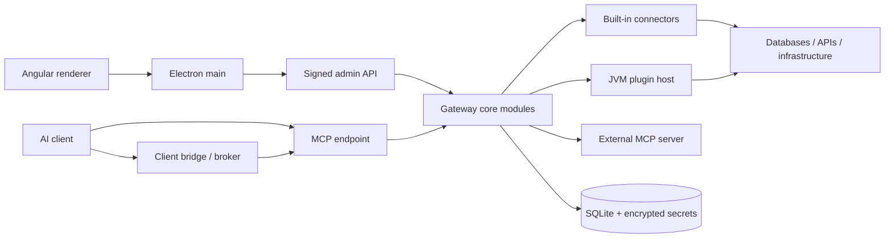

# GateRook MCP Firewall architecture

GateRook is a desktop MCP Firewall that controls AI access to connected infrastructure. It runs an Angular renderer inside Electron and a separate Java/Spring Boot core on loopback. The core owns encrypted credentials, policy enforcement, exact-action approvals, execution, and tamper-evident audit. A development build runs the core on JVM 25; the native-image build uses the same source. Dynamic Java extensions run in isolated JVM plugin hosts.

The [security model](security.md) explains these controls and their production boundaries. MCP Firewall describes the application-level enforcement on calls routed through GateRook; it does not imply an OS-wide network firewall or protection of alternate access paths. Existing gateway identifiers remain compatibility contracts.

This document describes the imported application and its architectural contracts. [Product decisions](DECISIONS.md) take precedence over exploratory [research](research/README.md). Research findings retain their original evidence dates and unresolved questions; they are not fresh compatibility certifications. Runtime contracts live in the source, schemas, migrations, and tests linked below. Implementation progress logs are intentionally excluded.

The product name is GateRook. The default home is `~/.gaterook`, the native core is `gaterook-core`, and deep links use `gaterook://`. Decision 11 starts a new default home without importing or modifying `~/.mcp-gateway`. Maven artifact IDs, plugin resource names, and `GW_*` / `gateway.*` configuration keys retain their existing contracts.

## 1. Architectural decisions

| ID | Choice | Rationale and boundary |
| --- | --- | --- |
| A1 | A thin JSON-RPC layer on Spring MVC serves `/mcp/{slug}`. | Endpoint-specific tool catalogs and protocol revisions stay under the gateway's control. GateRook's own client speaks to external MCP servers in both eras (§7.5). The MCP Java SDK provides the schema types that pin their tool definitions and serves as a test client and server; it is neither the gateway's server stack nor its upstream client. |
| A2 | Support modern `2026-07-28` and legacy `2025-11-25`, `2025-06-18`, and `2025-03-26` request shapes. | Clients migrate at different times. MCP POST replies are JSON, or an event stream once a call reports progress or log messages (§5.5). Legacy clients can open an authenticated GET SSE stream, and modern clients a `subscriptions/listen` stream, for list changes and resource updates. No MCP session IDs are issued. Administrative UI events use a separate SSE stream. |
| A3 | Persist one approval and execute its stored canonical call after a human decision. | The client never resubmits a mutable command as the approved action. MCP Apps clients get a review card and pending handle; other capable clients use URL elicitation, with `approval_status` as the common fallback. |
| A4 | Use opaque 256-bit tokens and store their hashes. | Lookup on each request enables immediate revocation. Named, bridge, OAuth access, and refresh tokens have distinct purposes and lifetimes. |
| A5 | Provide a small OAuth authorization server with desktop consent. | PKCE S256, resource/audience binding, issuer checking, and client metadata support serve both local and tunnel clients. |
| A6 | Publish through a child tunnel process and a separate loopback listener. | The public listener is deny-by-default and never exposes administrative routes. Cloudflared is downloaded on first tunnel use; ngrok is downloaded when selected. Both are pinned and hash-checked. |
| A7 | Use grants, a local broker, and thin client bridges. | Supported clients obtain short-lived tokens without placing long-lived credentials in ordinary configuration. Config edits are previewed and backed up. |
| A8 | Keep connector implementations in separate Maven modules. | Driver dependencies, schemas, native metadata, and tests remain owned by the relevant connector. |
| A9 | Use Jackson 3 throughout the application-facing API. | `connector-api` uses `tools.jackson.databind.JsonNode`; the Maven enforcer prevents incompatible Jackson 2 databind dependencies. |
| A10 | Use SQLite, Spring Data JPA/Hibernate, and Flyway for gateway state. | Migrations own the schema; startup validates mappings. User databases are accessed by connector drivers, not by gateway JPA repositories. |
| A11 | Build a native core while retaining a JVM development path. | Fast startup is a product requirement. Native compatibility must be verified independently of JVM compilation. |
| A12 | Load PF4J plugins outside the native core. | A JVM host per plugin generation supports dynamic class loading and isolates crashes and per-call secret access. |
| A13 | Register built-in connectors explicitly through Spring auto-configuration. | Spring AOT resolves registrations at build time; runtime enablement is database state, not classpath scanning. |
| A14 | Use envelope encryption and write-only secret APIs. | The master key remains outside the database; external store references and short-lived leases are supported. |
| A15 | Bound execution with deadlines, virtual threads, bulkheads, circuit breakers, and rate limits. | A slow or failing resource must not consume the whole gateway. Limits are keyed to the relevant connection or principal. |
| A16 | Keep notification adapters lightweight and gate remote approval. | Desktop notifications offer Review/Deny. Slack and Telegram approval is allowed only when the complete safe action can be shown and policy permits it. |
| A17 | Derive activity and insights from audit data; make telemetry export opt-in. | Do not send traces or metrics to an implicit endpoint. Trace correlation must work even without an external collector. |
| A18 | Use standalone, signal-based, zoneless Angular with shared styles. | Native dialog/popover behavior avoids a second overlay and styling system. |
| A19 | Use Lucide, a JSON Schema form renderer, and lazy CodeMirror editors. | Exact actions are server-produced code/diff segments, not a client-side reinterpretation of editable text. |
| A20 | Harden Electron and keep the launch secret in main. | Sandboxed renderer, context isolation, a narrow preload API, CSP, Trusted Types, validated IPC, and controlled navigation protect the process boundary. |
| A21 | Authenticate every admin request with a launch-secret HMAC. | A random nonce and timestamp prevent replay; the raw launch secret is never sent as a reusable HTTP credential. |
| A22 | Model one local desktop user. | Roles, OIDC, and multi-user identity are outside the current desktop application. |
| A23 | Adapt MINA SSHD for native-image constraints. | The shaded dependency excludes filesystem-provider discovery; crypto provider handling avoids unsupported runtime JCE registration. |

Exact dependency versions are pinned by [the Maven parent](../pom.xml) and [the npm lockfile](../package-lock.json). The baseline is Spring Boot 4.1.2, Java 25, Electron 45, and Angular 22.

## 2. Repository and module boundaries

See [repository layout](repository-layout.md) and [development](development.md) for the complete build tree and commands.

### 2.1 Process and source layout

### 2.2 Core modules

The Spring Modulith root is `ai.msrv.gaterook.core`; `platform` is shared. Connector libraries and the SPI are outside that root. Each core module declares allowed dependencies in its `package-info.java`. Public module APIs live at the package root; implementation details live under `internal`. [ModularityTests](../core/src/test/java/ai/msrv/gaterook/core/ModularityTests.java) enforce module and sensitive execution boundaries.

| Module | Responsibility |
| --- | --- |
| `platform` | Bootstrap, process readiness, database setup, local ingress guard, request authentication SPI, masking/taint, settings storage, clock, schema validation, tracing, and shared ports |
| `settings` | Typed settings sections, optimistic versions, local API configuration, and backup scheduling |
| `secrets` | Encryption, master-key lifecycle, external stores, scoped resolution, leases, and purpose-derived integrity keys |
| `audit` | Append-only call/setup events, integrity chain, activity queries, traces, export cursors, and retention |
| `connectors` | Registry, connector state, call contexts, plugin catalog/install/runtime management, and connector-source SPI |
| `connections` | Configuration, test/health checks, metadata, trust confirmations, usage, and coordinated removal |
| `templates` | Versioned templates, compilation against a connection's template kind, and catalog import |
| `mcpservers` | External server definitions, snapshots, review state, process supervision, and OAuth sign-ins to remote servers |
| `policy` | Environment policy, stricter-wins merging, limits, classification decisions, and immutable safety rules |
| `endpoints` | Exposed connection/tool pairs, modes, token/grant lifecycle, snapshots, risk analysis, and read-only attestations |
| `invocation` | The single connector execution path: scoped secrets, resilience controls, deadlines, masking, and result limits |
| `approvals` | Canonical requests, deduplication, decisions, expiry, execution, stored results, and action inspection |
| `mcp` | Protocol revisions, JSON-RPC dispatch, tools/resources/prompts, result encoding, and approval delivery |
| `playground` | UI-driven calls through the same dispatcher, under a distinct principal |
| `clients` | Client detection, config previews/edits, bundles, helper installation, drift checks, and bridge token issuance |
| `tunnel`, `oauth` | Public listener, provider supervision, publication checks, client metadata, consent, and OAuth grants |
| `notifications` | Desktop events, Slack Socket Mode, Telegram polling, pairing, delivery, and approval eligibility |
| `insights` | Audit aggregates, latency percentiles, and unusual-activity detection |
| `admin` | UI REST controllers and DTOs, event stream, errors, health, and demo seed |

Cross-module change events are published inside the transaction that changes state and handled after commit, typically on virtual threads. Readers invalidate snapshots rather than reaching into another module's internal repositories. Master-key changes have explicit ordering: the new in-memory keys must be usable before integrity-dependent listeners run. Startup changes wait until listeners are registered.

### 2.3 Connector registration and plugin processes

Each built-in connector module declares explicit beans in its own `@AutoConfiguration` and lists that configuration in `META-INF/spring/org.springframework.boot.autoconfigure.AutoConfiguration.imports`. Connector implementation classes remain independent of Spring. Runtime enablement belongs to the database; registration must remain deterministic for AOT.

`ConnectorRegistry` combines built-in connectors with `ConnectorSource` providers for installed plugins and external MCP servers. Stored manifests allow catalog display without starting a plugin process. Plugin-host lookup uses a packaged host JAR and a verified, lazily downloaded JRE, an explicit offline bundle, or the development JDK; child launch uses an argument array, cleared environment, and a dedicated data directory.

### 2.4 Builds and native metadata

The Maven reactor keeps shared versions in its root POM. Spring AOT/native compilation belongs to the executable modules (`app` and `bridge-cli`), not every library. Each connector contributes its own auto-configuration imports, schema resources, runtime hints, and manual reachability metadata. Manual metadata uses a separate `*-manual` location so generated AOT metadata cannot overwrite it.

Built-in registration uses explicit beans; enable/disable state is stored in `connector_type`. Dynamic plugins never enter the native core's classloader. The JVM build, AOT context, native executable, and installer are distinct validation targets. Existing scripts cover each layer; this document makes no blanket claim that every platform has passed them.

## 3. Connector SPI

The source of truth is [connector-api](../connector-api/src/main/java/ai/msrv/gaterook/connector/) and the [SPI reference](connector-spi.md). A connector exposes its manifest, schemas, tools, configuration test, classification, action description/preparation, execution, and optional template/resource capabilities.

- **Classification is fast and deterministic.** It receives configuration and policy, not secret values, and must not perform network I/O. Failures deny the call.
- **Preparation is bounded and side-effect-free.** It can reject a request, report no change, or produce a canonical action and approved payload. SQL preparation uses non-executing query plans and rollback; Kubernetes preparation uses server dry-run; HTTP/SSH preparation does not send the requested mutation.
- **Execution receives a scoped context.** Credentials are limited to the selected connection and call. The context carries cancellation, deadline, approved state, egress controls, and taint tracking.
- **Only the core can authorize mutation execution.** A human approval or an explicitly configured Bypass tool mode authorizes an exact prepared payload. A client-controlled field cannot set that state. Connectors reject mutations without it as defense in depth; Bypass carries no approval ID.
- **Results are data.** Every output is bounded and masked by the core before it reaches a client, audit view, or notification. A connector cannot opt out.
- **Resources obey the same boundary.** Resource reads, preparation, and tool execution use the central invoker rather than an alternate unguarded route.

A connector's JSON schemas describe input, output, configuration, and policy. UI extension keywords provide labels, variants, secret fields, options, environment locks, and stricter-wins merge rules. Schemas are bounded before validation to avoid excessive recursion or work. Shared tool names can merge only when their schemas match apart from the allowed connection enumeration.

MCP clients receive each input schema without the enumerations that follow the endpoint's connections: the `connection` names, and any values a connector adds for the endpoint to a property its manifest leaves open, such as SSH runbooks, GCP scopes and projects, or AWS regions. Tool descriptions name those values, and the core checks each call against the endpoint as it is then. A client that keeps the list it loaded first, and validates arguments against it, therefore still accepts connections added later. The admin API and Playground keep the enumerations.

Built-ins include SQL (PostgreSQL, MySQL/MariaDB, [Oracle Database](oracle.md) and [SQL Server](sql-server.md)), MongoDB, Redis, OpenSearch, Elasticsearch, SSH, logs, Kubernetes, GCP, AWS, HTTP/OpenAPI, and external MCP support. Connector-specific research documents describe drivers, classification edge cases, safe reads, and integration matrices.

## 4. Persistence and integrity

[Flyway migrations](../core/src/main/resources/db/migration/) are authoritative. Hibernate validates the migrated schema; it does not create or update production tables. SQLite uses WAL, a single write connection with `IMMEDIATE` transactions, and a small read pool whose connections set `query_only=1`. Read/write routing is verified at startup. A reader-pool-size fallback of zero can use the writer pool without changing the model.

Persistence-unit construction can overlap migrations and other startup work, but readiness waits for schema validation and database self-checks. Failed schema validation is a startup failure, not a warning. Connections that encounter unrecoverable SQLite errors are evicted so a poisoned single writer does not prevent recovery.

| Data area | Stored information and invariants |
| --- | --- |
| Settings and policies | Versioned sections, environment policy, backup state, and integrity-protected configuration |
| Connections and tools | Typed configuration, health metadata, endpoint associations, modes, definition versions, and read-only attestations |
| Credentials | Encrypted secret versions, external references, leases, and rotation state; no plaintext master key in SQLite |
| Access | Hashed named/bridge/OAuth tokens, client grants, audience, expiry, revocation, and confirmation state |
| Approvals | Canonical arguments/action, digest, preparation state, expiry, decision, execution status, result retention, and an append-only event timeline |
| Audit | Received/resolved/completed call events, setup changes, action/execution hashes, trace linkage, export state, and an integrity chain |
| Extensions | Plugin generations, catalog state, pinned artifacts, MCP snapshots, templates, and explicit trust decisions |

Security-sensitive rows carry MACs, access tokens, OAuth sign-ins and their tokens, and the owner, field and current version of local secrets among them; a revocation or a used token signs its row again, so it can't be undone by an edit. Direct database edits do not become trusted merely because the file can be opened: altered rows are surfaced as changed outside the gateway and require review, and reviewing an endpoint still applies the rules its own changes keep (the prod line, read-only modes, no Bypass or temporary bypass set outside GateRook). A lost/replaced master key cannot silently bless old tampered rows. Audit has append-only database constraints plus a hash chain and an authenticated head that also names where the verified history starts, so rows removed from either end are detected; bypassing a trigger remains detectable. Pooled connections run with `trusted_schema=OFF`. When a version adds a MAC to a table, the start that applies its migration signs the rows an older version wrote, once, only with the master key the database was protected with, and records a Setup change; a database rolled back to the older schema is signed again on its next upgrade, which stays inside the OS-account boundary of §9. Two kinds of settings act on their own and are signed rows as well: the audit retention, which would otherwise let an edit remove history without any record, and the catalog's last good index together with the highest sequence it reached (§7.5). The retention's row exists from the database's first start on (an upgrade writes the period the older version read when none was stored), so a missing one counts as an edit too; a retention that doesn't verify removes nothing and raises an integrity alert until it is saved again in Settings, unchanged or not. A stored catalog that doesn't verify installs and updates nothing until a fresh signed index is accepted, and never lowers the sequence an index must reach. Other settings, notification deliveries and client links carry no row MAC: an edit there can't authorize a call by itself. A MAC shows that the core wrote a row, not that it is the newest one: an older signed copy of a row put back in place also stays inside the §9 boundary.

Use short transactions around state changes. Do not hold a database transaction while waiting for a human, a long poll, or an external resource. Approval state changes use versioned compare-and-set transitions so only one executor wins. Retention must respect export progress; weekly database backups exclude the master key, and restores must preserve the integrity model.

### 4.1 Full backup and recovery

The desktop creates portable `.grbackup` files through native save/open dialogs. Renderer IPC carries only the newly entered passphrase, confirmation and a result; file paths, database contents and master-key material stay in main and the signed internal core API. Full backup requires a 12–1,024-character passphrase. It is never persisted or logged, and the renderer clears password fields on dispatch and close.

Version 1 uses AES-256-GCM with a random 12-byte nonce and a 16-byte authentication tag. A separate random 32-byte salt feeds scrypt (`N=131072`, `r=8`, `p=1`, 256 MiB allocation ceiling) to derive a 256-bit encryption key. The fixed format header is authenticated as associated data; the manifest and all contents are encrypted. Import accepts only this version's fixed parameters, caps the entire file at 256 MiB and authenticates it before parsing or writing payload files. These choices follow the [OWASP password derivation guidance](https://cheatsheetseries.owasp.org/cheatsheets/Password_Storage_Cheat_Sheet.html#scrypt) and [authenticated encryption guidance](https://cheatsheetseries.owasp.org/cheatsheets/Cryptographic_Storage_Cheat_Sheet.html). Buffer copies are cleared where possible; managed-runtime strings cannot guarantee erasure.

A master-key lock keeps the SQLite snapshot and portable keyset compatible during rotation. The core then stops before main collects plugin and connector files. Plugin JAR hashes must match the snapshot's pinned generations; a concurrent installation that breaks this match fails the backup. Plugin-owned data is copied with the plugin hosts stopped, without claiming an application-specific transaction across its files and the gateway database. OS key-store references, generated runtimes, caches, logs, old backups, browser sessions and external referenced files are excluded. Only allowlisted relative paths and regular files are accepted; symbolic links, traversal, duplicate paths, platform-ambiguous names and oversized indexes are refused.

Before restore, an internal validator checks SQLite integrity, the exact migration history and schema, every encrypted secret, the integrity root and required plugin hashes. It rejects tampered authorization rows rather than re-signing them as trusted. It revokes API/OAuth/bridge access and pending approvals, removes temporary bypasses, disables installed plugins, switches external MCP servers to first-call startup and disables login startup. Destination ports are retained. The portable keyset is encoded using the destination's current file-key protection, without exporting its OS-bound key-store reference.

Replacement requires the typed `RESTORE` confirmation and a native confirmation naming the validated file. The core and broker stop before database, keyset and local plugin data are replaced. An owner-only journal retains the original files until replacement is committed; interrupted replacement rolls back before normal core startup, and interrupted rollback is repeatable. Validation uses a temporary empty core with the destination's file key even when the main database cannot start; imported data is never started as that validator's live database. The application closes after restoration so every service reopens the restored state. See the [recovery procedure](development.md#full-backup-and-restore).

## 5. Call flow

1. **Guard ingress before dispatch.** The local listener permits only defined local routes. The public listener permits only the published endpoint and required OAuth metadata/authorization routes. Reject unexpected hosts, origins, encoded path tricks, oversized bodies, and browser-origin requests.
2. **Authenticate before interpreting the RPC.** Resolve the principal from the token hash and check expiry, revocation, endpoint, client/grant relationship, and ingress, before any of the body is read. Public requests accept only OAuth tokens with the matching public resource audience. A local named token cannot authenticate through a tunnel. A principal's request bodies count against an hourly budget (32 MiB by default; 429 beyond it), and the audit keeps of each call the client's name, title and version cut short, the task's first 512 characters, and the masked arguments up to 32 KiB of JSON (beyond that, their size, hash and a preview).
3. **Resolve the protocol revision.** Check modern metadata and corresponding headers for consistency; otherwise negotiate/interpret the supported legacy revision. Reject malformed or unsupported combinations. Notifications return HTTP 202.
4. **Load an immutable endpoint snapshot.** It contains connections, tool modes, effective policy, templates, and pinned extension definitions. Only exposed pairs appear in the wire catalog.
5. **Validate tool arguments.** Enforce the input schema with bounded depth, subschema count, and validation work. Unknown/off tools are not callable.
6. **Classify and decide.** Classification yields READ, MUTATION, or DENY. Policy combines this with the tool mode and stricter environment/connection limits. Exceptions fail closed.
7. **Persist audit before execution.** If the gateway cannot record receipt, it does not execute. Approval creation and its pending audit record are atomic.
8. **Run an allowed read through the invoker.** Apply scoped secret resolution, bulkhead, circuit breaker, rate limiter, deadline, cancellation, and output limits. Mask the result and complete audit before returning it.
9. **Prepare the exact mutation.** An approval stores the canonical request, exact action, preparation state, and digest for review. Bypass uses the prepared action immediately, retaining preparation refusals and no-change results. Human-visible previews may include masked impact/diff data that is not sent back to the agent.
10. **Decide and revalidate.** An approval atomically transitions from pending to running while unexpired and records the decision. Recheck integrity, policy, connection/template/tool versions, and canonical digest. Changes invalidate approval rather than modifying its meaning.
11. **Execute the authorized payload once.** The gateway runs the stored approved payload or freshly prepared Bypass payload itself. A failure or timeout is not retried automatically; uncertain external outcomes are reported explicitly. Approved calls retain their masked results for subsequent status retrieval.
12. **Correlate the trace.** Link MCP activity, the approval, and execution with trace IDs; propagate a valid parent trace when supplied. Telemetry export remains opt-in.

User access switches are independent of tool modes. Disabling an endpoint pauses resource access through it; disabling a connection pauses its use across all endpoints. Both settings persist, are covered by row signatures, and emit setup changes. The connection's legacy enabled default omits the new flag from its MAC fields so existing signatures remain valid after migration; disabled rows explicitly sign `enabled: false`. Tools and resource descriptors remain discoverable under the same authenticated scope. Calls, connection descriptions, and resource reads explain that access was disabled by the user and ask the agent to request enablement. Admission is rechecked after waiting for connector capacity, including preparation and approved execution. Operations already executing are not cancelled. Existing authorization, credentials, wiring, and stored modes survive a pause. A previously authorized bridge can renew its token and notification streams stay open. Health monitoring skips disabled connections; explicit administrative tests remain available.

Legacy `initialize` advertises `listChanged` for tools, resources and prompts, and `resources.subscribe`. Clients listen on `GET /mcp/{slug}` with the
same bearer token, the negotiated `MCP-Protocol-Version`, and `Accept: text/event-stream`. Opening a stream sends
one `notifications/tools/list_changed` to refresh any cached list from before connection or reconnection. After committed changes
invalidate the endpoint snapshot, each stream compares the published catalog hash and sends
`notifications/tools/list_changed` when the definitions clients receive change, including the connections and other
values that descriptions name. Changes that leave those definitions unchanged do not send further notifications. The same stream carries the resource and prompt list changes and the updates of subscribed resources (§5.5). Authentication and endpoint existence are checked before each
notification and heartbeat; disconnected streams are released, and shutdown closes subscriptions before waiting
for HTTP requests. A token or grant holds at most two streams: a third closes its oldest, so a client reconnecting after a drop the gateway has not noticed yet gets through; the gateway holds 64 in all and refuses more with 429. The stream has no replay IDs; its initial notification refreshes changes missed while disconnected.
Both stdio bridges forward these notifications. Claude Desktop's agent mode, which serves its Code and Cowork
sessions, lists tools once per connection and ignores the notification. After forwarding one, the Node bridge
therefore compares that client's last list with the current one; when they differ and the client has not listed
again, the bridge ends as soon as no request is in flight. The desktop connects again, and lists the current tools,
when a session next needs the server. Modern requests keep TTL-based discovery and can open a
`subscriptions/listen` stream (§5.5).

### 5.1 Policy truth table

| Classification / mode | Outcome |
| --- | --- |
| DENY | Deny |
| OFF | Not exposed / not callable |
| BYPASS on a standard endpoint | Execute without approval under effective limits |
| MUTATION with READ_ONLY or APPROVAL | Approval required |
| READ with APPROVAL | Approval required |
| READ with READ_ONLY | Execute under effective limits |

A read-only endpoint does not allow mutating pairs or Bypass. Bypass is an explicit tool setting, never a default. Classification denials, integrity checks, production isolation, rate limits, secret masking and result limits still apply. A Bypass mutation is prepared and may still be rejected or report no change; otherwise the exact prepared payload executes synchronously without an approval request. The audit records its Bypass mode and no human approval ID. Production connections and endpoints cannot be mixed across the production boundary; live grants and publication state constrain environment changes.

External tool descriptions and `readOnlyHint` are declarations, not proof. MCP server tools explicitly declaring `readOnlyHint: true` without `destructiveHint: true` default to Read only when wired into an endpoint or first discovered on an existing connection. Other MCP tools default to Approval on wiring, or Off on a read-only endpoint; newly discovered non-read tools stay Off. Refresh preserves existing saved modes, while losing the read-only declaration removes effective Read only access. Explicit bulk mode changes and Restore defaults apply the same eligibility and endpoint restrictions as individual mode changes. Plugin tools still require a human read-only attestation tied to the current definition and version; new or changed plugin definitions reset that trust.

Temporary bypass is a signed, expiring exception for one endpoint × connection × tool. The protected admin API accepts only 15, 30, 60, 180, 720, or 1,440 minutes and requires both environments to be DEV or STAGE, a usable tool, and a standard endpoint. The stored base mode remains unchanged; Off, permanent Bypass, and core tools are ineligible. The deadline is checked when resolving effective modes and again before bypass execution, so restart, cached snapshots, or slow preparation cannot prolong authorization. Revocation and explicit mode changes remove the exception. Grants and revocations are setup changes; existing pending approvals keep their separate decision lifecycle.

### 5.2 Approval delivery

The same persisted approval supports every client. Clients advertising the MCP Apps HTML MIME type receive a pending handle immediately so they can show the review card described below. Other capable modern clients can receive URL elicitation and an authenticated `requestState`; that state binds the principal, endpoint, method, tool, action digest, and expiry. The approval page and deep link navigate to review and do not approve by themselves. Form elicitation is never used as a client-controlled “Approve” answer.

Otherwise the gateway returns a pending handle. `approval_status(handle, wait_seconds)` is principal/endpoint scoped, with a maximum 25-second long poll. The initial wait is bounded (15 seconds by default). Modern continuation waits also have a bounded total budget and round count, then fall back to a handle. A call that runs as a task waits for the decision itself instead (§5.6). Decline means denial; expiry never grants approval. Masked completed results are retained for 60 minutes.

### 5.3 MCP Apps approval cards

Clients negotiate `io.modelcontextprotocol/ui` with `text/html;profile=mcp-app`. Modern clients provide capabilities per request. After a legacy `initialize`, both stdio bridges repeat what their client declared, its capabilities and its name, title, and version, on every later request in `X-Gateway-Bridge-Client` (base64url JSON, at most 4,096 characters). The core reads it only from bridge credentials. One grant can serve several clients at once, such as Claude Desktop's chat, its Code and Cowork sessions, and its version probe, and bridges keep their clients' sessions open across core restarts; the header keeps each connection's presentation its own. Other legacy capabilities are remembered per authenticated principal until reinitialization, bounded cache eviction, or a core restart. `approval_card(handle)` renders the versioned static `ui://gaterook/approval-card/v1.html` resource once. Its separate `approval_card_action(handle, action)` tool supports `status`, `open`, and `deny`; it carries app-only visibility and no resource URI, so refreshes do not mount another card. Clients without the extension retain the text and handle flow.

Visibility is a host presentation hint, not authorization or proof of a human click. Every card operation checks the original principal and endpoint. Denial uses the existing client-decline transition and audit origin. Both **Details** and **Approve in GateRook** open a server-selected review route; neither accepts a URL, digest, decision origin, nor an approval operation from MCP. Final approval uses the protected desktop review flow, including exact-action inspection, required comments, and digest checks. Repeated open requests are throttled. Rejected, expired, or completed requests cannot be revived through the card.

The card contains only the environment-masked caller-visible request projection, never private preparation summaries, impact/diff data, credentials, or decision capabilities, including in `_meta`. Previews are bounded and suspicious Unicode is made visible. The static resource embeds the canonical design CSS and its script with exact CSP hashes; it permits no external assets, frames, or network connections. The iframe uses the MCP Apps message protocol directly, validates host source/origin and correlated responses, renders untrusted text through `textContent`, and ignores stale updates. It polls only while visible and pending/running. Local expiry disables decisions while the server remains authoritative. Execution results continue through `approval_status`.

### 5.4 Federated MCP servers

An external MCP server shares more than its tools when the person lets it: `share.resources` publishes its resources and resource templates, `share.prompts` its prompts and the completions of their arguments. Both are off by default. Its resources are published under the connection's namespace, `mcpgw://connections/<name>/mcp/<its URI>`, and its prompts under the connection's tool prefix. The mapping is reversible, so no server answers for another's URIs, and a link or embedded resource in a result reads back through the gateway. A completion goes to the server that owns the prompt or template. Lists are asked of the server when a client lists them. Names, titles and descriptions are cleaned and cut like tool descriptions, and icons and other `_meta` are left out.

A read or `prompts/get` is a READ of the connection on the endpoint, in Read only: the person's choice to share is the confirmation, and the endpoint's policy still decides it. It goes the way of a READ tool call, through the user's pause switches, rate limits, audit `received` and `completed`, masking and result limits, without approval. Completions are decided the same way, masked, rate-limited and capped at 100 values. A server that doesn't share them lists and reads nothing, apart from its MCP Apps.

An MCP App (`ui://`) that a reviewed tool names in `_meta.ui.resourceUri` is published under `ui://gaterook/connections/<name>/<the rest of its URI>`, whether or not the server shares its resources. The tool definition's hash pins the URI. A client that negotiates `io.modelcontextprotocol/ui` sees the tool's `_meta.ui` with that URI, and can read the app while a tool that names it is on; the resource keeps its `ui` metadata, such as its CSP. An app is code, not data: its HTML is masked for the call's secrets and known credential formats, never for entropy or personal data, which would break it.

Tool results, resources and prompt messages keep their blocks: text, images, audio, embedded resources and resource links. Upstream `isError` and `structuredContent` pass through. Text is masked, but bytes are never altered: a block whose bytes contain a secret handed to the call (in their Base64 at any alignment, or as text) is withheld with a note, and so is a block that doesn't fit the call's size limit, largest first. Masking can't read a secret drawn into an image's pixels.

### 5.5 Call streams and subscriptions

A call whose client asks for its progress (`_meta.progressToken`) or for log messages (2025: `logging/setLevel`; 2026-07-28: `_meta["io.modelcontextprotocol/logLevel"]` in the request) hears the resource's progress and log messages while it runs. For an external MCP server they are the server's own notifications for that call. They are masked like a result, bounded in size and number, and progress is sent at most ten times a second. The POST stays a JSON answer until the call has something to say, then becomes an event stream that ends with the answer; both stdio bridges pass these events on as they come. A client's `notifications/cancelled` for its own request stops that call, as its deadline would stop it: the server hears `notifications/cancelled`, or its 2026-07-28 request stream closes. A modern client that closes the call's event stream cancels it too. A cancel never touches an approval, which a person decides, and an id of another principal or another client of the same bridge names nothing.

What a server says outside any call reaches the clients of its endpoints. A changed tool list becomes a new snapshot whose changed definitions need review (§7.5); resource and prompt list changes and updates of subscribed resources pass as notifications. The gateway offers `resources/subscribe` for the resources sharing servers list, at most 100 per subscriber. A 2025 client subscribes per principal, and its GET stream carries the updates. A 2026-07-28 client opens `subscriptions/listen`: the POST is answered with an event stream that acknowledges the filter the gateway honors, then carries the list changes and resource updates the client opted in to, each with the stream's `subscriptionId`, and keepalives. Access is checked again before each notification, and the answer of the request closes a stream the gateway ends. Each connection is told the union of the resources its endpoints' clients subscribe to, so a server is asked for each update once: with `resources/subscribe` over the 2025 revisions, or in the filter of its own listen stream over 2026-07-28. When the last subscriber goes, the connection is told that too.

### 5.6 Tasks

A call can run as a task: a `tools/call` with `params.task` of 2025-11-25, which answers with the task at once, or a call of 2026-07-28 from a client that takes the Tasks extension (`io.modelcontextprotocol/tasks` in its capabilities), which answers as usual when it ends within two seconds and with the task otherwise. Legacy `initialize` of 2025-11-25 advertises `tasks` with `list`, `cancel` and `tools/call`, and its tools carry `execution.taskSupport: "optional"`; `server/discover` advertises the extension. The gateway's own tools, an approval round's retry and the older revisions never run as tasks.

The task runs the call the way any call runs: policy, rate limits, approval, audit and masking. On approval it waits for the person's decision until the request expires, instead of answering with a handle; its status message names the request, and what the call reports as progress becomes its status message too. The client polls `tasks/get`. Over 2025-11-25 it reads the result with `tasks/result`, which names the task in `_meta["io.modelcontextprotocol/related-task"]`, and lists its tasks with `tasks/list`; over 2026-07-28 `tasks/get` carries the result or the error once the task ends. `tasks/cancel` stops a running call as `notifications/cancelled` does and declines an approval request nobody has decided yet. What a person decided runs to its end and stays the task's. The gateway's tasks never wait for input, so `tasks/update` is refused.

A task belongs to its client: the principal on the endpoint, and on a bridge that several clients share, the bridge's client. A task of another client is as unknown as one that never was. Tasks live in memory: at most 32 unfinished per client and 256 in all, and 256 finished ones, oldest first out. Each is kept until its ttl from creation passes, one hour unless a 2025-11-25 client asks for between a minute and a day, and at least a minute after it ends. A restart forgets them; an approval request a task waited for stays in GateRook under its handle.

## 6. Administrative API

The renderer requests `app://gw/api/*`. Electron main proxies these requests to loopback after removing browser headers and signing the method and exact request target. The HMAC input includes `method|path[?query]|timestamp|nonce`; timestamps have a narrow acceptance window and nonces are single-use. Main verifies the core instance identity in responses. The renderer never receives the launch secret.

Controllers under [core/admin](../core/src/main/java/ai/msrv/gaterook/core/admin/) define the current DTOs and routes. Configuration changes use optimistic versions and schema errors identify the invalid field. Secret response DTOs expose metadata, never stored values. Duplication does not copy secrets. General file operations use constrained tokens or known resource IDs rather than arbitrary renderer-supplied core filesystem paths. The SSH private-key picker is a narrow configuration exception: a dedicated desktop IPC operation opens a native file dialog and returns only the selected absolute path to the form. It takes no renderer-supplied path and does not read or upload file contents; the SSH connector reads the configured key locally after host-key verification.

Vault/OpenBao stores recommend HTTPS. Creating an HTTP store in the UI requires a warning confirmation naming the address and explaining that credentials and secrets travel unencrypted; cancellation sends no create or test request. Confirmation persists `config.allowPlainHttp: true` on that store. The core rejects non-loopback HTTP without this opt-in, while retaining compatibility with existing local HTTP stores. The opt-in does not relax address restrictions or enable redirects. Each request judges what the store's name resolves to, with the core's own ports refused. The CLI-token sign-in reads only `~/.vault-token`: a regular file, not followed through a link, at most 16 KB, one token.

Several Vault/OpenBao stores can be connected side by side, each with its own name, address and sign-in. The form's secret sources list every connected Vault separately (`secretSources[].store` and `detail`, its address), and a store chosen for a reference goes with it. A reference sent without a store (typed by hand) is bound before it is stored: to the natural store of its kind (the GCP project, the AWS region) or the only one; with several, the core asks each in turn, by name, outside any transaction, and binds the reference to the first that has it, zeroing the value it read. When none has it, the save is refused with what each store said. Test reference and the Test connection of a draft ask them in turn the same way; short-lived Vault credentials are never tried in turn (that would issue a lease), so they still need the store chosen when several could issue them. A Vault may also sign in with a token file (`auth.method: token-file`), such as a Vault Agent sink: the person chooses it in a native dialog, main registers the path with `/internal/files/grant` for the `vault-token` purpose, and the create or edit request carries only that one-time token in `files["/auth/file"]`. The core writes the path into the signed store settings, ignores any path the request names, keeps the stored file on an edit that chooses none, and reads the file at every sign-in with the same checks as `~/.vault-token`; the token is never stored.

Any text field of a connection may be read from a store instead of being typed: a value that starts with `vault://`, `gcp-sm://` or `aws-sm://` is a reference. The form sends it in `secrets` as the field's reference (each credential field has a menu, Text or a connected store, that puts the store's scheme in front of the value); the core accepts a reference for every `string` property that isn't secret, a choice of values (`enum`, `const`) or a list item (`SecretFields.textTemplates`), stores it like a secret field's reference, behind a placeholder, and refuses a typed value sent there as a secret and a reference typed into the config itself. The fields that say where the credentials go (`host`, `url`, `server`, `endpoint`, `address`, `command`, `ConnectionTargets`) are never read from a store: whoever can write that value in the store could otherwise send a password stored here to a server of their own. An AI's import candidate can't carry a reference in its config either; it describes the source with `credentialHints`, which only the person activates.

At call time one resolver serves every text field (`ConnectionTexts.fill`): before the connector runs a tool call, a prepare, a test, a discovery, a health check or a rotation, the core reads each text field kept in a store through the call's `ScopedSecretResolver.text` and puts its value into the config that call's connector gets, so a connector reads it like a typed one. These values aren't secret by their schema and aren't tainted; a store that can't answer fails the call as an unavailable secret would. A login's user read from a store also stays a secret field of the connection (`SecretResolver.isSet`), so connectors that read the login through `login(password)` get both with one combined version; the username isn't added to the taint, the password is.

The connection editor's Save changes sends the settings with `PUT /api/connections/{name}`, with a new `name` when the person changed it (§8.6 contract 13; the page then opens the connection at its new address), with the new secrets and references of fields that had none, and then points each stored reference the person changed with `PUT /api/secrets/{id}/reference`: a reference typed over a stored one, or the same one in another Vault picked in its field's menu. On prod the comment the core requires is asked first and sent with each change. A reference the core refuses leaves the saved settings and is reported. A text field typed in place of its stored reference keeps the typed value, and the reference goes; a secret can't become a value stored here that way, so Text is unavailable in a stored secret reference's menu.

Selecting Vault in the connection form automatically loads autocomplete suggestions through `POST /api/secret-stores/{id}/vault/references`, using the selected store's verified settings and credentials. The core walks accessible KV mounts and folders and reads each secret's key names, returning complete `vault://path#key` references without values. Discovery requires list permission on metadata paths and read permission on secret data; inaccessible paths and scan limits produce explicit partial results. The renderer shares the resulting names between fields for 30 seconds, filters them locally, and can refresh them. Selecting a suggestion inserts its path and key and retains a pinned version only when the secret path stays the same. Manual entry and `POST /api/secret-refs/test` remain available for tokens that can read known secrets but cannot list them.

| API area | Responsibility |
| --- | --- |
| `/api/connections`, `/api/connector-types` | List/create/edit/test connections, forms, health, variants, and usage |
| `/api/endpoints` | Endpoint configuration, tools, modes, policy overrides, tokens, risk, and access |
| `/api/approvals` | Review canonical actions, approve/deny with policy-required comments, and inspect outcomes |
| `/api/secrets`, `/api/master-key` | Replace/rotate/reference credentials, manage stores/leases, and backup/restore the key |
| `/api/clients` | Detection, connection previews, guarded config writes, checks, and disconnect |
| `/api/policies`, `/api/templates` | Environment policies, locks, runbooks, and template lifecycle |
| `/api/catalog`, `/api/plugins` | Verified catalog and staged installation/update review |
| `/api/playground` | Calls and wire inspection through the same policy and approval path |
| `/api/activity`, `/api/insights` | Masked history, traces, export, aggregates, and findings |
| `/api/settings`, `/api/tunnel`, `/api/notifications` | Local settings and supervised integrations |
| `/api/events` | Administrative SSE events for the desktop UI |

`/internal/**` is reserved for Electron/broker operations such as bridge token issuance and key protection. It is not available through the renderer proxy. Both admin and internal routes are blocked on the tunnel listener by ingress and controller-level guards. The starting/failed core screen is driven by process events even when no admin API is available.

## 7. Desktop processes and integrations

### 7.1 Electron

Main starts the core executable or development JAR, sends a one-line bootstrap through stdin, and keeps stdin open for lifecycle ownership. The bootstrap carries the launch secret and optional OS-protected file key. Progress and readiness are structured stdout messages. EOF means the parent is gone and the child must exit. Supervisors also handle crashes, locked homes, port conflicts, and orphaned children.

When OS credential protection is enabled, the renderer first shows an unlock screen explaining the available authentication. Main may check device capabilities without prompting, but waits for **Unlock GateRook** before accessing stored keys or requesting authentication. Main and its bundled native helper handle the file key; the renderer receives status, never key material, biometric data, or a password. Concurrent clicks share one operation. Cancelling or denying OS access closes GateRook without starting the core or downgrading protection. Local persistence errors remain retryable, and a missing Keychain item or Windows Hello key can enter master-key backup recovery. Development runs with protection disabled bypass this interaction.

On macOS, the helper uses the login Keychain and LocalAuthentication with device-owner authentication: Touch ID where it is enrolled, else the Mac password, which the unlock screen names. A Mac without a login password has nothing to ask for and keeps Electron safeStorage's Keychain protection. It tries Keychain access with interaction disabled first. A successful silent read is followed by LocalAuthentication; if the Keychain explicitly requires interaction, its successful native access grant replaces that step. The two authentication dialogs are never deliberately chained. Existing Electron safeStorage ciphertext is decrypted once and migrated without changing the file key or master keyset. Only after native storage succeeds does an atomic owner-only write replace `master.keyset.osk` with a versioned item reference. Failed migration retains the previous ciphertext. New vaults enroll through one native create operation.

On Windows, main always verifies the person before it decrypts a DPAPI-protected key, since DPAPI itself opens the key for any process of the account. The helper checks Hello availability and uses `IUserConsentVerifierInterop` with the application window. Where Hello isn't set up, is off by policy or can't be reached, and when it stops being available at verification, the helper asks for the account password instead: `CredUIPromptForWindowsCredentials` limited to the signed-in account and owned by the application window, on its own single-threaded apartment, then `LogonUser` with an interactive logon whose token must belong to the account GateRook runs as. A wrong password asks again in the same dialog up to three times. Errors Windows reports only after the password matched (expired, must change, logon type not granted, and a blank password refused away from the console) count as verified once the entered name resolves to that account. The password stays in the helper's buffers, which are cleared after the check. Cancelling, denying or failing either check closes GateRook without opening DPAPI; it never falls back to no check, and helper failures abort startup. Linux continues to validate its secure safeStorage backend. The helper accepts bounded JSON on private stdin/stdout, has no secret arguments or error output, and is terminated on quit. Main retains a separate file-key buffer for core restarts, gives each bootstrap a disposable copy, and clears the session copy on quit.

A file key first made on a Windows computer where Hello is available (a new home, or a cleartext keyset getting its first key) is bound to a Windows Hello key instead of DPAPI. The helper creates a key credential of its own (`KeyCredentialManager`, named `GateRook-<UUID>`) and signs a random 32-byte salt with it; main derives an AES-256-GCM key from the signature with HKDF-SHA256 and wraps a new file key under it, with the format and the key's name as associated data. `master.keyset.osk` then holds a `gaterook-hello-key-v1` reference: the key's name, the salt, the nonce and the wrapped key. Each start signs the salt again, which takes the person's Hello gesture; a key credential signs with RSA PKCS#1 v1.5, so the signature, and the key derived from it, is the same each time. `KeyCredentialManager` has no window interop for desktop apps, so the helper raises its dialog above the application window. Such a vault has no DPAPI copy and no password fallback: cancelling, refusing, Hello being unavailable or a helper failure closes GateRook and keeps everything for the next start. A Hello key that is gone, for example removed with the PIN, or that no longer opens the wrapped key enters master-key backup recovery, and the reference stays; a cleartext keyset restored there gets a new Hello key at the next start. Where Hello can't make a key, the vault uses DPAPI and the check above, asking for the account password when the person chose it over Hello. Existing DPAPI vaults keep DPAPI. A reset deletes the vault's Hello key on a best-effort basis, since a key that no reference names opens nothing.

For Keychain and DPAPI keys, Touch ID, Hello and the Mac and Windows password checks are application verification gates, not Secure Enclave/TPM-bound encryption policies. The storage boundary remains the OS account and Keychain/DPAPI protection; this does not defend against arbitrary code running as the same account. A Hello-bound Windows key differs: only its Hello key's signature opens it, Windows releases that signature only after the person's gesture, and the key is TPM-protected where the computer has a TPM. Code running as the account still can't be kept from asking the person for that gesture through the helper, or from reading the file key out of a running main or core process. The macOS file-based Keychain supports locally signed development builds without provisioning profiles. Stable helper builds preserve its Keychain identity; release signing and native authentication need platform validation.

Before reporting ready, an installation without endpoints creates a signed `default` endpoint with standard access and read-only core discovery tools. It starts without connections, tokens, client grants, or public access; connections added to it retain their connector's normal initial tool modes. The Overview welcome guide can therefore start with adding a connection. Initialization also covers older installations with no endpoints, leaves existing endpoint setups and the demo seed unchanged, and stores a marker atomically with the new endpoint so deliberate deletion is respected on later starts. A locked installation defers initialization until its master key is recovered.

The renderer is sandboxed with context isolation and no Node integration. A narrow preload surface validates IPC sender frames. The custom `app://gw/` handler rejects traversal, proxies only allowed API paths, and applies CSP/Trusted Types. External URLs use an allowlist; new windows, arbitrary navigation, and permissions are denied. Production bundles reject dangerous Chromium debugging/proxy/sandbox switches and apply Electron fuses.

Google ADC recovery uses a dedicated desktop sign-in operation with no renderer-supplied command or arguments. After an explicit click, main runs the installed Google Cloud CLI with fixed arguments, opens Google's browser sign-in and waits for completion. The command writes the default per-user ADC file used by the core; it also updates the sign-in used by other local ADC clients. Raw CLI output and credentials never cross IPC. The UI retries the connection test only after successful sign-in and only while the same configuration remains selected. The cloud credential cache reloads ADC credentials when that local file changes.

OS safe storage protects the master-key file only when an appropriate backend is available; `basic_text` is not encryption. The fallback file mode and residual risk are visible. Approval and OAuth consent screens use content protection and a 700 ms activation delay; Enter does not approve. These are mitigations, not a proof that a human rather than same-account automation clicked.

Installed application update checks use the site metadata feed with a persistent random 16-character installation ID, scoped to the Electron application data directory. Only metadata requests carry the ID; GitHub payload and blockmap URLs do not. The existing automatic-update preference controls scheduled checks, and signed update installation still requires an explicit action. Store builds only read Store metadata and delegate installation to Microsoft Store. The count describes installations that checked within the last 30 days; it is separate from gateway traces and metrics. See [update checks and installation identity](development.md#update-checks-and-installation-identity).

### 7.2 Broker and clients

The [broker](../bridge/README.md) runs in Electron main. Bridges connect through a random Unix-domain socket or Windows named pipe described by a restricted `broker.json`. The core checks grant, client, endpoint, revocation, and confirmation before issuing a 15-minute bridge token. Tokens are cached briefly by the helper, refreshed on expiry/401, and bound to the current core instance.

The first production token requires an explicit Allow in the desktop. That approval is stored on the signed client grant and survives token replacement, client reconnection, and core or application restarts. It applies only to that grant's client and endpoint; Disconnect or revocation stops access, and a newly created grant requires its own approval. Deny clears any stored approval and suppresses further prompts for the current core session. Existing grants created before persistent confirmation require one approval after upgrading; token activity is not used to infer consent. Tool modes and operation approval rules continue to apply independently.

Claude Desktop can use an endpoint-specific `.mcpb`. Electron hands it to Claude Desktop itself: `open -a Claude` on macOS; on Windows, where Claude Desktop's package registers no file type, its launcher (the MSIX `claude-desktop.exe` alias, else the per-user install's `claude.exe`) gets the file as its argument, which a running Claude Desktop also receives. Otherwise the file's default app opens it. Codex can use the Java/native `headers` helper; other clients can use supported HTTP/OAuth or stdio methods. A long-lived token in a client file is an explicit method with restricted permissions and production restrictions. Config changes preserve unrelated content, show a diff, create a backup, and compare the original file before writing. Disconnect removes only the gateway-owned entry and revokes its access.

Reconnecting reuses a generated `gaterook-<endpoint>` entry, including a numbered suffix, when its URL matches the endpoint's scheme, host, effective port, and exact path. The preview also consolidates generated duplicates for that address. Other addresses and custom aliases remain intact. This works after a local reset when the client file remains but its old link is no longer recorded. Only confirmed Connect writes the replacement; it preserves the existing managed link where possible and revokes superseded access owned by that link. A known Codex helper and grant can also prove ownership when only the local listener port changed.

Every bridge token request reports the bridge's version, and the grant keeps the last one outside its row MAC, like the last process id. The Java/native bridge updates with the application, but an installed `.mcpb` keeps the `gw-bridge.mjs` it was built with. When an extension's active grant last reported an older version, the client views say so and offer Reinstall: the core rebuilds the endpoint's `.mcpb` in its own client directory for the same grant, and Electron opens it in Claude Desktop, which installs it after the person confirms. No grant is created, so the access keeps its label and a production grant its stored Allow. GateRook never writes into Claude Desktop's extension folders.

New named tokens default to 184 days, covering at least six calendar months. Settings → Authorization can select a shorter default, and issuance accepts an explicit lifetime from 1 to 184 days. Existing saved defaults and issued expiry dates are preserved. Bridge credentials remain automatic, 15-minute credentials bound to the running core; their renewal does not ask the user to sign in.

An active local OAuth sign-in becomes connection evidence after token exchange, before any tool call. Cursor's browser Connect enables OAuth for the endpoint and opens its URL-only installer link; Cursor owns the config change, and GateRook creates no managed config entry. The client views match the sign-in to the registered app and endpoint, including browser installations made outside GateRook's config editor. These observed connections link to OAuth sign-in management; they do not imply ownership of a config file or expose the managed-entry Disconnect action. Grant changes refresh client status on the AI apps, endpoint, and Overview screens. Last call remains an audited tool call, separate from sign-in activity.

VS Code uses the same observed OAuth lifecycle with its official MCP installation link. Its adapter has no managed configuration path: VS Code selects the profile and edits its own JSONC. The desktop only opens the official HTTPS redirect wrapping a URL-only GateRook loopback HTTP configuration; commands, headers, arbitrary destinations, and other VS Code handlers are rejected. Local dynamic registration accepts VS Code's exact hosted callbacks in addition to loopback callbacks. VS Code installation is offered for all environments, including production. Local OAuth authorizes production access only when OAuth is enabled on that endpoint and the person allows the specific sign-in in the desktop. Client names classify cards, not authorization: the endpoint, ingress, resource, PKCE and consent are the access boundary. Production remains prohibited on tunnel authorization and resource access. The Windows consumer Microsoft Copilot adapter detects package data but offers no connection methods, because no custom MCP setup is documented for that app.

### 7.3 Tunnel and OAuth

The default local/public loopback ports are 7465/7466. The public port has an explicit small route allowlist, body limit, host checks, and provider-aware caller filtering. Publication performs a self-test through the edge and becomes active only after it succeeds. A production endpoint cannot be published; the current design publishes one endpoint at a time.

Cloudflared/ngrok run as supervised children with pinned binary hashes and minimal environments. ngrok's local agent API has no authentication, so it stays off together with traffic inspection; the core reads ngrok's public URL from the agent's JSON log. Provider tokens are secrets. A quick tunnel changes origin between runs, so grants and audience checks must follow the actual issuer/resource. OAuth uses PKCE S256, exact redirect/resource validation, client metadata checks, rotating refresh tokens, and local consent with a comparison code. Local and tunnel authorization domains cannot exchange tokens accidentally.

New OAuth sign-ins and their access and refresh tokens last up to 184 days from consent on both local and tunnel ingress. Refresh rotates the tokens without extending the sign-in's absolute expiry. GateRook stores only token hashes in its database and checks the grant on every request, so revocation still takes effect on the next call. Restarting the core with the same data directory and endpoint origin preserves a live sign-in; changing the port, home, or public origin changes its authorization context. Existing tokens keep their issued expiry: sign in once again to obtain the longer lifetime after upgrading.

### 7.4 Notifications

Desktop notices originate from core events; the OS notification exposes Review/Deny, not unconditional approval. Slack uses Socket Mode and Telegram uses polling, so neither requires an inbound webhook. Pairing binds the intended user and channel.

Remote approval is unavailable for production, required-comment cases, incomplete/truncated actions, unsafe or suspicious text, actions with characters beyond printable ASCII (a chat client renders them without the app's highlighting), and other ineligible states. Channel messages show the action's target, the connector's fields, its impact and its warnings next to the exact action (the database of a multi-database connection, a template's parameter values, the estimated rows), masked and inspected like the action; they exclude unverified agent notes. A message takes decisions only while its delivery is open, and Approve only when that message offered it. Actions bind to the stored request/digest, expire, and recheck policy. Flood controls and decision deduplication avoid repeated or stale interactions.

### 7.5 Plugins, catalog, and external MCP servers

[Plugin-host research](research/16-plugin-host.md) and [extensibility research](research/11-extensibility.md) define the extension boundary. GPP/1 is JSON-RPC 2.0 over newline-delimited stdio. The host runs one plugin generation with PF4J, a restricted environment, dedicated data directory, bounded heap, and platform sandbox controls where supported. Stdout is protocol-only; logs go to stderr and are sanitized.

The egress guard judges only what a plugin sends through `ctx.egress()`; the resolver hook of the host judges its name lookups, but a JDBC driver, a raw socket or an address literal goes past both. So the sandbox the core starts a host in also closes the core's own listeners (its local and public ports, 7465 and 7466 by default, as the egress guard's settings list them when the host starts) to the plugin's sockets: they can be neither connected to nor bound, on any address, while every other port stays open, and a plugin keeps reaching its databases on this computer or a private network. On macOS the `sandbox-exec` profile denies the ports on every host, because Seatbelt takes only `*` or `localhost` as a host and `localhost` lets `::ffff:0.0.0.0` (the IPv4-mapped wildcard, which the kernel connects to `127.0.0.1`) through. On Linux the host's first stage gets them as `--deny-tcp` and, from Landlock ABI 4 (Linux 6.7), handles TCP bind and connect with a rule for every other port; Landlock judges ports, not addresses. From ABI 6 (Linux 6.12) the first stage also scopes the host out of the session's abstract Unix sockets (the D-Bus session bus and, through it, the Secret Service keyring; X11) and the signals of the person's other processes, the same scoping `gw-bridge sandbox-exec` gives MCP servers, while the host still signals its own threads. With an older kernel the plugin log says the ports stay open. Two local-IPC paths stay open and are documented residuals: since Landlock's erratum 1 the TCP rules apply only to genuine TCP sockets, so a plugin's native code can reach a closed port over an MPTCP socket that the core's plain-TCP listener answers as TCP (a seccomp filter on the socket protocol would close it); and `connect(2)` to a pathname Unix socket — a database's socket, but also `/run/user/<uid>/bus` — is unmediated before ABI 9's `LANDLOCK_ACCESS_FS_RESOLVE_UNIX`, though the file rules keep the credentials on disk unreadable. In both cases a service elsewhere on one of those port numbers is out of a plugin's reach too.

On Windows the sandbox is low integrity, which needs no administrator. The core gives its home a medium mandatory label with no-read-up, no-write-up and no-execute-up, inherited by everything in it, once (`NativeOs.closeToLowIntegrity`). A low-integrity process can then read, write or run nothing there, and it writes nothing labelled medium anywhere, which is every file and registry key of the account that isn't labelled low: no Startup folder, Run key, shell profile or other program's settings. The plugin host drops itself at `plugin/load`, before PF4J reads the plugin: an integrity level belongs to the process token, which every thread and child shares. Still at medium integrity, it labels the plugin's version folder readable (medium, no-write-up only) and its data folder low, then lowers its token; the core asks for this with `MCP_GATEWAY_SANDBOX=low-integrity` once `WindowsIntegrity --probe` dropped to it on this system, and points the host's `TEMP` at the data folder. `gw-bridge sandbox-exec` does the same for MCP servers and their `npm ci`: it labels the `--rw` work folder low, creates in it the folders the server's environment names (the core makes the work folder the server's profile there: `USERPROFILE`, `APPDATA`, `LOCALAPPDATA`, `TEMP`), lowers its own token and starts the command as its child; the core starts the bridge from its own argv (`gw-bridge.argv` beside the shim) so a server's arguments never go through `cmd.exe`. Low integrity doesn't judge sockets, and a port rule needs an administrator, so the core judges its peers instead: on every listener it refuses with 403 a loopback connection whose process (found in the IPv4 TCP table) runs below medium integrity or in an AppContainer and descends from the core; the Electron app and a tunnel agent run at medium, and other programs' sandboxed processes aren't the core's. A plugin host also joins a job object it never closes: when the host ends, every process a plugin started ends with it, a crash doesn't wait on an error dialog, nothing leaves the job, and the job has every UI limit (no clipboard, no handles to other programs' windows, no global atoms, desktops, display or system settings, no logging off); the host turns legacy extension points off and refuses DLLs from a network share or with a low label. An MCP server's job ends it with its bridge and lets a browser's own sandbox break away explicitly, still at low integrity. A server the person keeps off this computer (`offThisComputer`, off by default) runs in an AppContainer instead, one per work folder, which `gw-bridge sandbox-exec --appcontainer` creates the process in itself (an AppContainer can't be entered by a running process): its files are closed unless they grant its container, which only its work folder (all of it) and its program's folder outside `Program Files` (read and run) do, so the account's other files and credentials are out of its reach too; it keeps the internet and the private network (`internetClient`, `privateNetworkClientServer`) and has no loopback, so no service on this computer. The bridge starts executables only: `npx.cmd` and `npm.cmd` beside `node.exe` become node with npm's script, other batch files are refused rather than handed to `cmd.exe`, and Node runs with `--preserve-symlinks --preserve-symlinks-main`, since its module loader would otherwise walk real paths up to the drive's root, which a container can't read. It isn't the default because a loopback exemption needs an administrator: a server that talks to a database on this computer or reads the person's files keeps low integrity. Residuals: low integrity still reads the account's other files (`~/.ssh`, browser profiles, other apps' configs) unless they carry a no-read-up label, it can bind a port the core hasn't taken yet, and it can use DPAPI on what it can read; GateRook's home, where its own DPAPI blob lives, isn't readable.

Secret callbacks require a live per-call capability and are restricted to the connection. Plugins never receive the master key. Host startup and idle shutdown are supervised, crashes fail calls, and old generations drain during updates. AOT caches are keyed to the runtime/artifacts and are disposable local optimization data. Optional Java support is prepared separately from plugin installation: status reads are local, explicit preparation is asynchronous, and unavailable Java support does not count as a host crash. Downloaded runtimes remain read-only to the sandbox. See [optional components and offline use](development.md#optional-components-and-offline-use) for pins, cache boundaries and retry behavior.

Database plugins may implement `Connector.discoverDatabases`, transported as `connector/discoverDatabases` with the same bounded context and secret callbacks as a connection test. Its `TestResult.details` contains a `databases` array of names (integer indexes for Redis) and a `discoveryComplete` flag. The default implementation reports that discovery is unavailable.

The catalog verifies an Ed25519 signature over raw index bytes plus sequence, expiry, revocations, artifact size, and SHA-256. Updates cannot roll back trusted sequence state: the highest accepted sequence is a signed setting kept apart from the cached index, so putting an older validly signed index in the cache's place, or deleting the cache, doesn't lower it (§4). A cached index the core can't vouch for is still shown and its revocations still apply, but nothing installs or updates from it until a fresh index is accepted. Unsigned plugin installation requires an explicit high-risk review. Public catalog examples contain placeholders, not operational signing keys.

External MCP servers run with pinned dependencies, cleared environments, scoped secret injection, supervision, and snapshots of their advertised tools. GateRook's client speaks both eras: a new server, and every Test, Start and Restart, is asked `server/discover` first and speaks `2026-07-28` when it can (the request envelope, its headers, `Mcp-Param-*` from `x-mcp-header`, state-only `input_required` rounds, a `subscriptions/listen` stream), else `initialize` with `2025-11-25` back to `2024-11-05`. A stored server speaks the revision recorded in its snapshot. Over HTTP it uses Streamable HTTP, or the HTTP+SSE transport of 2024-11-05 when a POST to the URL is refused the way that revision's backwards compatibility describes; the stream's message endpoint must be on the same origin. A tool that requires a task runs as one (2025-11-25), and a server that offers the Tasks extension may answer any call with a task (2026-07-28): either is polled until it ends within the call's budget, and cancelled when it wants input or outlives the call. GateRook declares no client capabilities: a server's request for roots, sampling or elicitation is answered "method not found", and a 2026-07-28 call that asks for such input fails with an explanation. What a server shares besides tools follows §5.4, and what it says during a call or outside one follows §5.5. Where the OS sandbox is available (Landlock on Linux, `sandbox-exec` on macOS) a server reads the system and the home minus GateRook's data and the credential folders (the folders above its work folder, GateRook's home among them, give only their metadata, which Node's realpath needs before it runs a script), and writes only its work folder (its `HOME`, where `npx` and `uvx` keep their caches) and the temporary folders, so nothing it plants (a login item, a shell profile, a package in a cache the person's own tools share) runs outside it later; a grant that would open the home, GateRook's home or a credential path is refused; on Linux with Landlock ABI 6 it is also scoped out of abstract Unix sockets and signals. On Linux it also reads the resolver's configuration in `/run`, where `/etc/resolv.conf` often links (Landlock judges a link's target). The network stays open, since servers need it, except the core's own listeners, which are closed to servers as they are to plugin hosts: the core passes its ports (7465 and 7466 by default, as the egress guard's settings list them at each start) to `gw-bridge sandbox-exec` as `--deny-tcp`, and the server's sockets can neither connect to nor bind them, on any address, while every other port stays reachable, on this computer too. On macOS the profile denies them on every host (a `localhost` rule lets `::ffff:0.0.0.0` through); on Linux, from Landlock ABI 4 (Linux 6.7), the ruleset handles TCP bind and connect with a rule for every other port, about 50 ms more at each start and 4.5 MB of kernel memory per running server, TCP only (MPTCP isn't covered); with an older kernel the server's log says the ports stay open. A service elsewhere on one of those port numbers is out of a server's reach too. A catalog server's `npm ci` runs in the same sandbox, install scripts included, the core's ports closed too, with the work folder as its `HOME`, its npm cache and its temporary folder; where there is no sandbox it runs as the person's user, like the server itself. Definition changes require review; reserved built-in/core names cannot be impersonated. Remote HTTP servers use controlled egress and may sign in with OAuth (§7.6). Upstream instructions and read-only claims are not trusted policy.

Editing a server in Connections (`PUT /api/connections/{name}`) checks its sign-in as adding does, with its stored secrets in place of typed ones: a sign-in only over HTTP and never beside the server's own `Authorization` header, cloud credentials only for a cloud sign-in, and a cloud key already stored when its credentials need one. Its tools stay published under the prefix it was added with, so another `toolPrefix` is refused, and only the catalog sets `catalogEntry`. Cloud credentials that hold nothing but their schema defaults, as the connection form sends them beside another sign-in, are dropped instead of refused. A rename keeps the prefix; the server's work folder `mcp/<name>` and log `logs/mcp/<name>.log` (with its rotated files) are named after the connection, so they move with it (`McpServerRuntime.relocate`): the server stops before the writing transaction, and inside it, after the other participants, the runtime stops it again if needed, refuses to start it until the transaction ends, and moves the files. What the new name held, left by a server deleted earlier, is set aside under a dot-prefixed name no connection can have; the commit deletes it without following links and lets the server start from its new folder, a rollback moves everything back.

Add MCP server can search an MCP registry that serves the read API of the Official MCP Registry (`GET /v0.1/servers?search=…&version=latest`), by default `https://registry.modelcontextprotocol.io` (`gateway.mcp-registry.url`; empty turns the search off). `connectors.McpRegistry` sends the person's query through the catalog's egress guard and passes on a checked view: registry names, texts without control or format characters and cut to length, `https://` remotes with the names of their headers and URL variables, and package facts without any values; deleted entries are skipped. A registry may add GateRook's facts about an entry under `_meta["dev.msrv.gaterook/catalog"]`: a verification level, a featured flag and a category. The renderer turns a chosen entry into the form as it does a pasted configuration (npm → `npx -y <package>@<version>`, PyPI → `uvx --from <package>==<version> <package>`, both exact pins as the review counts them) and refuses to review `{variables}` and `<placeholders>` left in it. Registry data only prefills the form: the review and its own probe of the server remain the gate.

The renderer's `mcp-official-publishers.ts` maintains exact server IDs and links to vendor documentation for its **Official** badge. It applies only to the canonical registry host; publisher-supplied titles, URLs, and metadata cannot grant it. Known official matches sort before other results, preserving order within each group. On the first page, matching curated IDs absent from the general results get bounded exact-name searches through the same API; only the requested ID from the canonical registry is merged. Failed supplementary lookups leave the general results usable. Pagination keeps the general search's cursor and deduplicates all results by registry name. This publisher evidence does not verify server behavior or replace review.

### 7.6 Remote MCP server sign-in

A server at a URL is added the way Claude Desktop, Cursor or Codex add one: by its URL, or by a configuration pasted from its documentation. The Add dialog reads `mcpServers` and `servers` JSON, Codex `[mcp_servers.<name>]` TOML, `claude mcp add` and `codex mcp add` commands and bare URLs. It keeps only names of headers and variables, never their values. A command that runs `mcp-remote` for a URL becomes that URL. An `/sse` address stays as given: GateRook tries Streamable HTTP there first and falls back to the HTTP+SSE transport (§7.5). A server may take its key only in its URL (`/<key>/mcp`, `?apiKey=…`). The schema marks that field `x-key-allowed`: saving keeps the URL as typed instead of refusing a secret-looking value, and the review warns. The review shows the URL with each part that looks like a key masked; the lists show it without its query and with such path segments masked. Agents never get the URL. When the server asks for a sign-in, the person signs in in their own browser, but GateRook, not the AI app, is the OAuth client and holds the result (decision 13).

- **Discovery.** The review sends one unauthenticated `initialize`. A 401 leads to the protected-resource metadata its `WWW-Authenticate` names, else the path-inserted and root well-known URIs (RFC 9728). The authorization server's metadata comes from RFC 8414, then OpenID Connect Discovery, with the issuer's path inserted and appended. A 2025-03-26 server without resource metadata is its own authorization server, with that revision's default endpoints when it publishes no metadata either. The metadata's resource must be the server's URL or a same-origin prefix of it, its issuer must match, and S256 must be listed. The review reports `oauth`, `optional` (it also answers anonymously), `none`, `refused` (a key in a header, probably) or `unknown`, and how GateRook becomes the client: `metadata-document`, `dynamic`, `app` or `app-required`.
- **Client.** Without a client ID, GateRook follows the MCP authorization specification's order. When the authorization server advertises `client_id_metadata_document_supported` and lists `none` among its token endpoint authentication methods, the client ID is the URL of GateRook's Client ID Metadata Document, `https://gaterook.com/oauth/gaterook-client.json`. That document names `GateRook`, a native public client with the authorization code and refresh token grants. It lists the portless redirect URIs `http://localhost/callback` and `http://127.0.0.1/callback`, as the AI apps' command-line clients publish theirs: authorization servers match a loopback redirect with any port (RFC 8252 §7.3). Nothing is registered: the sign-in's own redirect URI is used, and token and revocation requests carry the URL as `client_id` without a secret. In every other case, including a server that lists no authentication methods (RFC 8414 reads that as `client_secret_basic` only) and a callback path the document doesn't list, GateRook registers dynamically (RFC 7591), which the 2026-07-28 MCP revision deprecates, as `GateRook`, `application_type: native`, a public client when the server allows one. For a stored server it reuses that registration when its redirect URI can be listened on again; a sign-in by the document is never reused as one. A server that admits neither needs the person's OAuth app: its client ID (and secret, a write-only secret of the connection) and the fixed redirect URI `http://127.0.0.1:7471/callback`. GateRook never sends another application's client ID, client name or redirect URI, so a server that admits only approved clients refuses it with an explanation.
- **Redirect.** Each sign-in opens its own listener for `GET <path>?code&state` on this computer: `http://localhost:<free port>/callback` (127.0.0.1 and ::1) by default, or the person's host, port and path when a server accepts only certain loopback redirects. A server that refuses `localhost` at registration gets `127.0.0.1` on the same port. The listener checks the Host header, answers only that path once, and serves a page with `Referrer-Policy: no-referrer` and a hash-pinned CSP. It is not the core's listener, and it closes when the sign-in ends or after ten minutes. When the browser can't reach this computer, the person pastes the address it ended on; its `state` must match. The `iss` parameter is required when the server advertises it (RFC 9207).
- **Browser.** The renderer starts a sign-in and names it by id. Electron main asks `/internal/mcp-sign-ins/{id}/authorization` for the page and opens it only when it is HTTPS, or HTTP to this computer. No URL crosses IPC, and the documentation allowlist of `openExternal` is unchanged. When the sign-in ends, the window comes forward.
- **Tokens.** The authorization request and every token request carry PKCE S256, `state` and the server's `resource` (RFC 8707), with the scopes of the 401 challenge, else the resource metadata's, plus `offline_access` where offered. The tokens, client and endpoints of a sign-in form one bundle stored as an encrypted secret of the server (`owner_kind = 'mcp-server'`). Its authenticated encryption keeps a database edit from redirecting a renewal. Renewal replaces the secret's version in place, without a Setup change or a new connection version, so it never restarts a session. Tokens are learned for masking when issued. Replacing the bundle on the Secrets screen is refused, and removing the server deletes it and revokes the tokens (RFC 7009).
- **Use.** Each request of the HTTP session carries `Authorization: Bearer`, renewed a minute before expiry, one renewal at a time per server. A 401 renews the token and sends the same message once more: the server refused it before reading it, so nothing ran. A second 401 ends that request without dropping the sign-in. A token is sent only to the URL it was issued for, so a changed URL asks for a new sign-in. The sign-in becomes `needs-sign-in` when the authorization server refuses a renewal (`invalid_grant` and similar), when a token can't be renewed, or when the server answers 403 `insufficient_scope`. The next sign-in then asks for the union of the scopes. Calls meanwhile fail with a message that names where to sign in. Such a failure is not a crash: no backoff, no Failed state. Signing in again replaces the tokens, records a Setup change and restarts the session. Sign-out revokes and forgets them.
- **Optional sign-in.** A server the review found `optional` may be added with `auth.optional`. It connects without a token until the person signs in from its row; a call that needs a sign-in says where to sign in. After the sign-in, the next session carries the token.
- **Cloud credentials.** A server on Google Cloud or AWS may sign in with that cloud's credentials instead (`auth.type` `google` or `aws`), through the `cloud-auth` module the GCP and AWS connectors use. For Google, GateRook gets an access token from Google sign-in on this computer (ADC) or a service account key, optionally impersonating a service account for 900 s, for `auth.scopes` (default `cloud-platform`), with `x-goog-user-project` for the billed project. For AWS, it signs with SigV4 over the method, URL, `Host` and body hash, using an access key or a profile, optionally assuming a role with an ExternalId. The service and region come from the host (`aws-mcp.us-east-1.api.aws`) unless `auth.service` and `auth.region` name them. The runtime opens the credentials when a session starts and puts the token or signature on every request, the closing `DELETE` included. Their values are tainted for masking on every call. A 401 renews a Google token once; a refusal after that, or a 403, names the credentials and quotes the server. A key is a write-only secret of the connection (`/auth/credentials/serviceAccountKey`, `/auth/credentials/secretAccessKey`), and a new version of it starts a new session. The review offers the cloud's credentials when the URL or the authorization server belongs to Google or AWS (`cloud`), and says when an OAuth app needs its client secret (`secretRequired`).

The metadata document is a contract between this client and the website that publishes it: its `client_id` equals its URL, and its redirect URIs, grants and `none` match what the client sends. The URL must stay stable. Authorization servers fetch it without following redirects and cache it as its HTTP headers allow. While it is unavailable, new sign-ins at those servers fail on the provider's page, which can't return to GateRook; the sign-in then waits until it is cancelled or expires. The person's OAuth app is the way around a provider that refuses the document.

## 8. Angular UI

### 8.1 Structure and styling

The Angular application uses standalone components, signals, zoneless change detection, and lazy routes. Its compiled stylesheet, fonts, logos, and theme bootstrap are versioned in `assets/`; the asset synchronization script copies runtime files into ignored UI build inputs. Semantic CSS variables own themes; components reuse those variables and existing layout primitives rather than inventing colors or surfaces.

### 8.2 Interaction behavior

Shared interaction behavior is implemented by Angular directives/components with behavior tests. Native `<dialog>` and popovers keep focus, announcements, and menus in the correct modal subtree. Every actionable control has a native semantic element and accessible name. Keyboard navigation, disabled reasons, loading/empty/error states, and high-contrast themes are part of the contract.

### 8.3 Schema forms and editors

The schema-form layer renders bounded JSON Schema plus supported `x-*` extensions. CodeMirror is lazy and used for editing; approval display uses server-inspected segments and diffs. The action inspector exposes bidi, zero-width, confusable, whitespace, and dialect-sensitive ambiguities rather than rendering them invisibly. Client copy cannot replace the server's canonical action.

A root field or a field directly inside a section can use `x-section` with an existing top-level section's JSON Pointer to change its display placement while retaining its configuration path. An empty object used only to group such fields is omitted from the saved configuration. Validation errors expand the section that displays the field.

Conditional authentication fields are displayed and validated only for the selected method. An optional secret remains optional when its source is an external store. A required string condition with `minLength` can activate dependent fields, such as bastion settings after a host is entered.

An object without a `default` that its parent does not require may be left out even when it requires members, such as an external MCP server's `auth`. The form keeps its fields and defaults, but treats it as present only once a displayed field in it holds a value other than empty or a default, or one of its secret fields is filled. Until then its required members are not enforced and it is omitted from the saved configuration. A choice without a default that may stay empty offers **Not set**, so such an object can be left out again.

A field error from the core (a 422 problem) stays under its field until that value changes. Only the form's own checks hold Save back: Save sends the form for the core to check again, so a refusal that another field settled, such as an Authorization header beside a sign-in that was then removed, doesn't block it.

Database schemas declare `x-database-selection` with the selection array's `path` and an optional `legacyPath`. The connection wizard collects server settings and credentials first, loads accessible databases through `POST /api/connections/databases`, then saves the chosen databases as one connection. Discovery does not save credentials or create a connection. It shares draft testing's validation, masking, timeout, and confirmation before sending stored credentials to another host. Changing connection settings invalidates the loaded list. A `required` marker requires a nonempty selection or a legacy database outside discovery; selection arrays reject empty values.

MySQL, PostgreSQL, SQL Server, MongoDB, Redis, and ClickHouse retain existing connection formats when no selection array is present. A new selection intersects existing schema, collection, or key restrictions. Calls that need a database select one explicitly when several are configured; a single selection supplies the default. Database identity participates in SQL/Redis pool routing, SQL approval payloads, and Redis cursors. PostgreSQL discovery uses a configurable bootstrap database; Redis reports an incomplete list when the account cannot read the configured database count.

MongoDB retains boolean `connection.tls` settings and additionally accepts `"auto"`. Auto detects transport without credentials before creating the authenticated client. It prefers verified TLS and requires a successful MongoDB handshake before using an unencrypted connection. Certificate or host-name verification failures and timeouts do not trigger a plaintext retry. Explicit URI `tls`/`ssl` options and the SRV TLS default take precedence over detection. When detection is needed, a supplied CA requires TLS. A seed list uses one resolved transport, as required by the driver. Automatic probing is unavailable with a proxy; specify the transport in the form or URI. Existing TLS defaults remain unchanged, and choosing Auto survives environment changes.

Redis setup does not require database discovery or selection. It defaults to logical database 0; an optional database number or allowlist can be configured in Advanced without changing saved connection scopes.

Connector categories organize the catalog; they do not supply a shared tool set. GCP Cloud Logging (`gcp-logging`) exposes `gcp_logging_search` and `gcp_logging_tail`; Loki (`loki`) exposes `loki_search` and `loki_tail`; AWS CloudWatch (`cloudwatch`) exposes `cloudwatch_logs_search` and `cloudwatch_logs_tail`. Each has its own configuration and tool descriptions. OpenSearch (`opensearch`) and Elasticsearch (`elasticsearch`) belong to Databases. Each exposes only its own three tools: `opensearch_indices`, `opensearch_query`, and `opensearch_request`, or `elasticsearch_indices`, `elasticsearch_query`, and `elasticsearch_request`. Both reuse the REST request planner and transport while retaining separate tool names, schemas, and approval payloads. Elasticsearch supports Basic, Bearer, API key, or no authentication, with an optional custom CA certificate. API key secrets contain the encoded credential sent in the `Authorization: ApiKey` header; AWS SigV4 is specific to OpenSearch. Draft and saved connection tool lists are resolved against that connector and configuration. Saved legacy `logs` connections retain their type, compatible tool names, and stored endpoint modes, but are not offered for new connections.

GCP Cloud Logging collects credentials before project selection. Its `x-project-selection` schema extension loads project suggestions through `POST /api/connections/projects` using the draft credentials without saving the connection. A manually entered project ID is normalized to `projects/<id>`; explicit project resource names and log views remain supported. Changing credentials invalidates the discovered list. Discovery uses Cloud Resource Manager permissions and does not establish access to the selected log entries.

General GCP connections continue to expose `gcp_describe`, `gcp_metrics`, `logs_search`, and `logs_tail`. Their log calls reuse the Cloud Logging transport with the GCP connection's scopes and credentials. These compatibility tool definitions remain shared with legacy `logs` connections, so a mixed endpoint publishes one compatible tool whose description names every connection. The adapter enforces both Cloud and log execution limits, binds execution to the classified connection version and tool, and refuses Cloud service, region, or resource restrictions that cannot be safely translated to log selection. Search defaults to Read only on new endpoint attachments; tail defaults to Off. Existing endpoint grants retain their stored modes, and newly introduced tools require explicit enablement. See [GCP logs](gcp-logs.md) for setup and native Logs Explorer queries.

SSH log files use the `ssh-logs` connector, separate from arbitrary SSH command execution. A password or a local private-key file authenticates the connection after host-key verification. The form's `x-file-selection` extension opens a remote directory browser through `POST /api/connections/browse-files`; browsing uses the draft test's secret handling, deadline, masking, and trust confirmations without saving the draft. Saving requires a log folder and an explicit list of relative file paths. Browsing and `ssh_logs_list` use SFTP metadata operations. The read-only `ssh_logs_read` and `ssh_logs_search` tools execute bounded commands assembled by GateRook from validated file selections, filters and line ranges. AI clients cannot supply commands; paths and search values remain data. The host needs a POSIX shell, GNU or BSD `head`, `tail`, `grep` and `stat`, and standard `awk`, `cat`, `od` and `wc`. All tools enforce the selection, reject symbolic links and nonregular files, and apply byte, line and deadline limits. Reads also reject a file with more than one hard link; SFTP metadata has no link count, so listings show its size only. No persistent file copy is made. Authentication follows the SSH environment policy, including its production credential restrictions. Remote log contents are untrusted data.

SSH log commands select bounded source windows on the server independently of their response budget, in either direction, with signed continuations bound to the connection, line range and query. One-file physical ranges use 1-based inclusive `startLine` and `endLine`; byte offsets remain available for compatibility. Text and JSON Lines support event-time ranges, normalized levels, literal or RE2 regex matching and configurable timestamp parsing. Filters operate on masked records. Remote `grep` is a conservative candidate reduction in both scan directions, including level-only and time-filtered queries; masking and final matching stay in GateRook. Source windows default to 64 MiB, independently of the 1 MiB candidate-transfer budget. Candidate overflow falls back at the same source position without exposing raw-match cutoffs. With candidate filtering, `diagnosticCountsComplete` is false and excluded-record counters are null: neither unknown counts nor raw hidden matches become public diagnostic counts. Normal appends beyond a snapshot do not invalidate or extend it; rotation, truncation and detected snapshot edits require a fresh query. Unknown timestamps and oversized records are excluded; results report diagnostic counts or an explicit accounting-coverage warning instead of silently establishing that every source record was evaluated. See [SSH log files](ssh-log-files.md) for ordering, time-zone, record-size and multi-file snapshot contracts.

SSH log health probes authenticate, open SFTP and validate the selected root without walking every selected file. Explicit connection tests validate all selected files, sharing the initial root check while checking canonical paths and file types around each read-only open. Background metadata discovery does not overwrite the result of a bounded health probe; explicit stored tests still record their own success or failure.

### 8.4 Screens and data

Screens consume core API data, and the development gallery uses a coherent demo world. Demo data and dev element routes are development facilities; production routing excludes the gallery. The core owns the clock used for expiry and state. UI tests cover behavior against core-shaped data; see [UI development](../ui/README.md) for the demo environment and gallery.

### 8.5 Exact action display

Approval text, structured fields, diff, warnings, and suspicious-character segments come from the core. The renderer must not recompile a runbook or reinterpret the payload that will execute. Keep the agent's unverified explanation separate from the canonical action. A masked preview must never become an alternate source of executable arguments.

JSON action previews default to a Pretty view that changes only structural whitespace. Preserve number and string lexemes, property order, duplicate keys, and suspicious-character segments. The Original view restores the core's displayed segments; Copy follows the active view. Invalid, truncated, oversized, or unsafe-to-format previews stay in their original form. Display formatting never changes execution arguments or the approval digest.

### 8.6 Screen and runtime contracts

The application's Overview presents a connection map using current core data. Selecting an endpoint scopes service membership and AI-app status together. Search includes connections outside the initial compact list; unreachable badges filter enabled problem connections. Connection switches apply globally, while endpoint switches pause only that endpoint and preserve saved settings. Missing data is explicitly unavailable. Decorative paths show configured access, and the request example sends no traffic.

Adding an existing service previews its eligible tools and modes before connecting it to the selected endpoint. New MCP sources open the registry, URL, or configuration flow; those flows review their own endpoint scope. AI-app Connect actions keep the selected endpoint and show the exact setup review before changing client configuration. First connection setup can create an endpoint for the selected environment. Do not infer that every prototype is a current API capability. The following numbered contracts retain the references used by source comments, without an implementation progress log.

1. Show the actual core runtime from the API: native in a native build, JVM in development. The plugin runtime is a separate JRE.
2. Codex's `http_headers_helper` is a string. Claude Desktop uses an endpoint-specific bridge bundle. Cursor and Antigravity have supported token, browser, or bridge methods; production policy can disable methods.
3. SQL read protection is always on. PostgreSQL, MySQL and Oracle use read-only transactions; SQL Server uses strict SELECT validation and rollback, with a SELECT-only login required for server-enforced protection. Oracle autonomous routines require restricted grants and trusted schemas; see [Oracle limits](oracle.md). Kubernetes `watch` is outside the tool surface. `http_request` describes its actual supported mutation methods.
4. Tunnel caller filtering does not block the person's browser authorization page. Consent shows the actual browser address rather than a fixed service range.
5. Describe leased credentials as short-lived and automatically renewed, not necessarily a fresh user per call. The OpenSearch and Elasticsearch database connectors provide index discovery, JSON Query DSL and REST administration under server permissions. Administrative operations default to Approval mode. Saved legacy `logs` connections with the OpenSearch backend retain their scoped Lucene log tools and optional `apiAccess: "logs"` restriction; the dedicated OpenSearch and Elasticsearch connectors expose only their own three database tools. See [OpenSearch API access](research/opensearch-api.md). Plugins use separate processes. Show real child environment constraints and disable unsupported rotation with a reason.
6. SQL uses `limit` (default 50) and environment statement-timeout policy. Production SSH runbooks follow both tool mode and runbook classification.
7. Never offer Slack/Telegram approval for production. Review the resolved pinned MCP-server command, not an unpinned `npx -y` installation expression.
8. Plugin disclosure names the separate same-user process, scoped secrets, and any missing OS sandbox. Do not claim a classloader alone is a security boundary.
9. Quick tunnels obtain a new address after restart; stable addresses require a named/reserved configuration. Local port-change suggestions must avoid the public listener (the historical next suggestion after 7465 is 7475) and verify availability. Clients with embedded URLs may need reconnection; broker-discovered URLs can follow the new core port.
10. Onboarding/setup counts must come from the applicable current screen/data contract, rather than inconsistent illustrative counts in older samples.
11. Explain the OS-account boundary: protection against other users or copied files does not exclude programs run by the same person, including AI terminal agents. Enable OS key protection by default when supported.
12. Deferred choices remain deferred: separate OS privileges and hardware-backed approval presence. Upstream MCP OAuth is implemented as §7.6 describes. Download ngrok on selection rather than claiming it is bundled.
13. A connection keeps its id when it is renamed: Save changes sends the new `name` with the settings (`PUT /api/connections/{name}`), validated as a new name is and free. In the edit's transaction the row is signed with it, and what refers to the connection by name follows (`ConnectionRenameParticipant`): its secrets' names, the policies' private ranges allowed to it (`http.allowedPrivateRanges[].connections`), so a new connection that takes the old name gains none of them, an MCP server's tool keys (`mcp:<name>:<tool>`) with their modes, overrides and confirmations, and its work folder and log. A row among them changed outside GateRook vetoes the rename and nothing changes. What records the past keeps the old name: the audit, approval requests and Setup changes, one of which records the rename. A pending request no longer runs, since the connection changed after it. Agents see the new name in their next tool list; a call under the old one is refused with the names available, and resource URIs under `mcpgw://connections/<name>/` change. Duplicate does not copy secrets; unsupported rotation remains disabled; replacing a production secret requires a reason.
14. Endpoint tool defaults come from the connection type and must be previewed. Production connections require production endpoints. Protocol usage reflects the core's seven-day window. Stage inherits unset values from dev; prod has independent stricter defaults. Private egress is blocked unless allowed explicitly.
15. Client setup displays prohibited methods as unavailable with reasons, preserves unrelated configuration, and shows real core-generated snippets. Manual token setup uses restricted files rather than putting tokens in a command line.
16. Activity duration distinguishes work not run, waiting approvals, failures, and completed execution. Saved views, deep links, export results, traces, and insights reflect current core data and selected ranges. File export requires the desktop save-file capability.
17. Settings show actual runtime/data paths and supported operations. Consent previews are not fabricated sign-in requests. Slack/Telegram setup follows the current API; export-destination editing or pairing screens must not be promised where the UI does not implement them. Appearance is applied in the renderer before first paint.
18. The starting/locked/failed screens follow real process state. A locked core can already have completed migrations and opened the local API. Restore uses a one-time file capability; replacing a lost key leads to secret repair. Display only known endpoint URLs and verified free ports.

## 9. Security invariants and verification

| Invariant | Enforcement and verification |
| --- | --- |
| Agents do not receive configured secrets or upstream sign-ins | Upstream OAuth tokens stay in the core's encrypted bundle and are learned for masking when issued; scoped resolution, taint registration, masking of handed-out secrets in their encodings (Base64 at any alignment, URL and JSON escapes, hex, case, reversed) and of a cut secret's start, keyed fingerprints of every secret handed out since start-up so that one connection's secret is masked in another's data, credential spellings in text, write-only DTOs, canary-leak tests, and test-log scanning. Masking does not catch a secret the agent transforms at the server (substrings, character arithmetic, other encodings), one shorter than four characters, one no call has been handed since the process started, or one drawn into an image's pixels; image, audio and blob bytes that contain a handed-out secret are withheld, never altered |
| Mutations require approval unless Bypass is explicitly enabled | Policy truth table, read-only endpoint restrictions, prepared payloads, core-authorized context access rules, audit and end-to-end execution tests |
| Reviewed action equals executed action | Canonical persistence, digests/MACs, version rechecks, compare-and-set transition, and action/execution hashes |
| Approval cannot be forged through MCP | No approval form field; bound continuation state; navigation-only links; principal-scoped handles |
| Audit is required for execution | Atomic state/audit transitions, append-only rows, integrity verification, and failures tested before execution |
| Local admin is not exposed to agents or websites | Per-request HMAC, replay protection, host/origin guards, CSP, narrow proxy, and public-port isolation tests |
| Tokens remain purpose- and audience-bound | Hash lookup, revocation, TTL, ingress checks, client/grant binding, and OAuth negative tests |
| Untrusted network input cannot bypass egress policy | DNS and actual socket-address checks, metadata/internal-address blocks, explicit private ranges, no ambient proxy or automatic redirects |
| SQL reads cannot silently write | PostgreSQL/MySQL/Oracle read-only transactions with restricted database grants; SQL Server strict SELECT and function checks with a SELECT-only login; rollback, allowlists, timeouts, forbidden functions/hints, and privilege probes |
| SSH parameters cannot become shell syntax | Typed runbook parameters, constrained templates, POSIX quoting, leading-option restrictions, pinned host keys, and no PTY/agent forwarding |
| Extension code cannot claim built-in trust | Reserved namespaces, pinned artifacts, reviewed snapshots, separate hosts, and secret capability checks |
| Production remains stricter | Environment locks, no mixed production endpoints, constrained tools/limits, required review comments, and no channel approval/publication |
| UI review does not hide suspicious content | Server action inspection, explicit risk labels, exact-action presentation, and tests for bidi/confusables/injection |
| Process ownership is explicit | Restricted child environments, EOF shutdown, orphan cleanup, anti-attach/dump controls where supported, and process smoke tests |

The OS account is the current trust boundary. Same-account processes may read or modify local files, automate UI, or cause denial of service; platform key storage offers different guarantees on different operating systems. A separate privileged service account and hardware-backed presence are deferred, so the application must not claim to solve this boundary completely.

The egress guard is strongest on controlled HTTP/socket paths. Fixed human-configured service clients have their documented allowlist and transport boundaries; do not assume every library offers identical rebinding guarantees. Log, search and Vault clients judge every address a configured name resolves to: private ranges stay allowed, while metadata, link-local and reserved addresses and the core's own ports are refused; where the HTTP library offers no resolver hook, the check runs just before each request, without a rebinding guarantee. Connector research records these distinctions.

Validation includes Java unit/integration and process tests, module-boundary checks, broker/desktop tests, Angular behavior tests, design verification, AOT checks, and native smoke. Test sources and their fixtures remain in this repository. See [development](development.md) for commands and [research](research/README.md) for dated experiments and unresolved platform questions.

## 10. Verification map

Older source comments use compact area identifiers. They identify architectural coverage, not progress or completion status.

| Area | Source and verification responsibility |
| --- | --- |
| M1 | Core platform, persistence, secrets, policy, endpoint snapshots, approvals, audit, bootstrap, and module boundaries |
| C1–C10 | SQL, MongoDB, Redis, SSH, logs, Kubernetes, GCP, AWS, HTTP/OpenAPI, and external MCP connectors, in that order |
| K1 | Client configuration, token broker, helper/stdio bridges, and bundle process tests |
| K2 | Notification delivery, pairing, eligibility, tamper rejection, and flood controls |
| K3 | Tunnel supervision, OAuth, metadata, consent, audience binding, and public-port isolation |
| K4 | Plugin host/protocol, installation, supervision, capability-scoped secrets, and sandbox checks |
| K5 | Activity, trace aggregation, insights, export cursors, and audit integrity |
| K6 | Signed catalog verification, pinned artifacts, expiry, revocation, and rollback prevention |
| S1 | Local/external secrets, rotation, references, leases, and leak prevention |
| U0–U16 | Angular foundation, shared interactions, application pages, and state/interaction tests |
| E1 | Electron process lifecycle, proxy/IPC boundary, security controls, and desktop smoke |
| N1 / R1 | Native-image/AOT checks and installer/release validation, independently of JVM success |

Run the applicable commands in [development](development.md). A test profile's existence describes how to verify a behavior; it does not assert that its external services or platform targets were exercised during every source change.
