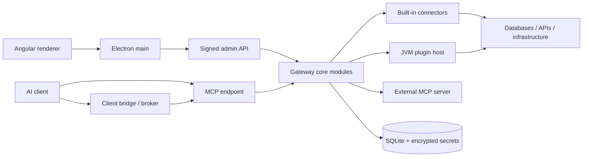

# GateRook desktop architecture

GateRook runs an Angular renderer inside Electron and a separate Java/Spring Boot core on loopback. The core owns credentials, policy, approvals, execution, and audit. A development build runs the core on JVM 25; the native-image build uses the same source. Dynamic Java extensions run in isolated JVM plugin hosts.

This document describes the imported application and its architectural contracts. [Product decisions](DECISIONS.md) take precedence over exploratory [research](research/README.md). Research findings retain their original evidence dates and unresolved questions; they are not fresh compatibility certifications. Runtime contracts live in the source, schemas, migrations, and tests linked below. Implementation progress logs are intentionally excluded.

The product name is GateRook. The default home is `~/.gaterook`, the native core is `gaterook-core`, and deep links use `gaterook://`. Decision 11 starts a new default home without importing or modifying `~/.mcp-gateway`. Maven artifact IDs, plugin resource names, and `GW_*` / `gateway.*` configuration keys retain their existing contracts.

## 1. Architectural decisions

| ID | Choice | Rationale and boundary |
| --- | --- | --- |
| A1 | A thin JSON-RPC layer on Spring MVC serves `/mcp/{slug}`. | Endpoint-specific tool catalogs and protocol revisions stay under the gateway's control. The MCP Java SDK is used as an upstream/test client, not as the gateway's entire server stack. |
| A2 | Support modern `2026-07-28` and legacy `2025-11-25`, `2025-06-18`, and `2025-03-26` request shapes. | Clients migrate at different times. MCP replies are JSON; there is no MCP SSE session. Administrative UI events use a separate SSE stream. |
| A3 | Persist one approval and execute its stored canonical call after a human decision. | The client never resubmits a mutable command as the approved action. Deliver results through URL elicitation when supported, otherwise a pending handle and `approval_status`. |
| A4 | Use opaque 256-bit tokens and store their hashes. | Lookup on each request enables immediate revocation. Named, bridge, OAuth access, and refresh tokens have distinct purposes and lifetimes. |
| A5 | Provide a small OAuth authorization server with desktop consent. | PKCE S256, resource/audience binding, issuer checking, and client metadata support serve both local and tunnel clients. |
| A6 | Publish through a child tunnel process and a separate loopback listener. | The public listener is deny-by-default and never exposes administrative routes. Cloudflared is a bundled target; ngrok is downloaded when selected and hash-checked. |
| A7 | Use grants, a local broker, and thin client bridges. | Supported clients obtain short-lived tokens without placing long-lived credentials in ordinary configuration. Config edits are previewed and backed up. |
| A8 | Keep connector implementations in separate Maven modules. | Driver dependencies, schemas, native metadata, and tests remain owned by the relevant connector. |
| A9 | Use Jackson 3 throughout the application-facing API. | `connector-api` uses `tools.jackson.databind.JsonNode`; the Maven enforcer prevents incompatible Jackson 2 databind dependencies. |
| A10 | Use SQLite, Spring Data JPA/Hibernate, and Flyway for gateway state. | Migrations own the schema; startup validates mappings. User databases are accessed by connector drivers, not by gateway JPA repositories. |
| A11 | Build a native core while retaining a JVM development path. | Fast startup is a product requirement. Native compatibility must be verified independently of JVM compilation. |
| A12 | Load PF4J plugins outside the native core. | A JVM host per plugin generation supports dynamic class loading and isolates crashes and per-call secret access. |
| A13 | Register built-in connectors explicitly through Spring auto-configuration. | Spring AOT resolves registrations at build time; runtime enablement is database state, not classpath scanning. |
| A14 | Use envelope encryption and write-only secret APIs. | The master key remains outside the database; external store references and short-lived leases are supported. |
| A15 | Bound execution with deadlines, virtual threads, bulkheads, circuit breakers, and rate limits. | A slow or failing resource must not consume the whole gateway. Limits are keyed to the relevant connection or principal. |
| A16 | Keep notification adapters lightweight and gate remote approval. | Desktop notifications offer Review/Deny. Slack and Telegram approval is allowed only when the complete safe action can be shown and policy permits it. |
| A17 | Derive activity and insights from audit data; make telemetry export opt-in. | Do not send traces or metrics to an implicit endpoint. Trace correlation must work even without an external collector. |
| A18 | Use standalone, signal-based, zoneless Angular with kit styles. | Native dialog/popover behavior avoids a second overlay and styling system. |
| A19 | Use Lucide, a JSON Schema form renderer, and lazy CodeMirror editors. | Exact actions are server-produced code/diff segments, not a client-side reinterpretation of editable text. |
| A20 | Harden Electron and keep the launch secret in main. | Sandboxed renderer, context isolation, a narrow preload API, CSP, Trusted Types, validated IPC, and controlled navigation protect the process boundary. |
| A21 | Authenticate every admin request with a launch-secret HMAC. | A random nonce and timestamp prevent replay; the raw launch secret is never sent as a reusable HTTP credential. |
| A22 | Model one local desktop user. | Roles, OIDC, and multi-user identity are outside the current desktop application. |
| A23 | Adapt MINA SSHD for native-image constraints. | The shaded dependency excludes filesystem-provider discovery; crypto provider handling avoids unsupported runtime JCE registration. |

Exact dependency versions are pinned by [the Maven parent](../pom.xml), [the npm lockfile](../package-lock.json), and [the design lockfile](../design/package-lock.json). The baseline is Spring Boot 4.1.2, Java 25, Electron 45, and Angular 22.

## 2. Repository and module boundaries

See [repository layout](repository-layout.md) and [development](development.md) for the complete build tree and commands.

### 2.1 Process and source layout

### 2.2 Core modules

The Spring Modulith root is `ai.msrv.gaterook.core`; `platform` is shared. Connector libraries and the SPI are outside that root. Each core module declares allowed dependencies in its `package-info.java`. Public module APIs live at the package root; implementation details live under `internal`. [ModularityTests](../core/src/test/java/ai/msrv/gaterook/core/ModularityTests.java) enforce module and sensitive execution boundaries.

| Module | Responsibility |
| --- | --- |
| `platform` | Bootstrap, process readiness, database setup, local ingress guard, request authentication SPI, masking/taint, settings storage, clock, schema validation, tracing, and shared ports |
| `settings` | Typed settings sections, optimistic versions, local API configuration, and backup scheduling |
| `secrets` | Encryption, master-key lifecycle, external stores, scoped resolution, leases, and purpose-derived integrity keys |
| `audit` | Append-only call/setup events, integrity chain, activity queries, traces, export cursors, and retention |
| `connectors` | Registry, connector state, call contexts, plugin catalog/install/runtime management, and connector-source SPI |
| `connections` | Configuration, test/health checks, metadata, trust confirmations, usage, and coordinated removal |
| `templates` | Versioned templates, compilation against a connection's template kind, and catalog import |
| `mcpservers` | External server definitions, snapshots, review state, and process supervision |
| `policy` | Environment policy, stricter-wins merging, limits, classification decisions, and immutable safety rules |
| `endpoints` | Exposed connection/tool pairs, modes, token/grant lifecycle, snapshots, risk analysis, and read-only attestations |
| `invocation` | The single connector execution path: scoped secrets, resilience controls, deadlines, masking, and result limits |
| `approvals` | Canonical requests, deduplication, decisions, expiry, execution, stored results, and action inspection |
| `mcp` | Protocol revisions, JSON-RPC dispatch, tools/resources/prompts, result encoding, and approval delivery |
| `playground` | UI-driven calls through the same dispatcher, under a distinct principal |
| `clients` | Client detection, config previews/edits, bundles, helper installation, drift checks, and bridge token issuance |
| `tunnel`, `oauth` | Public listener, provider supervision, publication checks, client metadata, consent, and OAuth grants |
| `notifications` | Desktop events, Slack Socket Mode, Telegram polling, pairing, delivery, and approval eligibility |
| `insights` | Audit aggregates, latency percentiles, and unusual-activity detection |
| `admin` | UI REST controllers and DTOs, event stream, errors, health, and demo seed |

Cross-module change events are published inside the transaction that changes state and handled after commit, typically on virtual threads. Readers invalidate snapshots rather than reaching into another module's internal repositories. Master-key changes have explicit ordering: the new in-memory keys must be usable before integrity-dependent listeners run. Startup changes wait until listeners are registered.

### 2.3 Connector registration and plugin processes

Each built-in connector module declares explicit beans in its own `@AutoConfiguration` and lists that configuration in `META-INF/spring/org.springframework.boot.autoconfigure.AutoConfiguration.imports`. Connector implementation classes remain independent of Spring. Runtime enablement belongs to the database; registration must remain deterministic for AOT.

`ConnectorRegistry` combines built-in connectors with `ConnectorSource` providers for installed plugins and external MCP servers. Stored manifests allow catalog display without starting a plugin process. Plugin-host lookup uses packaged resources in a distribution or explicit development JAR/JRE locations; child launch uses an argument array, cleared environment, and a dedicated data directory.

### 2.4 Builds and native metadata

The Maven reactor keeps shared versions in its root POM. Spring AOT/native compilation belongs to the executable modules (`app` and `bridge-cli`), not every library. Each connector contributes its own auto-configuration imports, schema resources, runtime hints, and manual reachability metadata. Manual metadata uses a separate `*-manual` location so generated AOT metadata cannot overwrite it.

Built-in registration uses explicit beans; enable/disable state is stored in `connector_type`. Dynamic plugins never enter the native core's classloader. The JVM build, AOT context, native executable, and installer are distinct validation targets. Existing scripts cover each layer; this document makes no blanket claim that every platform has passed them.

## 3. Connector SPI

The source of truth is [connector-api](../connector-api/src/main/java/ai/msrv/gaterook/connector/) and the [SPI reference](connector-spi.md). A connector exposes its manifest, schemas, tools, configuration test, classification, action description/preparation, execution, and optional template/resource capabilities.

- **Classification is fast and deterministic.** It receives configuration and policy, not secret values, and must not perform network I/O. Failures deny the call.
- **Preparation is bounded and side-effect-free.** It can reject a request, report no change, or produce a canonical action and approved payload. SQL preparation uses a read-only transaction; Kubernetes preparation uses server dry-run; HTTP/SSH preparation does not send the requested mutation.
- **Execution receives a scoped context.** Credentials are limited to the selected connection and call. The context carries cancellation, deadline, approved state, egress controls, and taint tracking.
- **Only the approval executor can obtain approved execution.** A client-controlled field cannot set that state. Connectors reject mutations without it as defense in depth.
- **Results are data.** Every output is bounded and masked by the core before it reaches a client, audit view, or notification. A connector cannot opt out.
- **Resources obey the same boundary.** Resource reads, preparation, and tool execution use the central invoker rather than an alternate unguarded route.

A connector's JSON schemas describe input, output, configuration, and policy. UI extension keywords provide labels, variants, secret fields, options, environment locks, and stricter-wins merge rules. Schemas are bounded before validation to avoid excessive recursion or work. Shared tool names can merge only when their schemas match apart from the allowed connection enumeration.

Built-ins include SQL, MongoDB, Redis, SSH, logs, Kubernetes, GCP, AWS, HTTP/OpenAPI, and external MCP support. Connector-specific research documents describe drivers, classification edge cases, safe reads, and integration matrices.

## 4. Persistence and integrity

[Flyway migrations](../core/src/main/resources/db/migration/) are authoritative. Hibernate validates the migrated schema; it does not create or update production tables. SQLite uses WAL, a single write connection with `IMMEDIATE` transactions, and a small read pool whose connections set `query_only=1`. Read/write routing is verified at startup. A reader-pool-size fallback of zero can use the writer pool without changing the model.

Persistence-unit construction can overlap migrations and other startup work, but readiness waits for schema validation and database self-checks. Failed schema validation is a startup failure, not a warning. Connections that encounter unrecoverable SQLite errors are evicted so a poisoned single writer does not prevent recovery.

| Data area | Stored information and invariants |
| --- | --- |
| Settings and policies | Versioned sections, environment policy, backup state, and integrity-protected configuration |
| Connections and tools | Typed configuration, health metadata, endpoint associations, modes, definition versions, and read-only attestations |
| Credentials | Encrypted secret versions, external references, leases, and rotation state; no plaintext master key in SQLite |
| Access | Hashed named/bridge/OAuth tokens, client grants, audience, expiry, revocation, and confirmation state |
| Approvals | Canonical arguments/action, digest, preparation state, expiry, decision, execution status, result retention, and an append-only event timeline |
| Audit | Received/resolved/completed call events, setup changes, action/execution hashes, trace linkage, export state, and an integrity chain |
| Extensions | Plugin generations, catalog state, pinned artifacts, MCP snapshots, templates, and explicit trust decisions |

Security-sensitive rows carry MACs. Direct database edits do not become trusted merely because the file can be opened: altered rows are surfaced as changed outside the gateway and require review. A lost/replaced master key cannot silently bless old tampered rows. Audit has append-only database constraints plus a hash chain and authenticated head; bypassing a trigger remains detectable.

Use short transactions around state changes. Do not hold a database transaction while waiting for a human, a long poll, or an external resource. Approval state changes use versioned compare-and-set transitions so only one executor wins. Retention must respect export progress; backup excludes the master key, and restores must preserve the integrity model.

## 5. Call flow

1. **Guard ingress before dispatch.** The local listener permits only defined local routes. The public listener permits only the published endpoint and required OAuth metadata/authorization routes. Reject unexpected hosts, origins, encoded path tricks, oversized bodies, and browser-origin requests.
2. **Authenticate before interpreting the RPC.** Resolve the principal from the token hash and check expiry, revocation, endpoint, client/grant relationship, and ingress. Public requests accept only OAuth tokens with the matching public resource audience. A local named token cannot authenticate through a tunnel.
3. **Resolve the protocol revision.** Check modern metadata and corresponding headers for consistency; otherwise negotiate/interpret the supported legacy revision. Reject malformed or unsupported combinations. Notifications return HTTP 202.
4. **Load an immutable endpoint snapshot.** It contains connections, tool modes, effective policy, templates, and pinned extension definitions. Only exposed pairs appear in the wire catalog.
5. **Validate tool arguments.** Enforce the input schema with bounded depth, subschema count, and validation work. Unknown/off tools are not callable.
6. **Classify and decide.** Classification yields READ, MUTATION, or DENY. Policy combines this with the tool mode and stricter environment/connection limits. Exceptions fail closed.
7. **Persist audit before execution.** If the gateway cannot record receipt, it does not execute. Approval creation and its pending audit record are atomic.
8. **Run an allowed read through the invoker.** Apply scoped secret resolution, bulkhead, circuit breaker, rate limiter, deadline, cancellation, and output limits. Mask the result and complete audit before returning it.
9. **Prepare a mutation for review.** Store the canonical request, exact action, preparation state, and digest. Human-visible previews may include masked impact/diff data that is not sent back to the agent.
10. **Decide and revalidate.** An approval atomically transitions from pending to running while unexpired and records the decision. Recheck integrity, policy, connection/template/tool versions, and canonical digest. Changes invalidate approval rather than modifying its meaning.
11. **Execute the stored payload once.** The gateway runs it itself. A failure or timeout is not retried as an unreviewed mutation; uncertain external outcomes are reported explicitly. Retain the masked result for subsequent status retrieval.
12. **Correlate the trace.** Link MCP activity, the approval, and execution with trace IDs; propagate a valid parent trace when supplied. Telemetry export remains opt-in.

### 5.1 Policy truth table

| Classification / mode | Outcome |
| --- | --- |
| DENY | Deny |
| OFF | Not exposed / not callable |
| MUTATION in any callable mode | Approval required |
| READ with APPROVAL | Approval required |
| READ with READ_ONLY | Execute under effective limits |

A read-only endpoint does not allow mutating pairs. External tool descriptions and `readOnlyHint` are declarations, not proof: enabling read-only requires a human attestation tied to the current definition. New or changed definitions reset trust. Production connections and endpoints cannot be mixed across the production boundary; live grants and publication state constrain environment changes.

### 5.2 Approval delivery

The same persisted approval supports every client. A capable modern client can receive URL elicitation and an authenticated `requestState`; that state binds the principal, endpoint, method, tool, action digest, and expiry. The approval page and deep link navigate to review and do not approve by themselves. Form elicitation is never used as a client-controlled “Approve” answer.

Otherwise the gateway returns a pending handle. `approval_status(handle, wait_seconds)` is principal/endpoint scoped, with a maximum 25-second long poll. The initial wait is bounded (15 seconds by default). Modern continuation waits also have a bounded total budget and round count, then fall back to a handle. Decline means denial; expiry never grants approval. Masked completed results are retained for 60 minutes.

## 6. Administrative API

The renderer requests `app://gw/api/*`. Electron main proxies these requests to loopback after removing browser headers and signing the method and exact request target. The HMAC input includes `method|path[?query]|timestamp|nonce`; timestamps have a narrow acceptance window and nonces are single-use. Main verifies the core instance identity in responses. The renderer never receives the launch secret.

Controllers under [core/admin](../core/src/main/java/ai/msrv/gaterook/core/admin/) define the current DTOs and routes. Configuration changes use optimistic versions and schema errors identify the invalid field. Secret response DTOs expose metadata, never stored values. Duplication does not copy secrets. File operations use constrained tokens or known resource IDs rather than arbitrary renderer-supplied core filesystem paths.

| API area | Responsibility |
| --- | --- |
| `/api/connections`, `/api/connector-types` | List/create/edit/test connections, forms, health, variants, and usage |
| `/api/endpoints` | Endpoint configuration, tools, modes, policy overrides, tokens, risk, and access |
| `/api/approvals` | Review canonical actions, approve/deny with policy-required comments, and inspect outcomes |
| `/api/secrets`, `/api/master-key` | Replace/rotate/reference credentials, manage stores/leases, and backup/restore the key |
| `/api/clients` | Detection, connection previews, guarded config writes, checks, and disconnect |
| `/api/policies`, `/api/templates` | Environment policies, locks, runbooks, and template lifecycle |
| `/api/catalog`, `/api/plugins` | Verified catalog and staged installation/update review |
| `/api/playground` | Calls and wire inspection through the same policy and approval path |
| `/api/activity`, `/api/insights` | Masked history, traces, export, aggregates, and findings |
| `/api/settings`, `/api/tunnel`, `/api/notifications` | Local settings and supervised integrations |
| `/api/events` | Administrative SSE events for the desktop UI |

`/internal/**` is reserved for Electron/broker operations such as bridge token issuance and key protection. It is not available through the renderer proxy. Both admin and internal routes are blocked on the tunnel listener by ingress and controller-level guards. The starting/failed core screen is driven by process events even when no admin API is available.

## 7. Desktop processes and integrations

### 7.1 Electron

Main starts the core executable or development JAR, sends a one-line bootstrap through stdin, and keeps stdin open for lifecycle ownership. The bootstrap carries the launch secret and optional OS-protected file key. Progress and readiness are structured stdout messages. EOF means the parent is gone and the child must exit. Supervisors also handle crashes, locked homes, port conflicts, and orphaned children.

When OS credential protection is enabled, the renderer first shows an unlock screen explaining the encryption key and any system permission request. Main waits for the explicit **Unlock GateRook** action before calling the OS key-store API, including availability checks. Only main handles the protected file key; the renderer receives status, never key material or a password. Cancelling or denying OS access closes GateRook without starting the core or downgrading protection. Local file persistence errors remain retryable; missing or corrupt key material retains the existing master-key recovery path. Development runs with protection disabled bypass this interaction.

The renderer is sandboxed with context isolation and no Node integration. A narrow preload surface validates IPC sender frames. The custom `app://gw/` handler rejects traversal, proxies only allowed API paths, and applies CSP/Trusted Types. External URLs use an allowlist; new windows, arbitrary navigation, and permissions are denied. Production bundles reject dangerous Chromium debugging/proxy/sandbox switches and apply Electron fuses.

OS safe storage protects the master-key file only when an appropriate backend is available; `basic_text` is not encryption. The fallback file mode and residual risk are visible. Approval and OAuth consent screens use content protection and a 700 ms activation delay; Enter does not approve. These are mitigations, not a proof that a human rather than same-account automation clicked.

### 7.2 Broker and clients

The [broker](../bridge/README.md) runs in Electron main. Bridges connect through a random Unix-domain socket or Windows named pipe described by a restricted `broker.json`. The core checks grant, client, endpoint, revocation, and confirmation before issuing a 15-minute bridge token. Tokens are cached briefly by the helper, refreshed on expiry/401, and bound to the current core instance.

Claude Desktop can use an endpoint-specific `.mcpb`; Codex can use the Java/native `headers` helper; other clients can use supported HTTP/OAuth or stdio methods. A long-lived token in a client file is an explicit method with restricted permissions and production restrictions. Config changes preserve unrelated content, show a diff, create a backup, and compare the original file before writing. Disconnect removes only the gateway-owned entry and revokes its access.

### 7.3 Tunnel and OAuth

The default local/public loopback ports are 7465/7466. The public port has an explicit small route allowlist, body limit, host checks, and provider-aware caller filtering. Publication performs a self-test through the edge and becomes active only after it succeeds. A production endpoint cannot be published; the current design publishes one endpoint at a time.

Cloudflared/ngrok run as supervised children with pinned binary hashes and minimal environments. Provider tokens are secrets. A quick tunnel changes origin between runs, so grants and audience checks must follow the actual issuer/resource. OAuth uses PKCE S256, exact redirect/resource validation, client metadata checks, rotating refresh tokens, and local consent with a comparison code. Local and tunnel authorization domains cannot exchange tokens accidentally.

### 7.4 Notifications

Desktop notices originate from core events; the OS notification exposes Review/Deny, not unconditional approval. Slack uses Socket Mode and Telegram uses polling, so neither requires an inbound webhook. Pairing binds the intended user and channel.

Remote approval is unavailable for production, required-comment cases, incomplete/truncated actions, unsafe or suspicious text, and other ineligible states. Channel messages exclude unverified agent notes. Actions bind to the stored request/digest, expire, and recheck policy. Flood controls and decision deduplication avoid repeated or stale interactions.

### 7.5 Plugins, catalog, and external MCP servers

[Plugin-host research](research/16-plugin-host.md) and [extensibility research](research/11-extensibility.md) define the extension boundary. GPP/1 is JSON-RPC 2.0 over newline-delimited stdio. The host runs one plugin generation with PF4J, a restricted environment, dedicated data directory, bounded heap, and platform sandbox controls where supported. Stdout is protocol-only; logs go to stderr and are sanitized.

Secret callbacks require a live per-call capability and are restricted to the connection. Plugins never receive the master key. Host startup and idle shutdown are supervised, crashes fail calls, and old generations drain during updates. AOT caches are keyed to the runtime/artifacts and are disposable local optimization data.

Database plugins may implement `Connector.discoverDatabases`, transported as `connector/discoverDatabases` with the same bounded context and secret callbacks as a connection test. Its `TestResult.details` contains a `databases` array of names (integer indexes for Redis) and a `discoveryComplete` flag. The default implementation reports that discovery is unavailable.

The catalog verifies an Ed25519 signature over raw index bytes plus sequence, expiry, revocations, artifact size, and SHA-256. Updates cannot roll back trusted sequence state. Unsigned plugin installation requires an explicit high-risk review. Public catalog examples contain placeholders, not operational signing keys.

External MCP servers run with pinned dependencies, cleared environments, scoped secret injection, supervision, and snapshots of their advertised tools. Definition changes require review; reserved built-in/core names cannot be impersonated. Remote HTTP servers use controlled egress. Upstream instructions and read-only claims are not trusted policy, and upstream OAuth is deferred.

## 8. Angular UI and design kit

### 8.1 Structure and styling

The Angular application uses standalone components, signals, zoneless change detection, lazy routes, and the canonical [design kit](../design/README.md). Tokens own themes; components do not branch on theme or invent raw colors/layout surfaces. Fonts, logos, and theme boot assets are synchronized from `design/` into ignored UI build inputs.

### 8.2 Interaction parity

Kit behavior is represented by Angular directives/components with parity tests. Native `<dialog>` and popovers keep focus, announcements, and menus in the correct modal subtree. Every actionable control has a native semantic element and accessible name. Keyboard navigation, disabled reasons, loading/empty/error states, and high-contrast themes are part of the contract.

### 8.3 Schema forms and editors

The schema-form layer renders bounded JSON Schema plus supported `x-*` extensions. CodeMirror is lazy and used for editing; approval display uses server-inspected segments and diffs. The action inspector exposes bidi, zero-width, confusable, whitespace, and dialect-sensitive ambiguities rather than rendering them invisibly. Client copy cannot replace the server's canonical action.

A field directly inside a section can use `x-section` with an existing top-level section's JSON Pointer to change its display placement while retaining its configuration path. Validation errors expand the section that displays the field.

Database schemas declare `x-database-selection` with the selection array's `path` and an optional `legacyPath`. The connection wizard collects server settings and credentials first, loads accessible databases through `POST /api/connections/databases`, then saves the chosen databases as one connection. Discovery does not save credentials or create a connection. It shares draft testing's validation, masking, timeout, and confirmation before sending stored credentials to another host. Changing connection settings invalidates the loaded list. A `required` marker requires a nonempty selection or a legacy database outside discovery; selection arrays reject empty values.

MySQL, PostgreSQL, MongoDB, Redis, and ClickHouse retain existing connection formats when no selection array is present. A new selection intersects existing schema, collection, or key restrictions. Calls that need a database select one explicitly when several are configured; a single selection supplies the default. Database identity participates in SQL/Redis pool routing, SQL approval payloads, and Redis cursors. PostgreSQL discovery uses a configurable bootstrap database; Redis reports an incomplete list when the account cannot read the configured database count.

### 8.4 Screens and data

The [blueprint](../design/BLUEPRINT.md) specifies screens and a coherent demo world. Demo data and dev element routes are development facilities; production routing excludes the gallery. The core owns the clock used for expiry and state. UI tests cover behavior against core-shaped data; [visual comparison](../ui/README.md) helps inspect kit parity.

### 8.5 Exact action display

Approval text, structured fields, diff, warnings, and suspicious-character segments come from the core. The renderer must not recompile a runbook or reinterpret the payload that will execute. Keep the agent's unverified explanation separate from the canonical action. A masked preview must never become an alternate source of executable arguments.

### 8.6 Application and kit compatibility

The application follows the kit's first-run, setup, and in-use Overview compositions using current core data. First connection setup can create an endpoint for the selected environment, and AI-app setup shows the exact connection review before changing client configuration. Do not infer that every prototype is a current API capability. The following numbered contracts retain the references used by source comments, without an implementation progress log.

1. Show the actual core runtime from the API: native in a native build, JVM in development. The plugin runtime is a separate JRE.
2. Codex's `http_headers_helper` is a string. Claude Desktop uses an endpoint-specific bridge bundle. Cursor and Antigravity have supported token, browser, or bridge methods; production policy can disable methods.
3. SQL read-only transaction enforcement is an always-on lock. Kubernetes `watch` is outside the tool surface. `http_request` describes its actual supported mutation methods.
4. Tunnel caller filtering does not block the person's browser authorization page. Consent shows the actual browser address rather than a fixed service range.
5. Describe leased credentials as short-lived and automatically renewed, not necessarily a fresh user per call. OpenSearch exposes Lucene queries, not unrestricted JSON DSL. Plugins use separate processes. Show real child environment constraints and disable unsupported rotation with a reason.
6. SQL uses `limit` (default 50) and environment statement-timeout policy. Production SSH runbooks follow both tool mode and runbook classification.
7. Never offer Slack/Telegram approval for production. Review the resolved pinned MCP-server command, not an unpinned `npx -y` installation expression.
8. Plugin disclosure names the separate same-user process, scoped secrets, and any missing OS sandbox. Do not claim a classloader alone is a security boundary.
9. Quick tunnels obtain a new address after restart; stable addresses require a named/reserved configuration. Local port-change suggestions must avoid the public listener (the historical next suggestion after 7465 is 7475) and verify availability. Clients with embedded URLs may need reconnection; broker-discovered URLs can follow the new core port.
10. Onboarding/setup counts must come from the applicable current screen/data contract, rather than inconsistent illustrative counts in older samples.
11. Explain the OS-account boundary: protection against other users or copied files does not exclude programs run by the same person, including AI terminal agents. Enable OS key protection by default when supported.
12. Deferred choices remain deferred: separate OS privileges, hardware-backed approval presence, and upstream MCP OAuth. Download ngrok on selection rather than claiming it is bundled.
13. Connection names cannot be renamed through the current API. Duplicate does not copy secrets; unsupported rotation remains disabled; replacing a production secret requires a reason.
14. Endpoint tool defaults come from the connection type and must be previewed. Production connections require production endpoints. Protocol usage reflects the core's seven-day window. Stage inherits unset values from dev; prod has independent stricter defaults. Private egress is blocked unless allowed explicitly.
15. Client setup displays prohibited methods as unavailable with reasons, preserves unrelated configuration, and shows real core-generated snippets. Manual token setup uses restricted files rather than putting tokens in a command line.
16. Activity duration distinguishes work not run, waiting approvals, failures, and completed execution. Saved views, deep links, export results, traces, and insights reflect current core data and selected ranges. File export requires the desktop save-file capability.
17. Settings show actual runtime/data paths and supported operations. Consent previews are not fabricated sign-in requests. Slack/Telegram setup follows the current API; export-destination editing or pairing screens must not be promised where the UI does not implement them. Appearance is applied in the renderer before first paint.
18. The starting/locked/failed screens follow real process state. A locked core can already have completed migrations and opened the local API. Restore uses a one-time file capability; replacing a lost key leads to secret repair. Display only known endpoint URLs and verified free ports.

## 9. Security invariants and verification

| Invariant | Enforcement and verification |
| --- | --- |
| Agents do not receive configured secrets | Scoped resolution, taint registration, masking, write-only DTOs, canary-leak tests, and test-log scanning |
| Every mutation requires approval | Policy truth table, connector defense in depth, approved-context access rules, and end-to-end mutation tests |
| Reviewed action equals executed action | Canonical persistence, digests/MACs, version rechecks, compare-and-set transition, and action/execution hashes |
| Approval cannot be forged through MCP | No approval form field; bound continuation state; navigation-only links; principal-scoped handles |
| Audit is required for execution | Atomic state/audit transitions, append-only rows, integrity verification, and failures tested before execution |
| Local admin is not exposed to agents or websites | Per-request HMAC, replay protection, host/origin guards, CSP, narrow proxy, and public-port isolation tests |
| Tokens remain purpose- and audience-bound | Hash lookup, revocation, TTL, ingress checks, client/grant binding, and OAuth negative tests |
| Untrusted network input cannot bypass egress policy | DNS and actual socket-address checks, metadata/internal-address blocks, explicit private ranges, no ambient proxy or automatic redirects |
| SQL reads cannot silently write | Read-only transaction plus rollback, parser/allowlist restrictions, server timeout, forbidden functions/hints, and privilege probes |
| SSH parameters cannot become shell syntax | Typed runbook parameters, constrained templates, POSIX quoting, leading-option restrictions, pinned host keys, and no PTY/agent forwarding |
| Extension code cannot claim built-in trust | Reserved namespaces, pinned artifacts, reviewed snapshots, separate hosts, and secret capability checks |
| Production remains stricter | Environment locks, no mixed production endpoints, constrained tools/limits, required review comments, and no channel approval/publication |
| UI review does not hide suspicious content | Server action inspection, explicit risk labels, exact-action presentation, and tests for bidi/confusables/injection |
| Process ownership is explicit | Restricted child environments, EOF shutdown, orphan cleanup, anti-attach/dump controls where supported, and process smoke tests |

The OS account is the current trust boundary. Same-account processes may read or modify local files, automate UI, or cause denial of service; platform key storage offers different guarantees on different operating systems. A separate privileged service account and hardware-backed presence are deferred, so the application must not claim to solve this boundary completely.

The egress guard is strongest on controlled HTTP/socket paths. Fixed human-configured service clients have their documented allowlist and transport boundaries; do not assume every library offers identical rebinding guarantees. Connector research records these distinctions.

Validation includes Java unit/integration and process tests, module-boundary checks, broker/desktop tests, Angular behavior tests, design verification, AOT checks, and native smoke. Test sources and their fixtures remain in this repository. See [development](development.md) for commands and [research](research/README.md) for dated experiments and unresolved platform questions.

## 10. Verification map

Older source comments use compact area identifiers. They identify architectural coverage, not progress or completion status.

| Area | Source and verification responsibility |
| --- | --- |
| M1 | Core platform, persistence, secrets, policy, endpoint snapshots, approvals, audit, bootstrap, and module boundaries |
| C1–C10 | SQL, MongoDB, Redis, SSH, logs, Kubernetes, GCP, AWS, HTTP/OpenAPI, and external MCP connectors, in that order |
| K1 | Client configuration, token broker, helper/stdio bridges, and bundle process tests |
| K2 | Notification delivery, pairing, eligibility, tamper rejection, and flood controls |
| K3 | Tunnel supervision, OAuth, metadata, consent, audience binding, and public-port isolation |
| K4 | Plugin host/protocol, installation, supervision, capability-scoped secrets, and sandbox checks |
| K5 | Activity, trace aggregation, insights, export cursors, and audit integrity |
| K6 | Signed catalog verification, pinned artifacts, expiry, revocation, and rollback prevention |
| S1 | Local/external secrets, rotation, references, leases, and leak prevention |
| U0–U16 | Angular foundation, kit parity, application pages, and state/interaction tests |
| E1 | Electron process lifecycle, proxy/IPC boundary, security controls, and desktop smoke |
| N1 / R1 | Native-image/AOT checks and installer/release validation, independently of JVM success |

Run the applicable commands in [development](development.md). A test profile's existence describes how to verify a behavior; it does not assert that its external services or platform targets were exercised during every source change.
