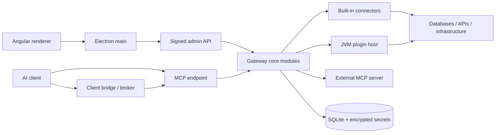

# GateRook desktop architecture

GateRook runs an Angular renderer inside Electron and a separate Java/Spring Boot core on loopback. The core owns credentials, policy, approvals, execution, and audit. A development build runs the core on JVM 25; the native-image build uses the same source. Dynamic Java extensions run in isolated JVM plugin hosts.

This document describes the imported application and its architectural contracts. [Product decisions](DECISIONS.md) take precedence over exploratory [research](research/README.md). Research findings retain their original evidence dates and unresolved questions; they are not fresh compatibility certifications. Runtime contracts live in the source, schemas, migrations, and tests linked below. Implementation progress logs are intentionally excluded.

The product name is GateRook. The default home is `~/.gaterook`, the native core is `gaterook-core`, and deep links use `gaterook://`. Decision 11 starts a new default home without importing or modifying `~/.mcp-gateway`. Maven artifact IDs, plugin resource names, and `GW_*` / `gateway.*` configuration keys retain their existing contracts.

## 1. Architectural decisions

| ID | Choice | Rationale and boundary |
| --- | --- | --- |
| A1 | A thin JSON-RPC layer on Spring MVC serves `/mcp/{slug}`. | Endpoint-specific tool catalogs and protocol revisions stay under the gateway's control. The MCP Java SDK is used as an upstream/test client, not as the gateway's entire server stack. |
| A2 | Support modern `2026-07-28` and legacy `2025-11-25`, `2025-06-18`, and `2025-03-26` request shapes. | Clients migrate at different times. MCP POST replies are JSON; legacy clients can open an authenticated GET SSE stream for tool-list changes. No MCP session IDs are issued. Administrative UI events use a separate SSE stream. |
| A3 | Persist one approval and execute its stored canonical call after a human decision. | The client never resubmits a mutable command as the approved action. MCP Apps clients get a review card and pending handle; other capable clients use URL elicitation, with `approval_status` as the common fallback. |
| A4 | Use opaque 256-bit tokens and store their hashes. | Lookup on each request enables immediate revocation. Named, bridge, OAuth access, and refresh tokens have distinct purposes and lifetimes. |
| A5 | Provide a small OAuth authorization server with desktop consent. | PKCE S256, resource/audience binding, issuer checking, and client metadata support serve both local and tunnel clients. |
| A6 | Publish through a child tunnel process and a separate loopback listener. | The public listener is deny-by-default and never exposes administrative routes. Cloudflared is a bundled target; ngrok is downloaded when selected and hash-checked. |
| A7 | Use grants, a local broker, and thin client bridges. | Supported clients obtain short-lived tokens without placing long-lived credentials in ordinary configuration. Config edits are previewed and backed up. |
| A8 | Keep connector implementations in separate Maven modules. | Driver dependencies, schemas, native metadata, and tests remain owned by the relevant connector. |
| A9 | Use Jackson 3 throughout the application-facing API. | `connector-api` uses `tools.jackson.databind.JsonNode`; the Maven enforcer prevents incompatible Jackson 2 databind dependencies. |
| A10 | Use SQLite, Spring Data JPA/Hibernate, and Flyway for gateway state. | Migrations own the schema; startup validates mappings. User databases are accessed by connector drivers, not by gateway JPA repositories. |
| A11 | Build a native core while retaining a JVM development path. | Fast startup is a product requirement. Native compatibility must be verified independently of JVM compilation. |
| A12 | Load PF4J plugins outside the native core. | A JVM host per plugin generation supports dynamic class loading and isolates crashes and per-call secret access. |
| A13 | Register built-in connectors explicitly through Spring auto-configuration. | Spring AOT resolves registrations at build time; runtime enablement is database state, not classpath scanning. |
| A14 | Use envelope encryption and write-only secret APIs. | The master key remains outside the database; external store references and short-lived leases are supported. |
| A15 | Bound execution with deadlines, virtual threads, bulkheads, circuit breakers, and rate limits. | A slow or failing resource must not consume the whole gateway. Limits are keyed to the relevant connection or principal. |
| A16 | Keep notification adapters lightweight and gate remote approval. | Desktop notifications offer Review/Deny. Slack and Telegram approval is allowed only when the complete safe action can be shown and policy permits it. |
| A17 | Derive activity and insights from audit data; make telemetry export opt-in. | Do not send traces or metrics to an implicit endpoint. Trace correlation must work even without an external collector. |
| A18 | Use standalone, signal-based, zoneless Angular with kit styles. | Native dialog/popover behavior avoids a second overlay and styling system. |
| A19 | Use Lucide, a JSON Schema form renderer, and lazy CodeMirror editors. | Exact actions are server-produced code/diff segments, not a client-side reinterpretation of editable text. |
| A20 | Harden Electron and keep the launch secret in main. | Sandboxed renderer, context isolation, a narrow preload API, CSP, Trusted Types, validated IPC, and controlled navigation protect the process boundary. |
| A21 | Authenticate every admin request with a launch-secret HMAC. | A random nonce and timestamp prevent replay; the raw launch secret is never sent as a reusable HTTP credential. |
| A22 | Model one local desktop user. | Roles, OIDC, and multi-user identity are outside the current desktop application. |
| A23 | Adapt MINA SSHD for native-image constraints. | The shaded dependency excludes filesystem-provider discovery; crypto provider handling avoids unsupported runtime JCE registration. |

Exact dependency versions are pinned by [the Maven parent](../pom.xml), [the npm lockfile](../package-lock.json), and [the design lockfile](../design/package-lock.json). The baseline is Spring Boot 4.1.2, Java 25, Electron 45, and Angular 22.

## 2. Repository and module boundaries

See [repository layout](repository-layout.md) and [development](development.md) for the complete build tree and commands.

### 2.1 Process and source layout

### 2.2 Core modules

The Spring Modulith root is `ai.msrv.gaterook.core`; `platform` is shared. Connector libraries and the SPI are outside that root. Each core module declares allowed dependencies in its `package-info.java`. Public module APIs live at the package root; implementation details live under `internal`. [ModularityTests](../core/src/test/java/ai/msrv/gaterook/core/ModularityTests.java) enforce module and sensitive execution boundaries.

| Module | Responsibility |
| --- | --- |
| `platform` | Bootstrap, process readiness, database setup, local ingress guard, request authentication SPI, masking/taint, settings storage, clock, schema validation, tracing, and shared ports |
| `settings` | Typed settings sections, optimistic versions, local API configuration, and backup scheduling |
| `secrets` | Encryption, master-key lifecycle, external stores, scoped resolution, leases, and purpose-derived integrity keys |
| `audit` | Append-only call/setup events, integrity chain, activity queries, traces, export cursors, and retention |
| `connectors` | Registry, connector state, call contexts, plugin catalog/install/runtime management, and connector-source SPI |
| `connections` | Configuration, test/health checks, metadata, trust confirmations, usage, and coordinated removal |
| `templates` | Versioned templates, compilation against a connection's template kind, and catalog import |
| `mcpservers` | External server definitions, snapshots, review state, and process supervision |
| `policy` | Environment policy, stricter-wins merging, limits, classification decisions, and immutable safety rules |
| `endpoints` | Exposed connection/tool pairs, modes, token/grant lifecycle, snapshots, risk analysis, and read-only attestations |
| `invocation` | The single connector execution path: scoped secrets, resilience controls, deadlines, masking, and result limits |
| `approvals` | Canonical requests, deduplication, decisions, expiry, execution, stored results, and action inspection |
| `mcp` | Protocol revisions, JSON-RPC dispatch, tools/resources/prompts, result encoding, and approval delivery |
| `playground` | UI-driven calls through the same dispatcher, under a distinct principal |
| `clients` | Client detection, config previews/edits, bundles, helper installation, drift checks, and bridge token issuance |
| `tunnel`, `oauth` | Public listener, provider supervision, publication checks, client metadata, consent, and OAuth grants |
| `notifications` | Desktop events, Slack Socket Mode, Telegram polling, pairing, delivery, and approval eligibility |
| `insights` | Audit aggregates, latency percentiles, and unusual-activity detection |
| `admin` | UI REST controllers and DTOs, event stream, errors, health, and demo seed |

Cross-module change events are published inside the transaction that changes state and handled after commit, typically on virtual threads. Readers invalidate snapshots rather than reaching into another module's internal repositories. Master-key changes have explicit ordering: the new in-memory keys must be usable before integrity-dependent listeners run. Startup changes wait until listeners are registered.

### 2.3 Connector registration and plugin processes

Each built-in connector module declares explicit beans in its own `@AutoConfiguration` and lists that configuration in `META-INF/spring/org.springframework.boot.autoconfigure.AutoConfiguration.imports`. Connector implementation classes remain independent of Spring. Runtime enablement belongs to the database; registration must remain deterministic for AOT.

`ConnectorRegistry` combines built-in connectors with `ConnectorSource` providers for installed plugins and external MCP servers. Stored manifests allow catalog display without starting a plugin process. Plugin-host lookup uses packaged resources in a distribution or explicit development JAR/JRE locations; child launch uses an argument array, cleared environment, and a dedicated data directory.

### 2.4 Builds and native metadata

The Maven reactor keeps shared versions in its root POM. Spring AOT/native compilation belongs to the executable modules (`app` and `bridge-cli`), not every library. Each connector contributes its own auto-configuration imports, schema resources, runtime hints, and manual reachability metadata. Manual metadata uses a separate `*-manual` location so generated AOT metadata cannot overwrite it.

Built-in registration uses explicit beans; enable/disable state is stored in `connector_type`. Dynamic plugins never enter the native core's classloader. The JVM build, AOT context, native executable, and installer are distinct validation targets. Existing scripts cover each layer; this document makes no blanket claim that every platform has passed them.

## 3. Connector SPI

The source of truth is [connector-api](../connector-api/src/main/java/ai/msrv/gaterook/connector/) and the [SPI reference](connector-spi.md). A connector exposes its manifest, schemas, tools, configuration test, classification, action description/preparation, execution, and optional template/resource capabilities.

- **Classification is fast and deterministic.** It receives configuration and policy, not secret values, and must not perform network I/O. Failures deny the call.
- **Preparation is bounded and side-effect-free.** It can reject a request, report no change, or produce a canonical action and approved payload. SQL preparation uses non-executing query plans and rollback; Kubernetes preparation uses server dry-run; HTTP/SSH preparation does not send the requested mutation.
- **Execution receives a scoped context.** Credentials are limited to the selected connection and call. The context carries cancellation, deadline, approved state, egress controls, and taint tracking.
- **Only the core can authorize mutation execution.** A human approval or an explicitly configured Bypass tool mode authorizes an exact prepared payload. A client-controlled field cannot set that state. Connectors reject mutations without it as defense in depth; Bypass carries no approval ID.
- **Results are data.** Every output is bounded and masked by the core before it reaches a client, audit view, or notification. A connector cannot opt out.
- **Resources obey the same boundary.** Resource reads, preparation, and tool execution use the central invoker rather than an alternate unguarded route.

A connector's JSON schemas describe input, output, configuration, and policy. UI extension keywords provide labels, variants, secret fields, options, environment locks, and stricter-wins merge rules. Schemas are bounded before validation to avoid excessive recursion or work. Shared tool names can merge only when their schemas match apart from the allowed connection enumeration.

Built-ins include SQL (PostgreSQL, MySQL/MariaDB, [Oracle Database](oracle.md) and [SQL Server](sql-server.md)), MongoDB, Redis, OpenSearch, Elasticsearch, SSH, logs, Kubernetes, GCP, AWS, HTTP/OpenAPI, and external MCP support. Connector-specific research documents describe drivers, classification edge cases, safe reads, and integration matrices.

## 4. Persistence and integrity

[Flyway migrations](../core/src/main/resources/db/migration/) are authoritative. Hibernate validates the migrated schema; it does not create or update production tables. SQLite uses WAL, a single write connection with `IMMEDIATE` transactions, and a small read pool whose connections set `query_only=1`. Read/write routing is verified at startup. A reader-pool-size fallback of zero can use the writer pool without changing the model.

Persistence-unit construction can overlap migrations and other startup work, but readiness waits for schema validation and database self-checks. Failed schema validation is a startup failure, not a warning. Connections that encounter unrecoverable SQLite errors are evicted so a poisoned single writer does not prevent recovery.

| Data area | Stored information and invariants |
| --- | --- |
| Settings and policies | Versioned sections, environment policy, backup state, and integrity-protected configuration |
| Connections and tools | Typed configuration, health metadata, endpoint associations, modes, definition versions, and read-only attestations |
| Credentials | Encrypted secret versions, external references, leases, and rotation state; no plaintext master key in SQLite |
| Access | Hashed named/bridge/OAuth tokens, client grants, audience, expiry, revocation, and confirmation state |
| Approvals | Canonical arguments/action, digest, preparation state, expiry, decision, execution status, result retention, and an append-only event timeline |
| Audit | Received/resolved/completed call events, setup changes, action/execution hashes, trace linkage, export state, and an integrity chain |
| Extensions | Plugin generations, catalog state, pinned artifacts, MCP snapshots, templates, and explicit trust decisions |

Security-sensitive rows carry MACs. Direct database edits do not become trusted merely because the file can be opened: altered rows are surfaced as changed outside the gateway and require review. A lost/replaced master key cannot silently bless old tampered rows. Audit has append-only database constraints plus a hash chain and authenticated head; bypassing a trigger remains detectable.

Use short transactions around state changes. Do not hold a database transaction while waiting for a human, a long poll, or an external resource. Approval state changes use versioned compare-and-set transitions so only one executor wins. Retention must respect export progress; daily database backups exclude the master key, and restores must preserve the integrity model.

### 4.1 Full backup and recovery

The desktop creates portable `.grbackup` files through native save/open dialogs. Renderer IPC carries only the newly entered passphrase, confirmation and a result; file paths, database contents and master-key material stay in main and the signed internal core API. Full backup requires a 12–1,024-character passphrase. It is never persisted or logged, and the renderer clears password fields on dispatch and close.

Version 1 uses AES-256-GCM with a random 12-byte nonce and a 16-byte authentication tag. A separate random 32-byte salt feeds scrypt (`N=131072`, `r=8`, `p=1`, 256 MiB allocation ceiling) to derive a 256-bit encryption key. The fixed format header is authenticated as associated data; the manifest and all contents are encrypted. Import accepts only this version's fixed parameters, caps the entire file at 256 MiB and authenticates it before parsing or writing payload files. These choices follow the [OWASP password derivation guidance](https://cheatsheetseries.owasp.org/cheatsheets/Password_Storage_Cheat_Sheet.html#scrypt) and [authenticated encryption guidance](https://cheatsheetseries.owasp.org/cheatsheets/Cryptographic_Storage_Cheat_Sheet.html). Buffer copies are cleared where possible; managed-runtime strings cannot guarantee erasure.

A master-key lock keeps the SQLite snapshot and portable keyset compatible during rotation. The core then stops before main collects plugin and connector files. Plugin JAR hashes must match the snapshot's pinned generations; a concurrent installation that breaks this match fails the backup. Plugin-owned data is copied with the plugin hosts stopped, without claiming an application-specific transaction across its files and the gateway database. OS key-store references, generated runtimes, caches, logs, old backups, browser sessions and external referenced files are excluded. Only allowlisted relative paths and regular files are accepted; symbolic links, traversal, duplicate paths, platform-ambiguous names and oversized indexes are refused.

Before restore, an internal validator checks SQLite integrity, the exact migration history and schema, every encrypted secret, the integrity root and required plugin hashes. It rejects tampered authorization rows rather than re-signing them as trusted. It revokes API/OAuth/bridge access and pending approvals, removes temporary bypasses, disables installed plugins, switches external MCP servers to first-call startup and disables login startup. Destination ports are retained. The portable keyset is encoded using the destination's current file-key protection, without exporting its OS-bound key-store reference.

Replacement requires the typed `RESTORE` confirmation and a native confirmation naming the validated file. The core and broker stop before database, keyset and local plugin data are replaced. An owner-only journal retains the original files until replacement is committed; interrupted replacement rolls back before normal core startup, and interrupted rollback is repeatable. Validation uses a temporary empty core with the destination's file key even when the main database cannot start; imported data is never started as that validator's live database. The application closes after restoration so every service reopens the restored state. See the [recovery procedure](development.md#full-backup-and-restore).

## 5. Call flow

1. **Guard ingress before dispatch.** The local listener permits only defined local routes. The public listener permits only the published endpoint and required OAuth metadata/authorization routes. Reject unexpected hosts, origins, encoded path tricks, oversized bodies, and browser-origin requests.
2. **Authenticate before interpreting the RPC.** Resolve the principal from the token hash and check expiry, revocation, endpoint, client/grant relationship, and ingress. Public requests accept only OAuth tokens with the matching public resource audience. A local named token cannot authenticate through a tunnel.
3. **Resolve the protocol revision.** Check modern metadata and corresponding headers for consistency; otherwise negotiate/interpret the supported legacy revision. Reject malformed or unsupported combinations. Notifications return HTTP 202.
4. **Load an immutable endpoint snapshot.** It contains connections, tool modes, effective policy, templates, and pinned extension definitions. Only exposed pairs appear in the wire catalog.
5. **Validate tool arguments.** Enforce the input schema with bounded depth, subschema count, and validation work. Unknown/off tools are not callable.
6. **Classify and decide.** Classification yields READ, MUTATION, or DENY. Policy combines this with the tool mode and stricter environment/connection limits. Exceptions fail closed.
7. **Persist audit before execution.** If the gateway cannot record receipt, it does not execute. Approval creation and its pending audit record are atomic.
8. **Run an allowed read through the invoker.** Apply scoped secret resolution, bulkhead, circuit breaker, rate limiter, deadline, cancellation, and output limits. Mask the result and complete audit before returning it.
9. **Prepare the exact mutation.** An approval stores the canonical request, exact action, preparation state, and digest for review. Bypass uses the prepared action immediately, retaining preparation refusals and no-change results. Human-visible previews may include masked impact/diff data that is not sent back to the agent.
10. **Decide and revalidate.** An approval atomically transitions from pending to running while unexpired and records the decision. Recheck integrity, policy, connection/template/tool versions, and canonical digest. Changes invalidate approval rather than modifying its meaning.
11. **Execute the authorized payload once.** The gateway runs the stored approved payload or freshly prepared Bypass payload itself. A failure or timeout is not retried automatically; uncertain external outcomes are reported explicitly. Approved calls retain their masked results for subsequent status retrieval.
12. **Correlate the trace.** Link MCP activity, the approval, and execution with trace IDs; propagate a valid parent trace when supplied. Telemetry export remains opt-in.

Legacy `initialize` advertises `capabilities.tools.listChanged: true`. Clients listen on `GET /mcp/{slug}` with the
same bearer token, the negotiated `MCP-Protocol-Version`, and `Accept: text/event-stream`. Opening a stream sends
one `notifications/tools/list_changed` to refresh any cached list from before connection or reconnection. After committed changes
invalidate the endpoint snapshot, each stream compares the published catalog hash and sends
`notifications/tools/list_changed` when tool definitions change, including connection enums. Changes that leave
the catalog unchanged do not send further notifications. Authentication and endpoint availability are checked before each
notification and heartbeat; disconnected streams are released, and shutdown closes subscriptions before waiting
for HTTP requests. The stream has no replay IDs; its initial notification refreshes changes missed while disconnected.
Both stdio bridges forward these notifications. Modern requests retain their existing
TTL-based discovery; `subscriptions/listen` is not implemented.

### 5.1 Policy truth table

| Classification / mode | Outcome |
| --- | --- |
| DENY | Deny |
| OFF | Not exposed / not callable |
| BYPASS on a standard endpoint | Execute without approval under effective limits |
| MUTATION with READ_ONLY or APPROVAL | Approval required |
| READ with APPROVAL | Approval required |
| READ with READ_ONLY | Execute under effective limits |

A read-only endpoint does not allow mutating pairs or Bypass. Bypass is an explicit per-tool setting, never a default. Classification denials, integrity checks, production isolation, rate limits, secret masking and result limits still apply. A Bypass mutation is prepared and may still be rejected or report no change; otherwise the exact prepared payload executes synchronously without an approval request. The audit records its Bypass mode and no human approval ID. External tool descriptions and `readOnlyHint` are declarations, not proof: enabling read-only requires a human attestation tied to the current definition. New or changed definitions reset trust. Production connections and endpoints cannot be mixed across the production boundary; live grants and publication state constrain environment changes.

Temporary bypass is a signed, expiring exception for one endpoint × connection × tool. The protected admin API accepts only 15, 30, 60, 180, 720, or 1,440 minutes and requires both environments to be DEV or STAGE, a usable tool, and a standard endpoint. The stored base mode remains unchanged; Off, permanent Bypass, and core tools are ineligible. The deadline is checked when resolving effective modes and again before bypass execution, so restart, cached snapshots, or slow preparation cannot prolong authorization. Revocation and explicit mode changes remove the exception. Grants and revocations are setup changes; existing pending approvals keep their separate decision lifecycle.

### 5.2 Approval delivery

The same persisted approval supports every client. Clients advertising the MCP Apps HTML MIME type receive a pending handle immediately so they can show the review card described below. Other capable modern clients can receive URL elicitation and an authenticated `requestState`; that state binds the principal, endpoint, method, tool, action digest, and expiry. The approval page and deep link navigate to review and do not approve by themselves. Form elicitation is never used as a client-controlled “Approve” answer.

Otherwise the gateway returns a pending handle. `approval_status(handle, wait_seconds)` is principal/endpoint scoped, with a maximum 25-second long poll. The initial wait is bounded (15 seconds by default). Modern continuation waits also have a bounded total budget and round count, then fall back to a handle. Decline means denial; expiry never grants approval. Masked completed results are retained for 60 minutes.

### 5.3 MCP Apps approval cards

Clients negotiate `io.modelcontextprotocol/ui` with `text/html;profile=mcp-app`. Legacy capabilities are remembered per authenticated principal until reinitialization or bounded cache eviction; modern clients provide them per request. `approval_card(handle)` renders the versioned static `ui://gaterook/approval-card/v1.html` resource once. Its separate `approval_card_action(handle, action)` tool supports `status`, `open`, and `deny`; it carries app-only visibility and no resource URI, so refreshes do not mount another card. Clients without the extension retain the text and handle flow.

Visibility is a host presentation hint, not authorization or proof of a human click. Every card operation checks the original principal and endpoint. Denial uses the existing client-decline transition and audit origin. Both **Details** and **Approve in GateRook** open a server-selected review route; neither accepts a URL, digest, decision origin, nor an approval operation from MCP. Final approval uses the protected desktop review flow, including exact-action inspection, required comments, and digest checks. Repeated open requests are throttled. Rejected, expired, or completed requests cannot be revived through the card.

The card contains only the environment-masked caller-visible request projection, never private preparation summaries, impact/diff data, credentials, or decision capabilities, including in `_meta`. Previews are bounded and suspicious Unicode is made visible. The static resource embeds the canonical design CSS and its script with exact CSP hashes; it permits no external assets, frames, or network connections. The iframe uses the MCP Apps message protocol directly, validates host source/origin and correlated responses, renders untrusted text through `textContent`, and ignores stale updates. It polls only while visible and pending/running. Local expiry disables decisions while the server remains authoritative. Execution results continue through `approval_status`.

## 6. Administrative API

The renderer requests `app://gw/api/*`. Electron main proxies these requests to loopback after removing browser headers and signing the method and exact request target. The HMAC input includes `method|path[?query]|timestamp|nonce`; timestamps have a narrow acceptance window and nonces are single-use. Main verifies the core instance identity in responses. The renderer never receives the launch secret.

Controllers under [core/admin](../core/src/main/java/ai/msrv/gaterook/core/admin/) define the current DTOs and routes. Configuration changes use optimistic versions and schema errors identify the invalid field. Secret response DTOs expose metadata, never stored values. Duplication does not copy secrets. General file operations use constrained tokens or known resource IDs rather than arbitrary renderer-supplied core filesystem paths. The SSH private-key picker is a narrow configuration exception: a dedicated desktop IPC operation opens a native file dialog and returns only the selected absolute path to the form. It takes no renderer-supplied path and does not read or upload file contents; the SSH connector reads the configured key locally after host-key verification.

Vault/OpenBao stores recommend HTTPS. Creating an HTTP store in the UI requires a warning confirmation naming the address and explaining that credentials and secrets travel unencrypted; cancellation sends no create or test request. Confirmation persists `config.allowPlainHttp: true` on that store. The core rejects non-loopback HTTP without this opt-in, while retaining compatibility with existing local HTTP stores. The opt-in does not relax address restrictions or enable redirects.

Selecting Vault in the connection form automatically loads autocomplete suggestions through `POST /api/secret-stores/{id}/vault/references`, using the selected store's verified settings and credentials. The core walks accessible KV mounts and folders and reads each secret's key names, returning complete `vault://path#key` references without values. Discovery requires list permission on metadata paths and read permission on secret data; inaccessible paths and scan limits produce explicit partial results. The renderer shares the resulting names between fields for 30 seconds, filters them locally, and can refresh them. Selecting a suggestion inserts its path and key and retains a pinned version only when the secret path stays the same. Manual entry and `POST /api/secret-refs/test` remain available for tokens that can read known secrets but cannot list them.

| API area | Responsibility |
| --- | --- |
| `/api/connections`, `/api/connector-types` | List/create/edit/test connections, forms, health, variants, and usage |
| `/api/endpoints` | Endpoint configuration, tools, modes, policy overrides, tokens, risk, and access |
| `/api/approvals` | Review canonical actions, approve/deny with policy-required comments, and inspect outcomes |
| `/api/secrets`, `/api/master-key` | Replace/rotate/reference credentials, manage stores/leases, and backup/restore the key |
| `/api/clients` | Detection, connection previews, guarded config writes, checks, and disconnect |
| `/api/policies`, `/api/templates` | Environment policies, locks, runbooks, and template lifecycle |
| `/api/catalog`, `/api/plugins` | Verified catalog and staged installation/update review |
| `/api/playground` | Calls and wire inspection through the same policy and approval path |
| `/api/activity`, `/api/insights` | Masked history, traces, export, aggregates, and findings |
| `/api/settings`, `/api/tunnel`, `/api/notifications` | Local settings and supervised integrations |
| `/api/events` | Administrative SSE events for the desktop UI |

`/internal/**` is reserved for Electron/broker operations such as bridge token issuance and key protection. It is not available through the renderer proxy. Both admin and internal routes are blocked on the tunnel listener by ingress and controller-level guards. The starting/failed core screen is driven by process events even when no admin API is available.

## 7. Desktop processes and integrations

### 7.1 Electron

Main starts the core executable or development JAR, sends a one-line bootstrap through stdin, and keeps stdin open for lifecycle ownership. The bootstrap carries the launch secret and optional OS-protected file key. Progress and readiness are structured stdout messages. EOF means the parent is gone and the child must exit. Supervisors also handle crashes, locked homes, port conflicts, and orphaned children.

When OS credential protection is enabled, the renderer first shows an unlock screen explaining the available authentication. Main may check device capabilities without prompting, but waits for **Unlock GateRook** before accessing stored keys or requesting authentication. Main and its bundled native helper handle the file key; the renderer receives status, never key material, biometric data, or a password. Concurrent clicks share one operation. Cancelling or denying OS access closes GateRook without starting the core or downgrading protection. Local persistence errors remain retryable, and a missing Keychain item can enter master-key backup recovery. Development runs with protection disabled bypass this interaction.

On macOS, the helper uses the login Keychain and LocalAuthentication with device-owner authentication (Touch ID or password). It tries Keychain access with interaction disabled first. A successful silent read is followed by LocalAuthentication; if the Keychain explicitly requires interaction, its successful native access grant replaces that step. The two authentication dialogs are never deliberately chained. Existing Electron safeStorage ciphertext is decrypted once and migrated without changing the file key or master keyset. Only after native storage succeeds does an atomic owner-only write replace `master.keyset.osk` with a versioned item reference. Failed migration retains the previous ciphertext. New vaults enroll through one native create operation.

On Windows, the helper checks Hello availability and uses `IUserConsentVerifierInterop` with the application window before main decrypts the DPAPI-protected key. Explicitly unavailable Hello keeps the existing OS account protection; helper failures abort startup. Linux continues to validate its secure safeStorage backend. The helper accepts bounded JSON on private stdin/stdout, has no secret arguments or error output, and is terminated on quit. Main retains a separate file-key buffer for core restarts, gives each bootstrap a disposable copy, and clears the session copy on quit.

Touch ID and Hello are application verification gates here, not Secure Enclave/TPM-bound encryption policies. The storage boundary remains the OS account and Keychain/DPAPI protection; this does not defend against arbitrary code running as the same account. The macOS file-based Keychain supports locally signed development builds without provisioning profiles. Stable helper builds preserve its Keychain identity; release signing and native authentication need platform validation.

Before reporting ready, an installation without endpoints creates a signed `default` endpoint with standard access and read-only core discovery tools. It starts without connections, tokens, client grants, or public access; connections added to it retain their connector's normal initial tool modes. The Overview welcome guide can therefore start with adding a connection. Initialization also covers older installations with no endpoints, leaves existing endpoint setups and the demo seed unchanged, and stores a marker atomically with the new endpoint so deliberate deletion is respected on later starts. A locked installation defers initialization until its master key is recovered.

The renderer is sandboxed with context isolation and no Node integration. A narrow preload surface validates IPC sender frames. The custom `app://gw/` handler rejects traversal, proxies only allowed API paths, and applies CSP/Trusted Types. External URLs use an allowlist; new windows, arbitrary navigation, and permissions are denied. Production bundles reject dangerous Chromium debugging/proxy/sandbox switches and apply Electron fuses.

Google ADC recovery uses a dedicated desktop sign-in operation with no renderer-supplied command or arguments. After an explicit click, main runs the installed Google Cloud CLI with fixed arguments, opens Google's browser sign-in and waits for completion. The command writes the default per-user ADC file used by the core; it also updates the sign-in used by other local ADC clients. Raw CLI output and credentials never cross IPC. The UI retries the connection test only after successful sign-in and only while the same configuration remains selected. The cloud credential cache reloads ADC credentials when that local file changes.

OS safe storage protects the master-key file only when an appropriate backend is available; `basic_text` is not encryption. The fallback file mode and residual risk are visible. Approval and OAuth consent screens use content protection and a 700 ms activation delay; Enter does not approve. These are mitigations, not a proof that a human rather than same-account automation clicked.

### 7.2 Broker and clients

The [broker](../bridge/README.md) runs in Electron main. Bridges connect through a random Unix-domain socket or Windows named pipe described by a restricted `broker.json`. The core checks grant, client, endpoint, revocation, and confirmation before issuing a 15-minute bridge token. Tokens are cached briefly by the helper, refreshed on expiry/401, and bound to the current core instance.

The first production token requires an explicit Allow in the desktop. That approval is stored on the signed client grant and survives token replacement, client reconnection, and core or application restarts. It applies only to that grant's client and endpoint; Disconnect or revocation stops access, and a newly created grant requires its own approval. Deny clears any stored approval and suppresses further prompts for the current core session. Existing grants created before persistent confirmation require one approval after upgrading; token activity is not used to infer consent. Tool modes and operation approval rules continue to apply independently.

Claude Desktop can use an endpoint-specific `.mcpb`; Codex can use the Java/native `headers` helper; other clients can use supported HTTP/OAuth or stdio methods. A long-lived token in a client file is an explicit method with restricted permissions and production restrictions. Config changes preserve unrelated content, show a diff, create a backup, and compare the original file before writing. Disconnect removes only the gateway-owned entry and revokes its access.

New named tokens default to 184 days, covering at least six calendar months. Settings → Authorization can select a shorter default, and issuance accepts an explicit lifetime from 1 to 184 days. Existing saved defaults and issued expiry dates are preserved. Bridge credentials remain automatic, 15-minute credentials bound to the running core; their renewal does not ask the user to sign in.

An active local OAuth sign-in becomes connection evidence after token exchange, before any tool call. Cursor's browser Connect enables OAuth for the endpoint and opens its URL-only installer link; Cursor owns the config change, and GateRook creates no managed config entry. The client views match the sign-in to the registered app and endpoint, including browser installations made outside GateRook's config editor. These observed connections link to OAuth sign-in management; they do not imply ownership of a config file or expose the managed-entry Disconnect action. Grant changes refresh client status on the AI apps, endpoint, and Overview screens. Last call remains an audited tool call, separate from sign-in activity.

### 7.3 Tunnel and OAuth

The default local/public loopback ports are 7465/7466. The public port has an explicit small route allowlist, body limit, host checks, and provider-aware caller filtering. Publication performs a self-test through the edge and becomes active only after it succeeds. A production endpoint cannot be published; the current design publishes one endpoint at a time.

Cloudflared/ngrok run as supervised children with pinned binary hashes and minimal environments. Provider tokens are secrets. A quick tunnel changes origin between runs, so grants and audience checks must follow the actual issuer/resource. OAuth uses PKCE S256, exact redirect/resource validation, client metadata checks, rotating refresh tokens, and local consent with a comparison code. Local and tunnel authorization domains cannot exchange tokens accidentally.

New OAuth sign-ins and their access and refresh tokens last up to 184 days from consent on both local and tunnel ingress. Refresh rotates the tokens without extending the sign-in's absolute expiry. GateRook stores only token hashes in its database and checks the grant on every request, so revocation still takes effect on the next call. Restarting the core with the same data directory and endpoint origin preserves a live sign-in; changing the port, home, or public origin changes its authorization context. Existing tokens keep their issued expiry: sign in once again to obtain the longer lifetime after upgrading.

### 7.4 Notifications

Desktop notices originate from core events; the OS notification exposes Review/Deny, not unconditional approval. Slack uses Socket Mode and Telegram uses polling, so neither requires an inbound webhook. Pairing binds the intended user and channel.

Remote approval is unavailable for production, required-comment cases, incomplete/truncated actions, unsafe or suspicious text, and other ineligible states. Channel messages exclude unverified agent notes. Actions bind to the stored request/digest, expire, and recheck policy. Flood controls and decision deduplication avoid repeated or stale interactions.

### 7.5 Plugins, catalog, and external MCP servers

[Plugin-host research](research/16-plugin-host.md) and [extensibility research](research/11-extensibility.md) define the extension boundary. GPP/1 is JSON-RPC 2.0 over newline-delimited stdio. The host runs one plugin generation with PF4J, a restricted environment, dedicated data directory, bounded heap, and platform sandbox controls where supported. Stdout is protocol-only; logs go to stderr and are sanitized.

Secret callbacks require a live per-call capability and are restricted to the connection. Plugins never receive the master key. Host startup and idle shutdown are supervised, crashes fail calls, and old generations drain during updates. AOT caches are keyed to the runtime/artifacts and are disposable local optimization data.

Database plugins may implement `Connector.discoverDatabases`, transported as `connector/discoverDatabases` with the same bounded context and secret callbacks as a connection test. Its `TestResult.details` contains a `databases` array of names (integer indexes for Redis) and a `discoveryComplete` flag. The default implementation reports that discovery is unavailable.

The catalog verifies an Ed25519 signature over raw index bytes plus sequence, expiry, revocations, artifact size, and SHA-256. Updates cannot roll back trusted sequence state. Unsigned plugin installation requires an explicit high-risk review. Public catalog examples contain placeholders, not operational signing keys.

External MCP servers run with pinned dependencies, cleared environments, scoped secret injection, supervision, and snapshots of their advertised tools. Definition changes require review; reserved built-in/core names cannot be impersonated. Remote HTTP servers use controlled egress. Upstream instructions and read-only claims are not trusted policy, and upstream OAuth is deferred.

## 8. Angular UI and design kit

### 8.1 Structure and styling

The Angular application uses standalone components, signals, zoneless change detection, lazy routes, and the canonical [design kit](../design/README.md). Tokens own themes; components do not branch on theme or invent raw colors/layout surfaces. Fonts, logos, and theme boot assets are synchronized from `design/` into ignored UI build inputs.

### 8.2 Interaction parity

Kit behavior is represented by Angular directives/components with parity tests. Native `<dialog>` and popovers keep focus, announcements, and menus in the correct modal subtree. Every actionable control has a native semantic element and accessible name. Keyboard navigation, disabled reasons, loading/empty/error states, and high-contrast themes are part of the contract.

### 8.3 Schema forms and editors

The schema-form layer renders bounded JSON Schema plus supported `x-*` extensions. CodeMirror is lazy and used for editing; approval display uses server-inspected segments and diffs. The action inspector exposes bidi, zero-width, confusable, whitespace, and dialect-sensitive ambiguities rather than rendering them invisibly. Client copy cannot replace the server's canonical action.

A root field or a field directly inside a section can use `x-section` with an existing top-level section's JSON Pointer to change its display placement while retaining its configuration path. An empty object used only to group such fields is omitted from the saved configuration. Validation errors expand the section that displays the field.

Conditional authentication fields are displayed and validated only for the selected method. An optional secret remains optional when its source is an external store. A required string condition with `minLength` can activate dependent fields, such as bastion settings after a host is entered.

Database schemas declare `x-database-selection` with the selection array's `path` and an optional `legacyPath`. The connection wizard collects server settings and credentials first, loads accessible databases through `POST /api/connections/databases`, then saves the chosen databases as one connection. Discovery does not save credentials or create a connection. It shares draft testing's validation, masking, timeout, and confirmation before sending stored credentials to another host. Changing connection settings invalidates the loaded list. A `required` marker requires a nonempty selection or a legacy database outside discovery; selection arrays reject empty values.

MySQL, PostgreSQL, SQL Server, MongoDB, Redis, and ClickHouse retain existing connection formats when no selection array is present. A new selection intersects existing schema, collection, or key restrictions. Calls that need a database select one explicitly when several are configured; a single selection supplies the default. Database identity participates in SQL/Redis pool routing, SQL approval payloads, and Redis cursors. PostgreSQL discovery uses a configurable bootstrap database; Redis reports an incomplete list when the account cannot read the configured database count.

MongoDB retains boolean `connection.tls` settings and additionally accepts `"auto"`. Auto detects transport without credentials before creating the authenticated client. It prefers verified TLS and requires a successful MongoDB handshake before using an unencrypted connection. Certificate or host-name verification failures and timeouts do not trigger a plaintext retry. Explicit URI `tls`/`ssl` options and the SRV TLS default take precedence over detection. When detection is needed, a supplied CA requires TLS. A seed list uses one resolved transport, as required by the driver. Automatic probing is unavailable with a proxy; specify the transport in the form or URI. Existing TLS defaults remain unchanged, and choosing Auto survives environment changes.

Redis setup does not require database discovery or selection. It defaults to logical database 0; an optional database number or allowlist can be configured in Advanced without changing saved connection scopes.

Connector categories organize the catalog; they do not supply a shared tool set. GCP Cloud Logging (`gcp-logging`) exposes `gcp_logging_search` and `gcp_logging_tail`; Loki (`loki`) exposes `loki_search` and `loki_tail`; AWS CloudWatch (`cloudwatch`) exposes `cloudwatch_logs_search` and `cloudwatch_logs_tail`. Each has its own configuration and tool descriptions. OpenSearch (`opensearch`) and Elasticsearch (`elasticsearch`) belong to Databases. Each exposes only its own three tools: `opensearch_indices`, `opensearch_query`, and `opensearch_request`, or `elasticsearch_indices`, `elasticsearch_query`, and `elasticsearch_request`. Both reuse the REST request planner and transport while retaining separate tool names, schemas, and approval payloads. Elasticsearch supports Basic, Bearer, API key, or no authentication, with an optional custom CA certificate. API key secrets contain the encoded credential sent in the `Authorization: ApiKey` header; AWS SigV4 is specific to OpenSearch. Draft and saved connection tool lists are resolved against that connector and configuration. Saved legacy `logs` connections retain their type, compatible tool names, and stored endpoint modes, but are not offered for new connections.

GCP Cloud Logging collects credentials before project selection. Its `x-project-selection` schema extension loads project suggestions through `POST /api/connections/projects` using the draft credentials without saving the connection. A manually entered project ID is normalized to `projects/<id>`; explicit project resource names and log views remain supported. Changing credentials invalidates the discovered list. Discovery uses Cloud Resource Manager permissions and does not establish access to the selected log entries.

General GCP connections continue to expose `gcp_describe`, `gcp_metrics`, `logs_search`, and `logs_tail`. Their log calls reuse the Cloud Logging transport with the GCP connection's scopes and credentials. These compatibility tool definitions remain shared with legacy `logs` connections, so a mixed endpoint publishes one compatible tool with the combined connection enum. The adapter enforces both Cloud and log execution limits, binds execution to the classified connection version and tool, and refuses Cloud service, region, or resource restrictions that cannot be safely translated to log selection. Search defaults to Read only on new endpoint attachments; tail defaults to Off. Existing endpoint grants retain their stored modes, and newly introduced tools require explicit enablement. See [GCP logs](gcp-logs.md) for setup and native Logs Explorer queries.

SSH log files use the `ssh-logs` connector, separate from arbitrary SSH command execution. A password or a local private-key file authenticates the connection after host-key verification. The form's `x-file-selection` extension opens a remote directory browser through `POST /api/connections/browse-files`; browsing uses the draft test's secret handling, deadline, masking, and trust confirmations without saving the draft. Saving requires a log folder and an explicit list of relative file paths. Browsing and `ssh_logs_list` use SFTP metadata operations. The read-only `ssh_logs_read` and `ssh_logs_search` tools execute bounded commands assembled by GateRook from validated file selections, filters and line ranges. AI clients cannot supply commands; paths and search values remain data. The host needs a POSIX shell, GNU or BSD `head`, `tail`, `grep` and `stat`, and standard `awk`, `cat`, `od` and `wc`. All tools enforce the selection, reject symbolic links and nonregular files, and apply byte, line and deadline limits. No persistent file copy is made. Authentication follows the SSH environment policy, including its production credential restrictions. Remote log contents are untrusted data.

SSH log commands select bounded source windows on the server independently of their response budget, in either direction, with signed continuations bound to the connection, line range and query. One-file physical ranges use 1-based inclusive `startLine` and `endLine`; byte offsets remain available for compatibility. Text and JSON Lines support event-time ranges, normalized levels, literal or RE2 regex matching and configurable timestamp parsing. Filters operate on masked records. Remote `grep` is a conservative candidate reduction in both scan directions, including level-only and time-filtered queries; masking and final matching stay in GateRook. Source windows default to 64 MiB, independently of the 1 MiB candidate-transfer budget. Candidate overflow falls back at the same source position without exposing raw-match cutoffs. With candidate filtering, `diagnosticCountsComplete` is false and excluded-record counters are null: neither unknown counts nor raw hidden matches become public diagnostic counts. Normal appends beyond a snapshot do not invalidate or extend it; rotation, truncation and detected snapshot edits require a fresh query. Unknown timestamps and oversized records are excluded; results report diagnostic counts or an explicit accounting-coverage warning instead of silently establishing that every source record was evaluated. See [SSH log files](ssh-log-files.md) for ordering, time-zone, record-size and multi-file snapshot contracts.

SSH log health probes authenticate, open SFTP and validate the selected root without walking every selected file. Explicit connection tests validate all selected files, sharing the initial root check while checking canonical paths and file types around each read-only open. Background metadata discovery does not overwrite the result of a bounded health probe; explicit stored tests still record their own success or failure.

### 8.4 Screens and data

The [blueprint](../design/BLUEPRINT.md) specifies screens and a coherent demo world. Demo data and dev element routes are development facilities; production routing excludes the gallery. The core owns the clock used for expiry and state. UI tests cover behavior against core-shaped data; [visual comparison](../ui/README.md) helps inspect kit parity.

### 8.5 Exact action display

Approval text, structured fields, diff, warnings, and suspicious-character segments come from the core. The renderer must not recompile a runbook or reinterpret the payload that will execute. Keep the agent's unverified explanation separate from the canonical action. A masked preview must never become an alternate source of executable arguments.

JSON action previews default to a Pretty view that changes only structural whitespace. Preserve number and string lexemes, property order, duplicate keys, and suspicious-character segments. The Original view restores the core's displayed segments; Copy follows the active view. Invalid, truncated, oversized, or unsafe-to-format previews stay in their original form. Display formatting never changes execution arguments or the approval digest.

### 8.6 Application and kit compatibility

The application follows the kit's first-run, setup, and in-use Overview compositions using current core data. First connection setup can create an endpoint for the selected environment, and AI-app setup shows the exact connection review before changing client configuration. Do not infer that every prototype is a current API capability. The following numbered contracts retain the references used by source comments, without an implementation progress log.

1. Show the actual core runtime from the API: native in a native build, JVM in development. The plugin runtime is a separate JRE.
2. Codex's `http_headers_helper` is a string. Claude Desktop uses an endpoint-specific bridge bundle. Cursor and Antigravity have supported token, browser, or bridge methods; production policy can disable methods.
3. SQL read protection is always on. PostgreSQL, MySQL and Oracle use read-only transactions; SQL Server uses strict SELECT validation and rollback, with a SELECT-only login required for server-enforced protection. Oracle autonomous routines require restricted grants and trusted schemas; see [Oracle limits](oracle.md). Kubernetes `watch` is outside the tool surface. `http_request` describes its actual supported mutation methods.
4. Tunnel caller filtering does not block the person's browser authorization page. Consent shows the actual browser address rather than a fixed service range.
5. Describe leased credentials as short-lived and automatically renewed, not necessarily a fresh user per call. The OpenSearch and Elasticsearch database connectors provide index discovery, JSON Query DSL and REST administration under server permissions. Administrative operations default to Approval mode. Saved legacy `logs` connections with the OpenSearch backend retain their scoped Lucene log tools and optional `apiAccess: "logs"` restriction; the dedicated OpenSearch and Elasticsearch connectors expose only their own three database tools. See [OpenSearch API access](research/opensearch-api.md). Plugins use separate processes. Show real child environment constraints and disable unsupported rotation with a reason.
6. SQL uses `limit` (default 50) and environment statement-timeout policy. Production SSH runbooks follow both tool mode and runbook classification.
7. Never offer Slack/Telegram approval for production. Review the resolved pinned MCP-server command, not an unpinned `npx -y` installation expression.
8. Plugin disclosure names the separate same-user process, scoped secrets, and any missing OS sandbox. Do not claim a classloader alone is a security boundary.
9. Quick tunnels obtain a new address after restart; stable addresses require a named/reserved configuration. Local port-change suggestions must avoid the public listener (the historical next suggestion after 7465 is 7475) and verify availability. Clients with embedded URLs may need reconnection; broker-discovered URLs can follow the new core port.
10. Onboarding/setup counts must come from the applicable current screen/data contract, rather than inconsistent illustrative counts in older samples.
11. Explain the OS-account boundary: protection against other users or copied files does not exclude programs run by the same person, including AI terminal agents. Enable OS key protection by default when supported.
12. Deferred choices remain deferred: separate OS privileges, hardware-backed approval presence, and upstream MCP OAuth. Download ngrok on selection rather than claiming it is bundled.
13. Connection names cannot be renamed through the current API. Duplicate does not copy secrets; unsupported rotation remains disabled; replacing a production secret requires a reason.
14. Endpoint tool defaults come from the connection type and must be previewed. Production connections require production endpoints. Protocol usage reflects the core's seven-day window. Stage inherits unset values from dev; prod has independent stricter defaults. Private egress is blocked unless allowed explicitly.
15. Client setup displays prohibited methods as unavailable with reasons, preserves unrelated configuration, and shows real core-generated snippets. Manual token setup uses restricted files rather than putting tokens in a command line.
16. Activity duration distinguishes work not run, waiting approvals, failures, and completed execution. Saved views, deep links, export results, traces, and insights reflect current core data and selected ranges. File export requires the desktop save-file capability.
17. Settings show actual runtime/data paths and supported operations. Consent previews are not fabricated sign-in requests. Slack/Telegram setup follows the current API; export-destination editing or pairing screens must not be promised where the UI does not implement them. Appearance is applied in the renderer before first paint.
18. The starting/locked/failed screens follow real process state. A locked core can already have completed migrations and opened the local API. Restore uses a one-time file capability; replacing a lost key leads to secret repair. Display only known endpoint URLs and verified free ports.

## 9. Security invariants and verification

| Invariant | Enforcement and verification |
| --- | --- |
| Agents do not receive configured secrets | Scoped resolution, taint registration, masking, write-only DTOs, canary-leak tests, and test-log scanning |
| Mutations require approval unless Bypass is explicitly enabled | Policy truth table, read-only endpoint restrictions, prepared payloads, core-authorized context access rules, audit and end-to-end execution tests |
| Reviewed action equals executed action | Canonical persistence, digests/MACs, version rechecks, compare-and-set transition, and action/execution hashes |
| Approval cannot be forged through MCP | No approval form field; bound continuation state; navigation-only links; principal-scoped handles |
| Audit is required for execution | Atomic state/audit transitions, append-only rows, integrity verification, and failures tested before execution |
| Local admin is not exposed to agents or websites | Per-request HMAC, replay protection, host/origin guards, CSP, narrow proxy, and public-port isolation tests |
| Tokens remain purpose- and audience-bound | Hash lookup, revocation, TTL, ingress checks, client/grant binding, and OAuth negative tests |
| Untrusted network input cannot bypass egress policy | DNS and actual socket-address checks, metadata/internal-address blocks, explicit private ranges, no ambient proxy or automatic redirects |
| SQL reads cannot silently write | PostgreSQL/MySQL/Oracle read-only transactions with restricted database grants; SQL Server strict SELECT and function checks with a SELECT-only login; rollback, allowlists, timeouts, forbidden functions/hints, and privilege probes |
| SSH parameters cannot become shell syntax | Typed runbook parameters, constrained templates, POSIX quoting, leading-option restrictions, pinned host keys, and no PTY/agent forwarding |
| Extension code cannot claim built-in trust | Reserved namespaces, pinned artifacts, reviewed snapshots, separate hosts, and secret capability checks |
| Production remains stricter | Environment locks, no mixed production endpoints, constrained tools/limits, required review comments, and no channel approval/publication |
| UI review does not hide suspicious content | Server action inspection, explicit risk labels, exact-action presentation, and tests for bidi/confusables/injection |
| Process ownership is explicit | Restricted child environments, EOF shutdown, orphan cleanup, anti-attach/dump controls where supported, and process smoke tests |

The OS account is the current trust boundary. Same-account processes may read or modify local files, automate UI, or cause denial of service; platform key storage offers different guarantees on different operating systems. A separate privileged service account and hardware-backed presence are deferred, so the application must not claim to solve this boundary completely.

The egress guard is strongest on controlled HTTP/socket paths. Fixed human-configured service clients have their documented allowlist and transport boundaries; do not assume every library offers identical rebinding guarantees. Connector research records these distinctions.

Validation includes Java unit/integration and process tests, module-boundary checks, broker/desktop tests, Angular behavior tests, design verification, AOT checks, and native smoke. Test sources and their fixtures remain in this repository. See [development](development.md) for commands and [research](research/README.md) for dated experiments and unresolved platform questions.

## 10. Verification map

Older source comments use compact area identifiers. They identify architectural coverage, not progress or completion status.

| Area | Source and verification responsibility |
| --- | --- |
| M1 | Core platform, persistence, secrets, policy, endpoint snapshots, approvals, audit, bootstrap, and module boundaries |
| C1–C10 | SQL, MongoDB, Redis, SSH, logs, Kubernetes, GCP, AWS, HTTP/OpenAPI, and external MCP connectors, in that order |
| K1 | Client configuration, token broker, helper/stdio bridges, and bundle process tests |
| K2 | Notification delivery, pairing, eligibility, tamper rejection, and flood controls |
| K3 | Tunnel supervision, OAuth, metadata, consent, audience binding, and public-port isolation |
| K4 | Plugin host/protocol, installation, supervision, capability-scoped secrets, and sandbox checks |
| K5 | Activity, trace aggregation, insights, export cursors, and audit integrity |
| K6 | Signed catalog verification, pinned artifacts, expiry, revocation, and rollback prevention |
| S1 | Local/external secrets, rotation, references, leases, and leak prevention |
| U0–U16 | Angular foundation, kit parity, application pages, and state/interaction tests |
| E1 | Electron process lifecycle, proxy/IPC boundary, security controls, and desktop smoke |
| N1 / R1 | Native-image/AOT checks and installer/release validation, independently of JVM success |

Run the applicable commands in [development](development.md). A test profile's existence describes how to verify a behavior; it does not assert that its external services or platform targets were exercised during every source change.
